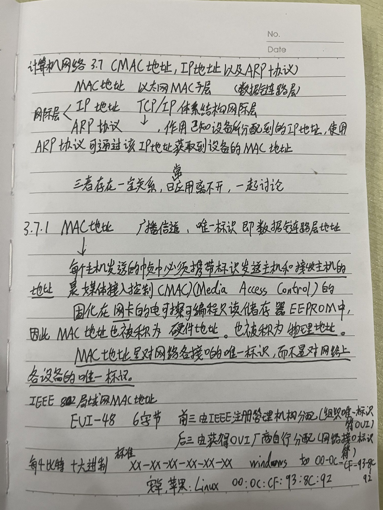
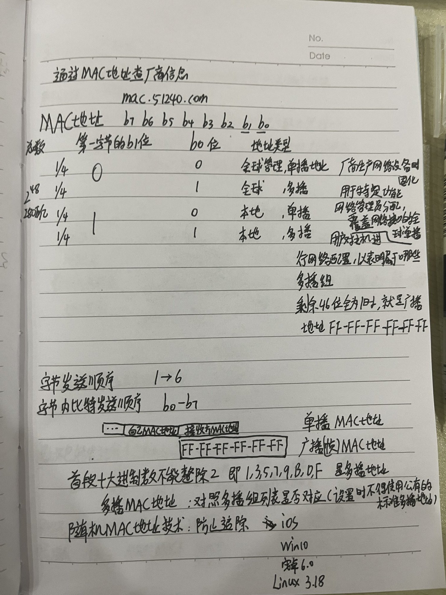

# 03-IP、MAC 地址与 ARP 地址解析协议

> **核心结论**：网络通信中，**IP 地址负责跨网络找路（全局），MAC 地址负责在同一局域网内找人（局部）**。两者配合，缺一不可。

## 一、 MAC 地址（物理地址/硬件地址）

*   **所在层**：以太网 MAC 子层（数据链路层）。
*   **定义**：**每个主机发送的帧中必须携带标识发送主机和接收主机的地址**，这就是媒体接入控制 (MAC)。
*   **存储**：MAC 地址**固化在网卡的电可擦可编程只读存储器 EEPROM 中**。
*   **别名**：**因此 MAC 地址也被称为硬件地址，也被称为物理地址**。
*   **特性**：**MAC 地址是对网络各接口的唯一标识，而不是对网络上各设备的唯一标识**（一台电脑如果有网卡和Wi-Fi，就有两个MAC）。

### 1. MAC 地址的位结构 (b7 ~ b0)

以第一字节为例，**第一字节的 b1 位和 b0 位**决定了地址类型：
*   **b0 位 (I/G 位)**：
    *   `0` 代表**单播地址**（发给单个网卡）。
    *   `1` 代表**多播/广播地址**。
*   **b1 位 (U/L 位)**：
    *   `0` 代表**全球管理**（出厂固化）。
    *   `1` 代表**本地管理**（管理员分配）。

*   **地址分类速记**：
    *   **多播 MAC 地址**：首字节最低位为 1，也就是首字节是奇数——十六进制下个位是 `1/3/5/7/9/B/D/F`。
    *   **广播 (帧) MAC 地址**：剩余 46 位全为 1，即 **`FF-FF-FF-FF-FF-FF`**。

### 2. 发送顺序

*   字节发送顺序：1 -> 6。
*   字节内比特发送顺序：b0 -> b7（先发最低位）。

### 3. 随机 MAC 地址技术

*   **作用**：**防止追踪**（隐私保护）。
*   **应用**：iOS, Win10, 安卓 6.0+, Linux 3.18+ 等系统默认支持。

**图 03-1**：MAC地址笔记1

**图 03-2**：MAC地址笔记2

---

## 二、 IP 地址（逻辑地址）

*   **定义**：**IP 地址是因特网上的主机和路由器所使用的地址**。
*   **结构**：由两部分组成：
    *   **网络编号：网络**。
    *   **主机编号：同一网络上的不同主机**。
*   **规则**：接入因特网的主机，IP 和 MAC 都要用；不接入因特网（仅局域网），可只使用 MAC 地址。

---

## 三、 数据包转发过程（IP 与 MAC 的变化）

数据在跨越多个网络传输时，有一个铁律（⭐ 必考）：
*   ⭐ **源 IP 地址和目的 IP 地址保持不变**（起点和终点不变）。
*   ⭐ **源 MAC 地址和目的 MAC 地址逐个链路（或逐个网络）改变**（上一跳和下一跳在变）。

*   **路由器的层级**：路由器最高层只到网络层（包含物理层、链路层、网络层）。它收到帧后，拆掉 MAC 首部，看 IP 地址查路由表，再给下一跳重新封装新的 MAC 首部。

*   **链路图示意**：
    主机 H1 (IP1, MAC1) -> 路由器 R1 (IP3,MAC3 | IP4,MAC4) -> 路由器 R2 (IP5,MAC5 | IP6,MAC6) -> 主机 H2 (IP2, MAC2)
    *   网络层：IP 数据报始终是 IP1 -> IP2。
    *   链路层：MAC1->MAC3，MAC4->MAC5，MAC6->MAC2（逐段变化）。

**图 03-3**：IP地址笔记

---

## 四、 地址解析协议 ARP (Address Resolution Protocol)

*   **共同问题**：我们知道对方的 IP 地址，但底层传输需要对方的 MAC 地址才能封装成帧。**需通过地址解析协议 ARP 实现**。

### 1. ARP 工作流程（⭐ 核心四步）

1.  **查缓存**：**先在 ARP 高速缓存表中查找主机 IP 地址对应的 MAC 地址**。
2.  **发请求**：**若无，则发送 ARP 请求（封装在广播 MAC 帧中）**。向局域网大喊：“谁是 xxx.xxx.xxx.xxx (IP)？”
3.  **记缓存**：**目的主机收到后，将源主机 IP/MAC 记录到自己的 ARP 高速缓存表中**（动态表项默认 2 分钟）。
4.  **发响应**：**之后给源主机发送 ARP 响应（封装在单播 MAC 帧中）**，包含目的主机的 IP 和 MAC。

### 2. ARP 协议的细节与安全

*   **作用范围**：逐段链路或逐个网络使用。
*   **报文类型**：除请求和响应外，还有检查 IP 冲突的“无故 ARP、免费 ARP (Gratuitous ARP)”。
*   ⚠️ **安全漏洞**：**ARP 没有安全验证机制，存在 ARP 欺骗（攻击）问题**。攻击者可以伪造 ARP 响应，导致中间人攻击或断网。

**图 03-4**：ARP协议笔记

