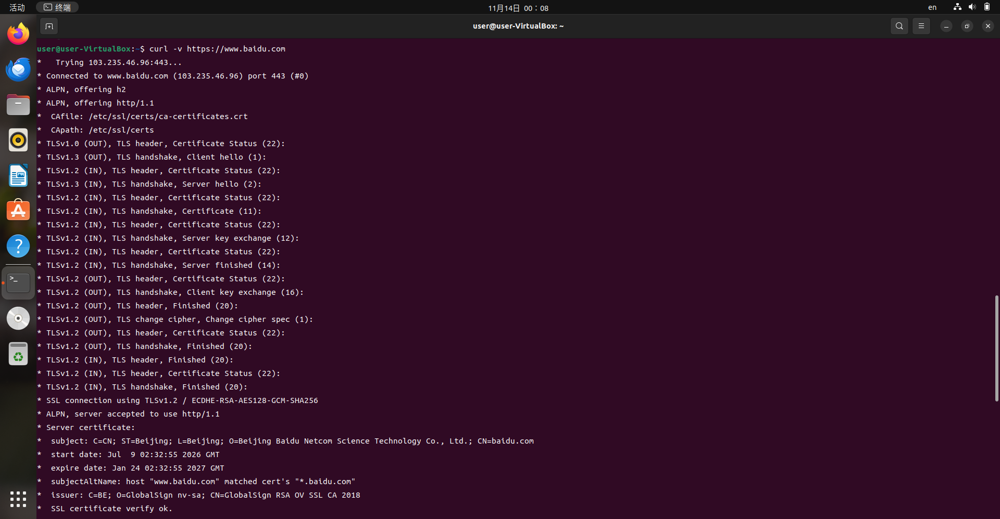
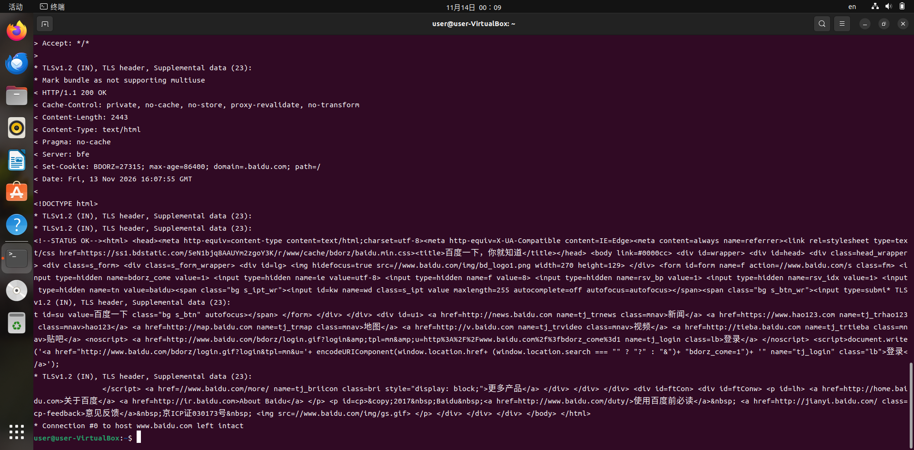
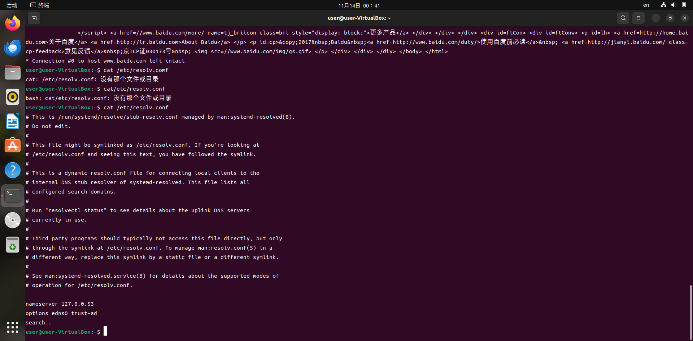
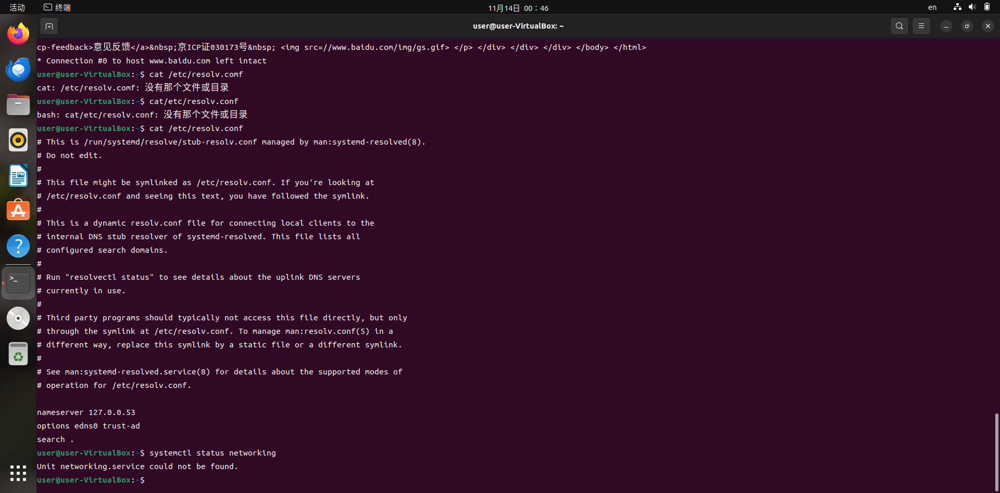

# 终端排查网络的四个指令

## 1. 查看本机 IP：`ip a`
- **干嘛用**：出门先看自己家门牌号。主要看 `enp0s3` 这块网卡。
- **看什么**：`link/ether` 是网卡身份证（MAC地址）；`inet 10.0.2.15/24` 是我的内网 IP；`brd 10.0.2.255` 是广播地址。

- **图片路径里不能有空格

## 2. 测试域名通不通：`ping baidu.com`
- **干嘛用**：测试自己能不能连外网，顺便看看 DNS 解析正不正常。
- **结果**：屏幕会一直刷 `64 bytes from...`，只要有 `time=xx ms` 就代表通了。
- **注意**：它不会自己停，必须按 `Ctrl + C` 强行打断。

## 3. 测试直连 IP：`ping -c 5 8.8.8.8`
- **干嘛用**：直接 ping 谷歌的公共 DNS。加上 `-c 5` 就是只发5个包就停，不用手动去按 `Ctrl + C`。
- **排错思路**：如果它能通，但 `ping baidu.com` 不通，说明网没问题，是 DNS 挂了。

## 4. 追踪数据包走哪条路：`traceroute www.qq.com` （trace追踪 route路线）（（缺少组件，已进行安装））
- **干嘛用**：看看数据包从虚拟机出来，经过了哪些路由器才到腾讯。
- **现象**：第一跳是 `10.0.2.2`（虚拟机网关）。**但是第 2 跳之后全是 `* * *`**。
- **原因**：不是断网了！是运营商的路由器开了防探测，把包丢了；加上虚拟机现在是 NAT 模式，外面的路由找不到回来的路。在网安里，扫不出别人信息是很正常的。
- *（如果提示找不到命令，先用 `sudo apt install traceroute -y` 装一下）*

## 💡 顺便记个比喻
- **IP** = 门牌号
- **端口** = 房间号
- **TCP** = 顺丰快递（必须签收）
- **UDP** = 发传单（扔了就走）

> 记录网络排障与抓包分析的核心命令原理。

---

## 5. `nslookup www.baidu.com` —— 域名解析查询

*   **🎯 总体作用**：向 DNS 服务器发起查询，将人类可读的域名转换为机器可路由的 IP 地址。
*   **🔧 硬核解析（底层原理）**：
    *   **通信协议**：默认基于 **UDP 协议**，目标端口为 **53**。
    *   **查询过程**：属于**递归查询**。客户端向本地 DNS（如截图中的 `127.0.0.53`）发起请求，本地 DNS 若没有缓存，会代替客户端向根域名服务器 -> 顶级域名服务器 -> 权威域名服务器逐级查询（迭代查询）。
    *   **记录类型**：截图中出现的 `canonical name` 属于 **CNAME（别名记录）**。百度使用 CNAME 将 `www.baidu.com` 指向 CDN 网络节点（如 `www.wshifen.com`），最终返回的多个 `Address` 属于 **A 记录（IPv4 地址）**，用于实现负载均衡。
*   **💬 大白话翻译**：你打电话给本地查号台（DNS），问“百度在哪？”查号台查了查说：“百度改名成百度二狗了，二狗现在有两个住处，你随便挑一个去吧。”

---

## 6. `curl -v https://www.baidu.com` —— 抓取 HTTP/HTTPS 通信全貌（缺少组件，已进行安装）

*   **🎯 总体作用**：在命令行发送网络请求，并详细打印出底层协议握手与数据交互的全过程。
*   **🔧 硬核解析（底层原理）**：
    *   **TCP 三次握手**：客户端与服务器 443 端口建立 TCP 连接（SYN -> SYN+ACK -> ACK）。
    *   **TLS 握手（建立加密隧道）**：
        *   `Client Hello`：客户端发送支持的 TLS 版本和密码套件（Cipher Suites）。
        *   `Server Hello` 与 `Certificate`：服务器选定加密套件，并下发数字证书（X.509），客户端验证证书合法性（防中间人劫持）。
        *   `Key Exchange`：双方利用非对称加密（如 ECDHE）协商出对称密钥。
    *   **HTTP 请求与响应**：加密隧道建立后，发送 HTTP 请求（带 `>` 的 Request Headers），接收 HTTP 响应（带 `<` 的 Response Headers，如 `200 OK`）及响应体（HTML 源码）。
*   **💬 大白话翻译**：你跑去敲百度的门。第一步（TCP）确认双方都在家；第二步（TLS）你们俩对暗号，互相查验身份证，并商量好一套只有你俩懂的加密黑话；第三步（HTTP）你用黑话告诉它你要干嘛，它用黑话把网页内容回传给你。

---

## 7. `cat /etc/resolv.conf` —— 查看系统 DNS 配置

*   **🎯 总体作用**：查看 Linux 系统当前配置的本地 DNS 解析器地址及相关参数。
*   **🔧 硬核解析（底层原理）**：
    *   **软链接机制**：Ubuntu 22.04 中，该文件实际是软链接（Symlink），指向 `/run/systemd/resolve/stub-resolv.conf`。由 `systemd-resolved` 服务动态管理，防止手动修改被覆盖。
    *   **`nameserver 127.0.0.53`**：指定本地存根解析器（Stub Resolver）。本机所有应用的 DNS 请求先发往这个本地回环地址，再由该服务代理转发给上游的真实 DNS 服务器（如路由器或运营商 DNS）。
    *   **`options edns0`**：扩展 DNS 机制（EDNS）。传统 DNS 报文受限于 512 字节，开启后允许更大的 UDP 报文，以支持 DNSSEC 签名信息或更多 IP 记录。
*   **💬 大白话翻译**：你打开电脑的通讯录说明书，看到上面写着：“遇到不懂的地址，先拨打内部总机 127.0.0.53 询问，并且允许对方一次性报一串长地址（edns0）。”

---

## 8. `systemctl status NetworkManager` —— 检查网络管理服务状态(新版本已经改名字了"networking"变成”NetworkManager“)

*   **🎯 总体作用**：查询 systemd 系统和服务管理器中，特定网络服务（这里是 NetworkManager）的运行状态。
*   **🔧 硬核解析（底层原理）**：
    *   **Systemd 体系**：现代 Linux 使用 systemd 作为初始化系统。`NetworkManager.service` 是一个 **Unit（单元）**，负责管理网络接口、连接和路由。
    *   **状态解析**：输出中的 `Active: active (running)` 表示服务处于活动运行状态。`Main PID` 为该守护进程的进程 ID。
    *   **底层日志**：底部展示的是 Journal 日志（如 `device (enp0s3): Activation: successful`），记录了网卡激活、分配 IP、设置默认路由等底层 NetworkManager 操作。
*   **💬 大白话翻译**：你跑到系统后台查岗，问“网络管家（NetworkManager）在不在？”。系统回你：“在呢（active），工号是 658，刚给网卡派了 IP，活干得很漂亮。”

---
*注：Linux 命令行严格区分大小写，且命令与参数之间必须有空格（如 `cat /etc/...`）。*