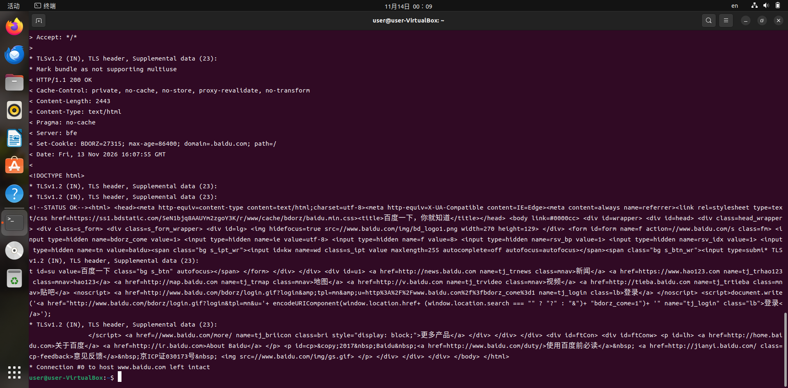
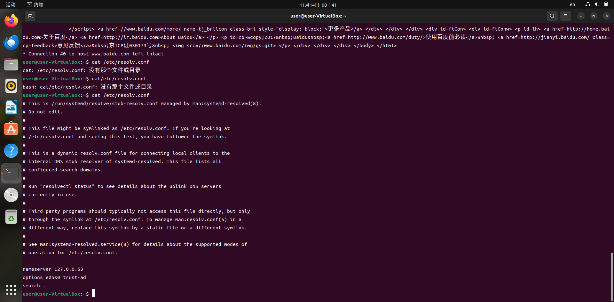
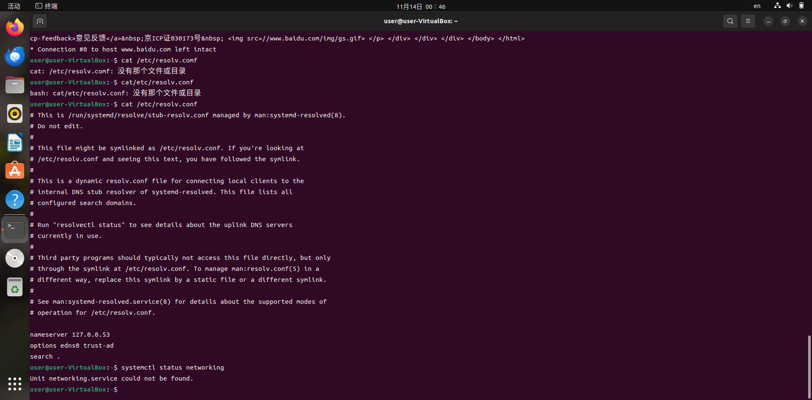

# 04-Linux 网络命令实操

## 1. 查看本机 IP：`ip a`

- **🎯 总体作用**：出门先看自己家门牌号，确认网卡拿到了什么 IP。主要看 `enp0s3` 这块网卡。
- **🔧 硬核解析（底层原理）**：
    - `link/ether`：网卡身份证（MAC 地址）。
    - `inet 10.0.2.x/24`：本机的内网 IP 与掩码长度。
    - `brd 10.0.2.255`：广播地址。
- **💬 大白话翻译**：出门前先低头看一眼自己的门牌号，别连自己住哪都不知道。

**图 04-1**：`ip a`

## 2. 测试域名通不通：`ping baidu.com`

- **🎯 总体作用**：测试自己能不能连外网，顺便看看 DNS 解析正不正常。
- **🔧 硬核解析（底层原理）**：
    - 屏幕会一直刷 `64 bytes from...`，只要有 `time=xx ms` 就代表通了。
    - 它不会自己停，必须按 `Ctrl + C` 强行打断。
- **💬 大白话翻译**：给外面打个电话，有人接就说明线路是通的；但它会一直响，得自己挂断。

**图 04-2**：`ping www.baidu.com`

## 3. 测试直连 IP：`ping -c 5 8.8.8.8`

- **🎯 总体作用**：绕开域名，直接 ping 一个公共 DNS（谷歌 8.8.8.8），判断故障出在网络还是在 DNS。
- **🔧 硬核解析（底层原理）**：
    - `-c 5` 表示只发 5 个包就停，不用手动去按 `Ctrl + C`。
    - **排错思路**：如果它能通、但 `ping baidu.com` 不通，说明网络没问题，是 DNS 挂了。
- **💬 大白话翻译**：不翻通讯录，直接拨一个你背下来的号码。能通说明电话线是好的，那刚才打不通就是查号台坏了。

**图 04-3**：`ping -c 5 8.8.8.8`

## 4. 追踪数据包走哪条路：`traceroute www.qq.com`

- **🎯 总体作用**：看看数据包从虚拟机出来，经过了哪些路由器才走到腾讯（trace 追踪 + route 路线）。
- **🔧 硬核解析（底层原理）**：
    - **第一次敲**：直接 `traceroute www.qq.com`，Ubuntu 回「找不到命令 "traceroute"，但可以通过以下软件包安装它」（图 04-4）。新装的系统不带这个工具。
    - **装完再跑**：`sudo apt install traceroute -y` 之后，第 1 跳是 `10.0.2.2`（NAT 网关），**第 2 跳之后全是 `* * *`**（图 04-6）。
    - **为什么全是星号**：不是断网。一是运营商路由器大多不回 ICMP 超时的回包，二是虚拟机在 NAT 后面，回来的包找不到路。探测不到，不代表目标不存在。
- **💬 大白话翻译**：你想弄清快递经过了几个中转站，可中转站不肯报名字，后面几站就只显示 `* * *`。看不到名字，不代表没送到。

**图 04-4**：`traceroute` 没装，提示「找不到命令」

**图 04-5**：安装必要组件

**图 04-6**：`traceroute www.qq.com`

## 5. `nslookup www.baidu.com`：域名解析查询

- **🎯 总体作用**：向 DNS 服务器发起查询，将人类可读的域名转换为机器可路由的 IP 地址。
- **🔧 硬核解析（底层原理）**：
    - **通信协议**：默认基于 **UDP 协议**，目标端口为 **53**。
    - **查询过程**：属于**递归查询**。客户端向本地 DNS（如截图中的 `127.0.0.53`）发起请求，本地 DNS 若没有缓存，会代替客户端向根域名服务器 -> 顶级域名服务器 -> 权威域名服务器逐级查询（迭代查询）。
    - **记录类型**：截图中出现的 `canonical name` 属于 **CNAME（别名记录）**。百度使用 CNAME 将 `www.baidu.com` 指向 CDN 网络节点（如 `www.wshifen.com`），最终返回的多个 `Address` 属于 **A 记录（IPv4 地址）**，用于实现负载均衡。
- **💬 大白话翻译**：你打电话给本地查号台（DNS），问“百度在哪？”查号台查了查说：“百度改名成百度二狗了，二狗现在有两个住处，你随便挑一个去吧。”

**图 04-7**：`nslookup www.baidu.com`

## 6. `curl -v https://www.baidu.com`：抓取 HTTP/HTTPS 通信全貌

- **🎯 总体作用**：在命令行发送网络请求，并详细打印出底层协议握手与数据交互的全过程。
- **🔧 硬核解析（底层原理）**：
    - **TCP 三次握手**：客户端与服务器 443 端口建立 TCP 连接（SYN -> SYN+ACK -> ACK）。
    - **TLS 握手（建立加密隧道）**：
        - `Client Hello`：客户端发送支持的 TLS 版本和密码套件（Cipher Suites）。
        - `Server Hello` 与 `Certificate`：服务器选定加密套件，并下发数字证书（X.509），客户端验证证书合法性（防中间人劫持）。
        - `Key Exchange`：双方利用非对称加密（如 ECDHE）协商出对称密钥。
    - **HTTP 请求与响应**：加密隧道建立后，发送 HTTP 请求（带 `>` 的 Request Headers），接收 HTTP 响应（带 `<` 的 Response Headers，如 `200 OK`）及响应体（HTML 源码）。
    - **缺少组件时**：先执行 `sudo apt install curl -y` 安装。
- **💬 大白话翻译**：你跑去敲百度的门。第一步（TCP）确认双方都在家；第二步（TLS）你们俩对暗号，互相查验身份证，并商量好一套只有你俩懂的加密黑话；第三步（HTTP）你用黑话告诉它你要干嘛，它用黑话把网页内容回传给你。

**图 04-8**：`curl -v` 报错

**图 04-9**：`sudo apt install curl -y`

**图 04-10**：`curl -v https://baidu.com`（握手过程）

**图 04-11**：`curl -v https://baidu.com`（响应内容）

## 7. `cat /etc/resolv.conf`：查看系统 DNS 配置

- **🎯 总体作用**：查看 Linux 系统当前配置的本地 DNS 解析器地址及相关参数。
- **🔧 硬核解析（底层原理）**：
    - **软链接机制**：Ubuntu 22.04 中，该文件实际是软链接（Symlink），指向 `/run/systemd/resolve/stub-resolv.conf`。由 `systemd-resolved` 服务动态管理，防止手动修改被覆盖。
    - **`nameserver 127.0.0.53`**：指定本地存根解析器（Stub Resolver）。本机所有应用的 DNS 请求先发往这个本地回环地址，再由该服务代理转发给上游的真实 DNS 服务器（如路由器或运营商 DNS）。
    - **`options edns0`**：扩展 DNS 机制（EDNS）。传统 DNS 报文受限于 512 字节，开启后允许更大的 UDP 报文，以支持 DNSSEC 签名信息或更多 IP 记录。
- **💬 大白话翻译**：你打开电脑的通讯录说明书，看到上面写着：“遇到不懂的地址，先拨打内部总机 127.0.0.53 询问，并且允许对方一次性报一串长地址（edns0）。”

**图 04-12**：`cat /etc/resolv.conf`

## 8. `systemctl status NetworkManager`：检查网络管理服务状态

- **🎯 总体作用**：查询 systemd 里某个网络服务的运行状态。这个命令我一开始把服务名敲错了，敲成了 `systemctl status networking`。
- **🔧 硬核解析（底层原理）**：
    - **我敲的和它回我的**：`systemctl status networking` → `Unit networking.service could not be found.`（图 04-13）。不是服务挂了，是这个单元名根本不存在。
    - **为什么不存在**：`networking` 是旧版 Debian / Ubuntu 用 ifupdown 管网络时的服务名。Ubuntu 22.04 桌面版改用 **NetworkManager**，服务单元叫 `NetworkManager.service`。
    - **正确的命令**：`systemctl status NetworkManager`。输出里 `Loaded:` 一行给出单元文件路径和是否开机自启；`Active: active (running)` 表示活动运行；`Main PID:` 是主进程号。
    - **底层日志**：`systemctl status` 末尾会带几行 journal 日志，记录网卡激活、拿到 IP、设置默认路由这些动作。
- **💬 大白话翻译**：我去后台找「网络管家」，喊的是它以前的旧名字（networking），系统回我「查无此人」。它不是离职了，是改名了——现在叫 NetworkManager，喊新名字才有人应。

**图 04-13**：`systemctl status networking` 回 `Unit networking.service could not be found.`

---

## 💡 顺便记个比喻

- **IP** = 门牌号
- **端口** = 房间号
- **TCP** = 顺丰快递（必须签收）
- **UDP** = 发传单（扔了就走）

---

*注：Linux 命令行严格区分大小写，且命令与参数之间必须有空格（如 `cat /etc/...`）；Markdown 图片路径里不能有空格和中文。*

---

## 学习作用

- 掌握 `ip a`、`ping`、`traceroute`、`nslookup` / `dig`、`curl` 等命令的用途与输出含义。
- 形成排障顺序：先看本机地址（`ip a`）→ 看连通性（`ping`）→ 看路径（`traceroute`）→ 看域名解析（`nslookup` / `dig`）→ 最后看应用层响应（`curl`）。
