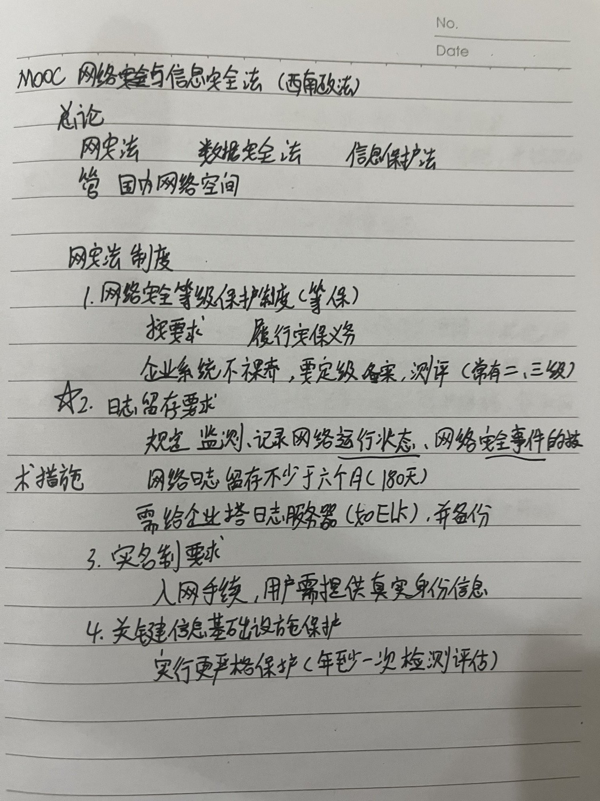
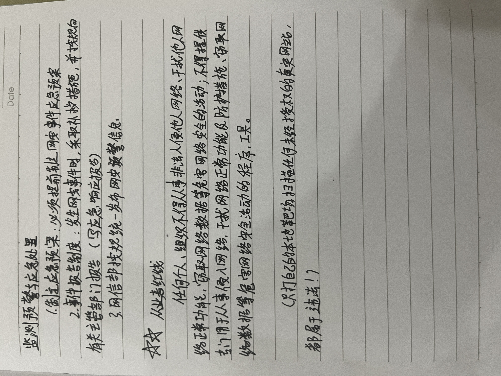

# 06-网络安全法规与合规笔记

> 学习来源：西南政法大学 MOOC《网络安全与信息安全法》
> 学习目的：搞懂网安从业者的“法律红线”，以及作为安全运营/合规人员，法律要求企业必须做到哪些防护措施。

## 一、 总论

*   **三驾马车**：《网络安全法》、《数据安全法》、《个人信息保护法》。
*   **适用范围**：管国内网络空间。

## 二、 网安法核心制度（企业合规必做）

1.  **网络安全等级保护制度（等保）**
    *   按要求履行安保义务。
    *   企业系统不裸奔，要定级、备案、测评（常二、三级）。
2.  **☆☆ 日志留存要求（面试极高频考点）**
    *   规定：监测、记录网络运行状态、网络安全事件的技术措施。
    *   要求：网络日志留存**不少于六个月（180天）**。
    *   实操：需给企业搭日志服务器（如 ELK），并做好备份。
3.  **实名制要求**
    *   入网手续，用户需提供真实身份信息。
4.  **关键信息基础设施保护（关基保护）**
    *   实行更严格保护（年至少一次检测评估）。

**图 06-1**：总论，核心制度

## 三、 监测预警与应急处置（蓝队日常）

1.  **制定应急预案**：必须提前制定网络安全事件应急预案。
2.  **事件报告制度**：发生网安事件时，采取补救措施，并**按规定向有关主管部门报告**（日常写应急响应报告）。
3.  **统一发布**：网信部门（网信办）按规定统一发布网络安全预警信息。

## 四、 ⚠️ 从业者红线（重中之重！）

**任何个人、组织不得从事非法侵入他人网络、干扰他人网络正常功能、窃取网络数据等危害网络安全的活动；不得提供专门用于从事侵入网络、干扰网络正常功能及防护措施、窃取网络数据等危害网络安全活动的程序、工具。**

> **只打自己的本地靶场，扫描任何未经授权的真实网站，都属于违法！**

**图 06-2**：预警处置,从业者红线

