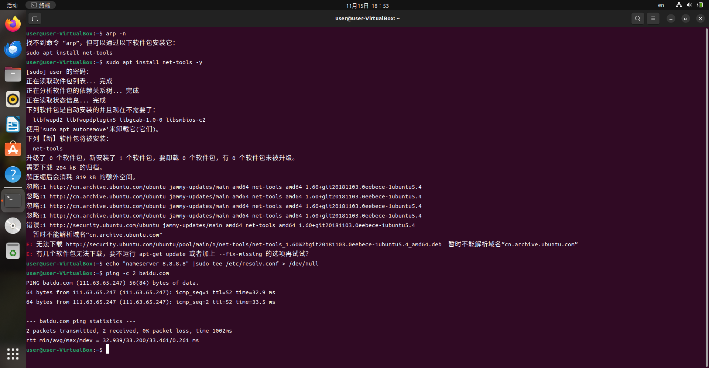
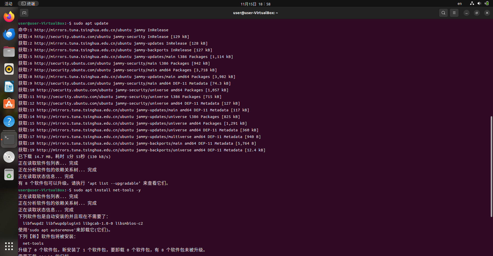

# 08-ARP表抓包记录与双端对比

> **总体作用**：查看并对比 Windows 与 Linux 系统的本地 ARP 缓存表，理解 IP 与 MAC 地址映射关系。同时记录在安装网络工具时遇到的 DNS 解析故障排错过程。

## 一、 Ubuntu 虚拟机踩坑与实操

### 1. 排错记录：DNS 解析失败导致无法下载
*   **现象**：执行 `sudo apt install net-tools -y` 时，提示“暂时不能解析域名 `cn.archive.ubuntu.com`”。
*   **🔧 硬核解析**：系统的 DNS 配置未能正常工作，导致无法将域名解析为 IP，软件包无法下载。
*   **💬 大白话翻译**：电脑突然找不到通讯录了，不知道要去哪里下载软件。
*   **解决方案**：临时向 `/etc/resolv.conf` 写入公共 DNS（8.8.8.8）恢复网络，随后通过 `ping -c 2 baidu.com` 验证网络已连通。

```text
# 临时修改 DNS 操作
[你的用户名]@[你的主机名]:~$ echo "nameserver 8.8.8.8" | sudo tee /etc/resolv.conf > /dev/null
# 验证网络（成功 Ping 通）
[你的用户名]@[你的主机名]:~$ ping -c 2 baidu.com
64 bytes from 111.63.65.247: icmp_seq=1 ttl=52 time=32.9 ms
```



### 2. 命令一：`arp -n`（老牌通讯录）
*   **🎯 总体解释**：查看 Linux 系统的 ARP 缓存表。
*   **🔧 硬核解析**：调用 `net-tools` 工具包，`-n` 参数表示以纯数字形式显示 IP 和 MAC，不尝试反向解析主机名，提升查询速度。MAC 地址显示格式为冒号 `:` 分隔。
*   **💬 大白话翻译**：翻阅系统的老版“通讯录”，看看最近记住了谁的 IP 和身份证号。
*   **输出结果**：
```text
[你的用户名]@[你的主机名]:~$ arp -n
地址                  类型    硬件地址            标志  Mask            接口
192.168.1.1           ether   [网关MAC已脱敏]     C                enp0s3
```

### 3. 命令二：`ip neigh`（现代通讯录）
*   **🎯 总体解释**：使用现代 `iproute2` 工具集查看网络邻居表。
*   **🔧 硬核解析**：相比 `arp`，`ip neigh` 提供了更多状态信息。例如 `REACHABLE` 表示最近通信过，表项有效；`STALE` 表示表项已陈旧。MAC 地址同样为冒号 `:` 分隔。
*   **💬 大白话翻译**：新版的查号台，不仅能看到门牌号和身份证号，还能看到对方现在是“活跃”还是“失联”状态。
*   **输出结果**：
```text
[你的用户名]@[你的主机名]:~$ ip neigh
192.168.1.1 dev enp0s3 lladdr [网关MAC已脱敏] REACHABLE
fe80::... dev enp0s3 lladdr [网关MAC已脱敏] router STALE
```

---

## 二、 Windows 物理机实操

### 命令三：`arp -a`（全量通讯录）
*   **🎯 总体解释**：显示 Windows 系统中所有网络接口的 ARP 缓存表。
*   **🔧 硬核解析**：`-a` 参数表示显示所有接口的表项。Windows 的 MAC 地址使用短横线 `-` 分隔。列表中不仅包含动态缓存（与真实设备通信产生），还包含大量系统默认的静态组播/广播地址（如 `224.0.0.x` 和 `255.255.255.255`）。
*   **💬 大白话翻译**：Windows 的大通讯录，列出所有网卡记住的邻居。不仅有人类邻居，还记录了一堆专门用于系统广播的“公共大喇叭”地址。
*   **输出结果（已脱敏）**：
```text
C:\Users\[你的用户名]>arp -a

接口: 192.168.x.x --- 0xb
  Internet 地址         物理地址              类型
  192.168.1.1           [网关MAC已脱敏]       动态
  192.168.1.255         ff-ff-ff-ff-ff-ff     静态
  224.0.0.22            01-00-5e-00-00-16     静态
  ...

接口: 192.168.56.1 --- 0xc  (VirtualBox 虚拟网卡接口)
  Internet 地址         物理地址              类型
  192.168.56.255        ff-ff-ff-ff-ff-ff     静态
  ...
```

---

## 三、 双端总结对比
1. **底层逻辑一致**：两端都在维护 IP 与 MAC 的映射关系，以加速局域网通信。
2. **格式差异**：Windows 用短横线 `-` 分割 MAC，Linux 用冒号 `:` 分割 MAC。
3. **状态展示**：Linux 的 `ip neigh` 增加了状态字段，比 Windows 单纯的“动态/静态”更直观。
4. **默认缓存项**：Windows 在未通信时也会自带很多静态组播表项，而 Linux 初始状态非常干净，基本只有网关。