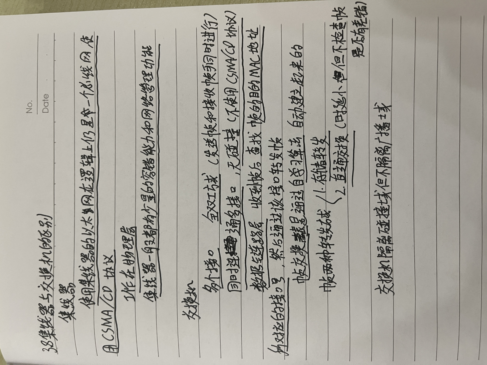
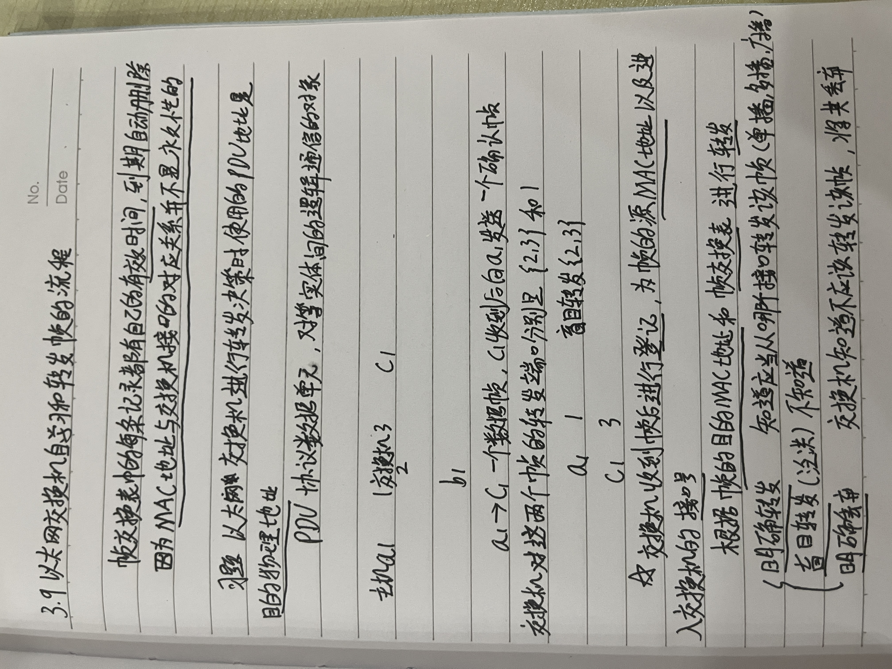

# 09-集线器与交换机原理及自学习流程

## 3.8 集线器与交换机的区别

### 1. 集线器 (Hub)
*   使用集线器的以太网在逻辑上仍是一个**总线网**。
*   使用 **CSMA/CD 协议**。
*   工作在**物理层**。
*   集线器一般都有少量的容错能力和网络管理功能。

### 2. 交换机 (Switch)
*   多个接口，支持**全双工方式**（发送帧和接收帧同时进行）。
*   同时连通多接口，**无碰撞**（不使用 CSMA/CD 协议）。
*   工作在**数据链路层**。收到帧后，查找帧的**目的 MAC 地址**所对应的接口，然后通过该接口转发帧。
*   帧交换表是通过**自学习算法**自动建立起来的。
*   帧有两种转发方式：
    1.  **存储转发**
    2.  **直通交换**（时延小，但不检查帧是否有差错）。
*   **核心结论**：交换机**隔离碰撞域，但不隔离广播域**。

---

## 3.9 以太网交换机自学习和转发帧的流程

### 1. 帧交换表的特性
*   帧交换表中的每条记录都有自己的**有效时间**，到期自动删除。
*   **原因**：因为 MAC 地址与交换机接口的对应关系并非永久性的（比如换了网线插口）。

### 2. 习题与概念
*   **习题**：以太网交换机进行转发决策时，使用的 PDU 地址是 **目的物理地址**。
*   **PDU (协议数据单元)**：对等实体间的逻辑通信的对象。

### 3. 拓扑推导例题
*(假设拓扑：主机 a1 连在接口1，主机 b1 连在接口2，主机 c1 连在接口3)*
*   **过程**：a1 向 c1 发送一个数据帧。交换机此时表里没有 c1 的记录，只能向 {2, 3} 接口盲目转发（泛洪）。c1 收到后，向 a1 发送一个确认帧。此时交换机已经通过 a1 发来的帧，登记了 a1 在接口1，因此直接将确认帧从接口1发给 a1。

### 4. 交换机的核心工作流程
**第一步：登记（自学习）**
交换机收到帧后，进行登记：**为帧的源 MAC 地址以及进入交换机的接口号**。

**第二步：转发决策**
根据帧的**目的 MAC 地址**和**帧交换表**进行转发，分为三种情况：
1.  **明确转发**：知道应当从哪个接口转发该帧（单播、多播、广播）。
2.  **盲目转发（泛洪）**：不知道目的 MAC 地址在哪里。
3.  **明确丢弃**：交换机知道不应该转发该帧，将其丢弃。
