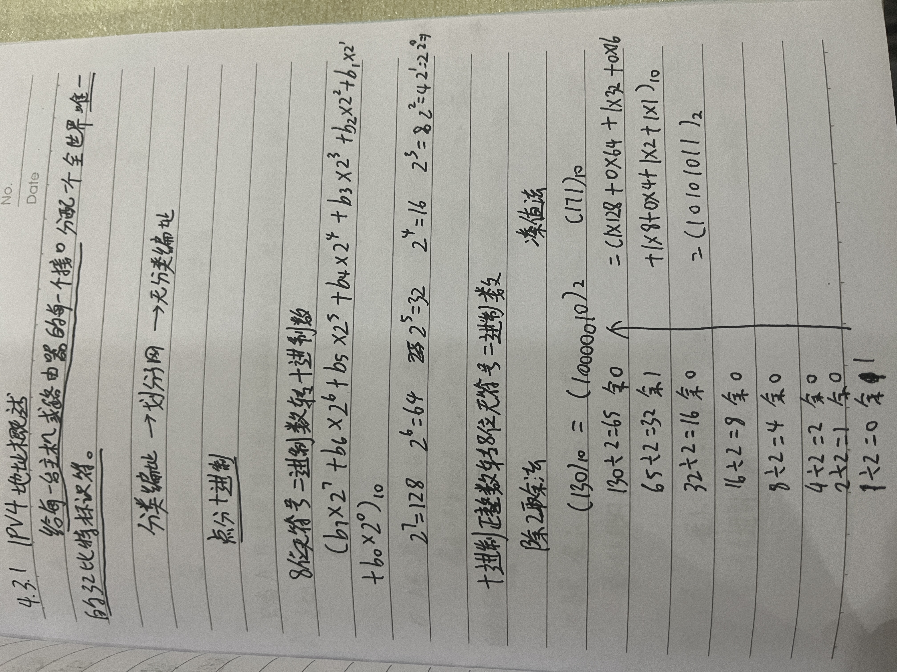
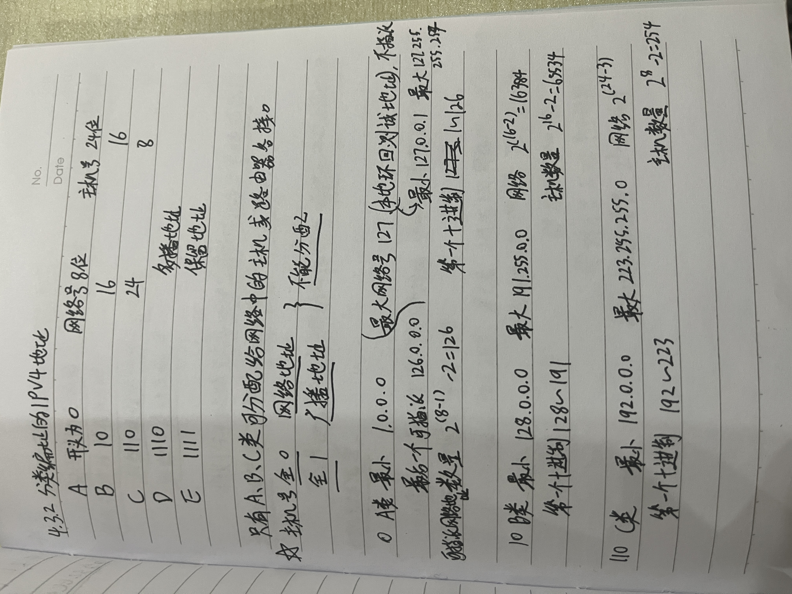
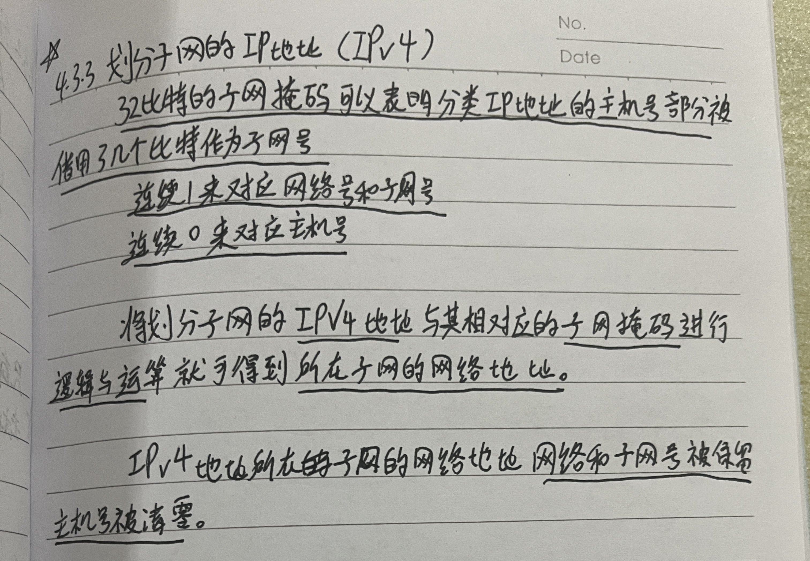
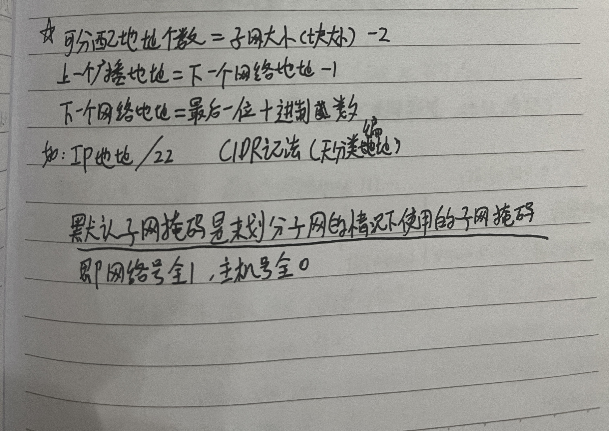
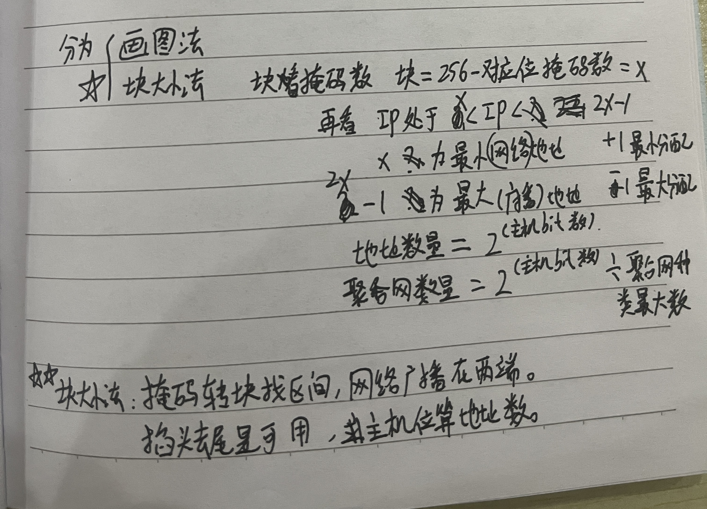
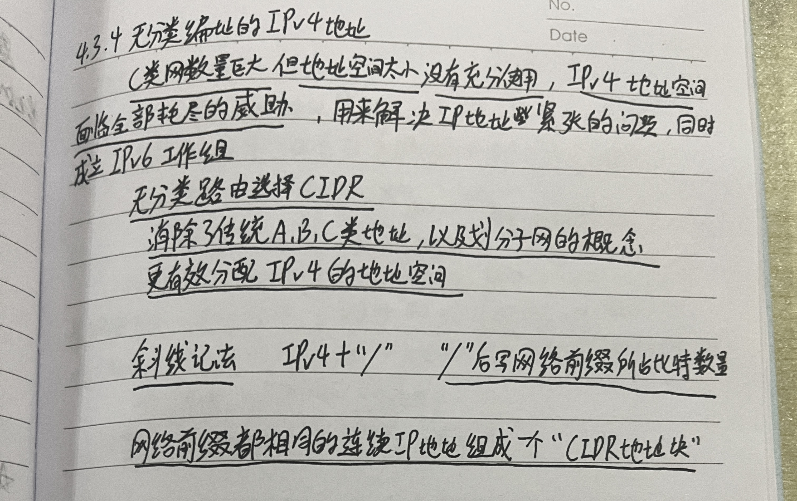
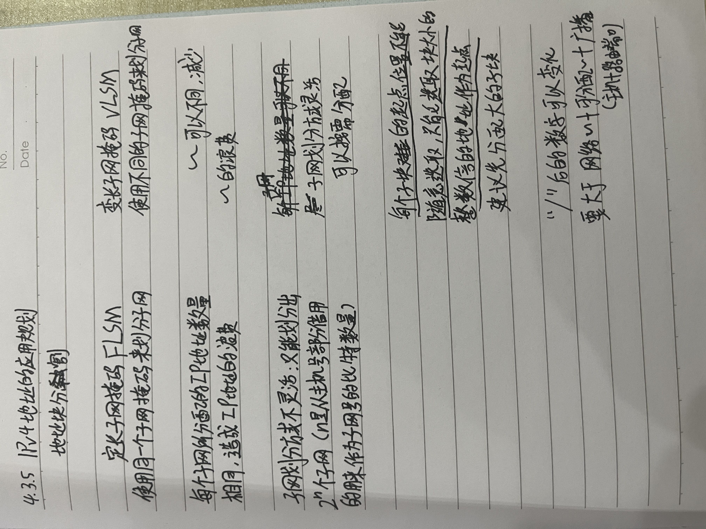

# 10-IPv4 地址理论全家桶（理论篇）

## 4.3.1 IPv4 地址概述

- **定义**：给每一台主机或路由器的每一个接口分配一个全世界唯一的 32 比特标识符。
- **演进史**：分类编址 -> 划分子网 -> 无分类编址（CIDR）。
- **表示法**：点分十进制（如 192.168.1.1）。
- **进制转换**：
  - **8位无符号二进制转十进制**：\(b_7 \times 2^7 + b_6 \times 2^6 + ... + b_0 \times 2^0\)。
  - **常用 2 的次幂**：\(2^7=128, 2^6=64, 2^5=32, 2^4=16, 2^3=8, 2^2=4, 2^1=2, 2^0=1\)。
  - **十进制转二进制**：除2取余法（倒序读）、凑值法（如 171 = 128 + 32 + 8 + 2 + 1 = 10101011）。

**图 10-1**：IPv4 地址概述

## 4.3.2 分类编址的 IPv4 地址

- **A类**：开头为 `0`，网络号 8 位，主机号 24 位。
- **B类**：开头为 `10`，网络号 16 位，主机号 16 位。
- **C类**：开头为 `110`，网络号 24 位，主机号 8 位。
- **D类**：开头 `1110`，多播地址。
- **E类**：开头 `1111`，保留地址。
- **重要规则**：
  - 只有 A、B、C 类可分配给网络中的主机或路由器各接口。
  - **主机号全 0** = 网络地址（不能分配）；**主机号全 1** = 广播地址（不能分配）。
- **各类地址范围**：
  - **A类**：最小 `1.0.0.0`，最大 `127.255.255.255`（127 为本地环回测试地址，不指派）。可指派的网络数量 \(2^{(8-1)}-2 = 126\)。
  - **B类**：最小 `128.0.0.0`，最大 `191.255.255.255`。网络数 \(2^{(16-2)} = 16384\)；主机数 \(2^{16}-2 = 65534\)。
  - **C类**：最小 `192.0.0.0`，最大 `223.255.255.255`。网络数 \(2^{(24-3)}\)；主机数 \(2^8-2 = 254\)。

**图 10-2**：分类编址的 IPv4 地址

## 4.3.3 划分子网的 IPv4 地址

- **核心逻辑**：32 比特的子网掩码，用来表明分类 IP 地址的主机号部分被借用了几个比特作为子网号。
- **规则**：连续的 1 对应网络号和子网号；连续的 0 对应主机号。
- **网络地址计算**：将划分子网的 IPv4 地址与其对应的子网掩码进行**逻辑与运算**，得到所在子网的网络地址（主机号被清零）。
- **默认子网掩码**：未划分子网情况下使用的掩码（即网络号全 1，主机号全 0）。
- **块大小法口诀**：掩码转块找区间，网络广播在两端。掐头去尾是可用，靠主机位算地址数。

**图 10-3**：划分子网的 IPv4 地址

**图 10-4**：判断定位可分配地址、广播地址、网络地址方法

**图 10-5**：块大小法口诀与具体用法

## 4.3.4 无分类编址的 IPv4 地址（CIDR）

- **背景**：传统 C 类网数量巨大但地址空间太小，没有充分利用，IPv4 地址空间面临耗尽。
- **核心**：无分类路由选择 CIDR 消除了传统 A、B、C 类地址以及划分子网的概念，能更有效分配 IPv4 地址空间。
- **CIDR斜线记法**：IP地址 + "/" + 网络前缀所占的比特数量。如 IP 地址/22，即无分类编址。
- **CIDR 地址块**：网络前缀都相同的连续 IP 地址组成一个“CIDR 地址块”。
- **路由聚合（构造超网）**：找共同前缀进行聚合。网络前缀越长，地址块越小，路由越具体。采用**最长前缀匹配**原则。

**图 10-6**：无分类编址的 IPv4 地址

**图 10-7**：路由聚合及计算方法

## 4.3.5 IPv4 地址的应用规划（VLSM）

- **定长子网掩码 (FLSM)**：
  - 使用同一个子网掩码来划分子网，每个子网分配的 IP 地址数量相同。
  - 缺点：造成 IP 地址浪费；只能划分出 \(2^n\) 个子网（n为借用主机号作为子网号的比特数）；划分方式不灵活。
- **变长子网掩码 (VLSM)**：
  - 使用不同的子网掩码划分子网，子网可以不同大小，减少浪费，按需分配。
  - **规则**：每个子块的起点位置不能随意选取，只能选取**块大小的整数倍**的地址作为起点。
  - **建议**：**先分配大的子块**。
  - "/" 后的数字可以变化，要大于等于：网络号 + 可分配地址 + 广播地址（主机 + 路由端口）。

**图 10-8**：FLSM与VLSM对比图

