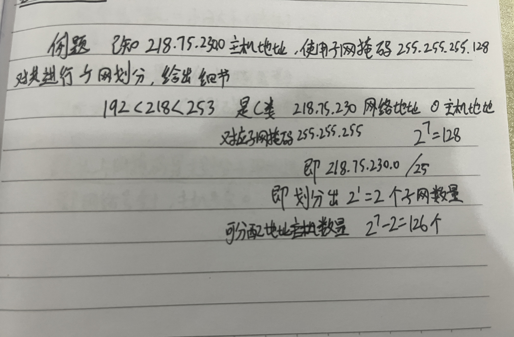
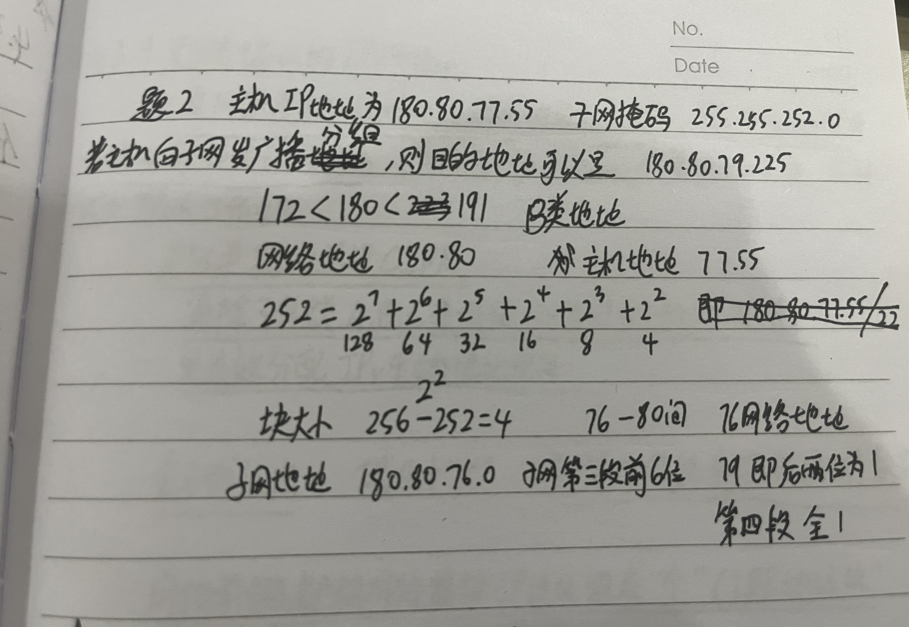
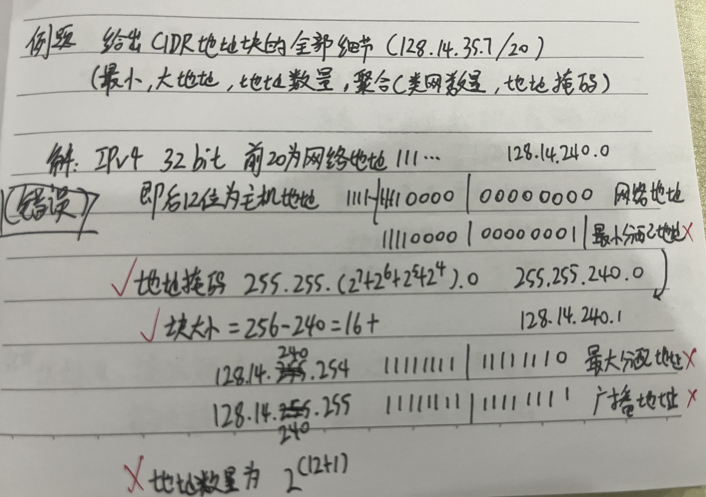
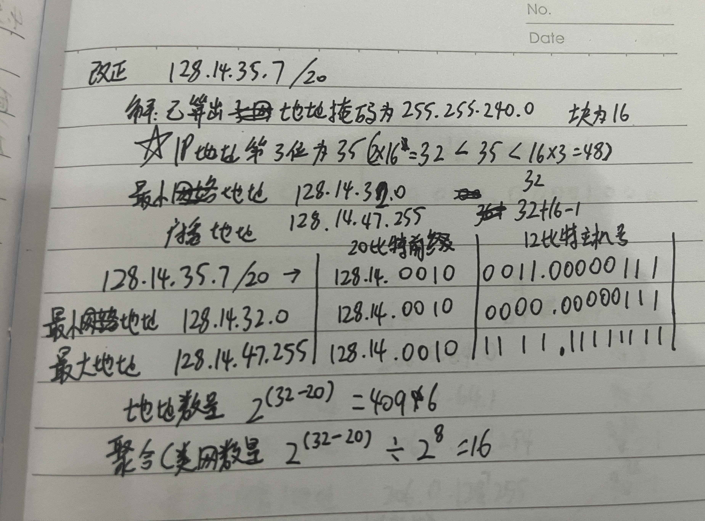
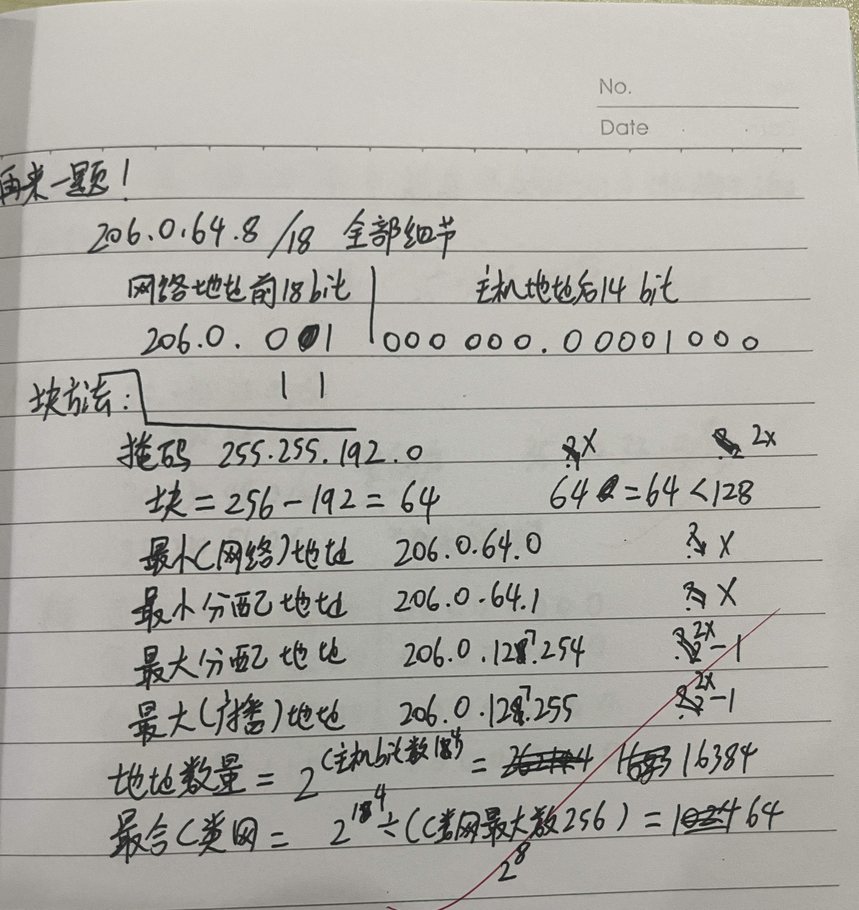
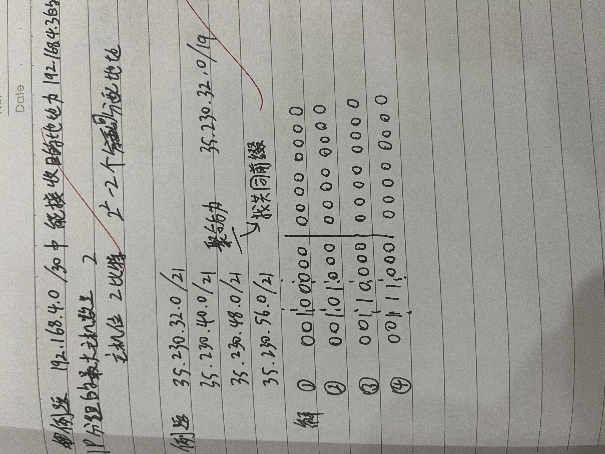

# IPv4 地址计算与划分实战练习

## 例题 1：C类地址基础子网划分
- **题目**：已知 `218.75.230.0` 是主机地址，使用子网掩码 `255.255.255.128` 对其进行子网划分，给出细节。
- **通俗解析**：这是一道基础划分题，重点是判断类别和计算借位数。
- **解题过程**：
  - **类型判断**：`192 < 218 < 223`，属于 C 类地址。前 3 段为网络地址，最后 1 段为主机地址。
  - **掩码对应**：子网掩码 `255.255.255.128`，相当于 `/25`（二进制 `10000000`），借用 1 位主机号作子网号。
  - **子网数量**：\(2^1 = 2\) 个。
  - **主机数量**：剩余主机位 7 位，可用地址数 \(2^7 - 2 = 126\) 个。
  - **子网范围**：
    - 第一个子网：`218.75.230.0 ~ 218.75.230.127`
    - 第二个子网：`218.75.230.128 ~ 218.75.230.255`

  
---

## 例题 2：B类地址子网广播地址计算
- **题目**：主机 IP 地址为 `180.80.77.55`，子网掩码 `255.255.252.0`。若该主机向其所在子网发送广播分组，则目的地址可以是？（答案：`180.80.79.255`）
- **通俗解析**：利用“块大小法”定位网络区间，从而推算广播地址。
- **解题过程**：
  - **类型判断**：`172 < 180 < 191`，属于 B 类地址。网络地址前 16 位（`180.80`），主机地址后 16 位（`77.55`）。
  - **掩码拆解**：`252 = 2^7 + 2^6 + 2^5 + 2^4 + 2^3 + 2^2`（128+64+32+16+8+4），即 `/22` 前缀。
  - **块大小计算**：`256 - 252 = 4`。
  - **定位网络地址**：IP 第三段为 `77`。因为块大小为 4，`76` 到 `80` 构成一个区间。`77` 落在 `76` 的区间内。
  - **子网地址**：`180.80.76.0`。
  - **广播地址**：`180.80.79.255`（区间终点 `76 + 4 - 1 = 79`，第四段全 1）。


---

## 例题 3：CIDR 地址块全细节（含纠错复盘）
- **题目**：给出 CIDR 地址块的全部细节 `(128.14.35.7 /20)`（求最小、最大地址、地址数量、聚合C类网数量、子网掩码）。
- **通俗解析**：此题极易踩坑（不可将掩码数字与 IP 段位混淆）。
- **解题过程**：
  - **掩码与块大小**：掩码为 `255.255.240.0`，块大小 = `256 - 240 = 16`。
  - **定位网络地址**：IP 第三段为 `35`。\(16 \times 2 = 32 < 35 < 16 \times 3 = 48\)。所以网络地址起点为 `32`。
  - **最小（网络）地址**：`128.14.32.0`。
  - **最大（广播）地址**：`128.14.47.255`（`32 + 16 - 1 = 47`）。
  - **地址数量**：主机位 \(32-20=12\) 位，总地址数 \(2^{12} = 4096\) 个。
  - **聚合C类网数量**：\(2^{12} \div 2^8 = 16\) 个。


### 二进制画图法辅助验证（防错技巧）：
```text
20比特前缀 | 12比特主机
128.14.0010 | 0011.00000000 (IP: 128.14.35.7)
128.14.0010 | 0000.00000000 (网络地址: 128.14.32.0)
128.14.0010 | 1111.11111111 (广播地址: 128.14.47.255)
```



---

## 例题 4：跨字节 CIDR 划分
- **题目**：`206.0.64.8 /18` 的全部细节。
- **通俗解析**：块大小计算直接命中网络地址起点的题型。
- **解题过程**：
  - **网络与主机位**：网络地址前 18 位，主机地址后 14 位。
  - **掩码与块大小**：掩码 `255.255.192.0`，块大小 `256 - 192 = 64`。
  - **定位网络地址**：IP 第三段为 `64`，刚好是块大小 `64` 的 \(1\) 倍。
  - **最小（网络）地址**：`206.0.64.0`。
  - **最小分配地址**：`206.0.64.1`。
  - **最大分配地址**：`206.0.127.254`（即广播地址前一位）。
  - **最大（广播）地址**：`206.0.127.255`（区间终点 `64 + 64 - 1 = 127`）。
  - **地址数量**：\(2^{14} = 16384\) 个。
  - **聚合C类网数量**：\(2^{14} \div 256 = 64\) 个。


---

## 例题 5：微小网络与路由聚合

### 1. 微小网络可用主机数
- **题目**：在 `192.168.4.0 /30` 中，能接收目的地址为 `192.168.4.3` 的 IP 分组的最大主机数是多少？
- **解答**：`/30` 掩码为 `255.255.255.252`，块大小为 4。主机位仅剩 2 比特。可用分配地址数 = \(2^2 - 2 = 2\) 个（即 `.1` 和 `.2`）。`.3` 为广播地址。

### 2. 路由聚合（构造超网）
- **题目**：将 `35.230.32.0/21`、`35.230.40.0/21`、`35.230.48.0/21`、`35.230.56.0/21` 进行路由聚合。
- **通俗解析**：路由聚合的核心是“找共同前缀”。需要将十进制转为二进制进行纵向对齐比对。
- **解题过程（画图法）**：
```text
① 35.230.32.0/21: 001 00000
② 35.230.40.0/21: 001 01000
③ 35.230.48.0/21: 001 10000
④ 35.230.56.0/21: 001 11000
```
  - **观察比对**：第三段的前 3 位（`001`）完全一致。加上前两段的 16 位，共同前缀长度为 \(16 + 3 = 19\) 位。
  - **聚合结果**：`35.230.32.0/19`。
  