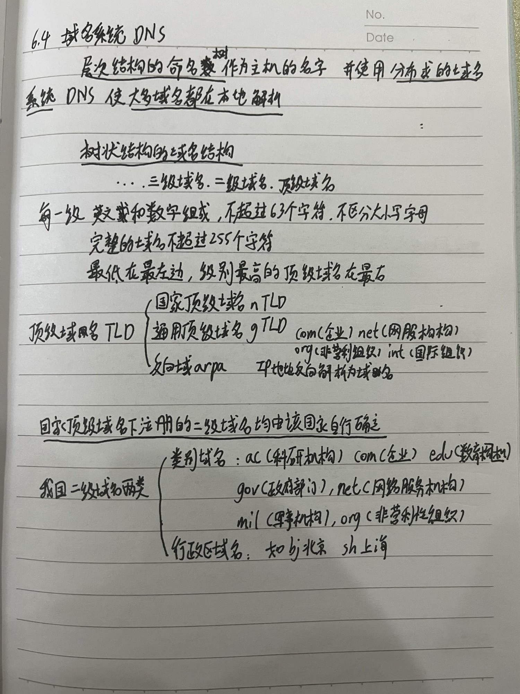
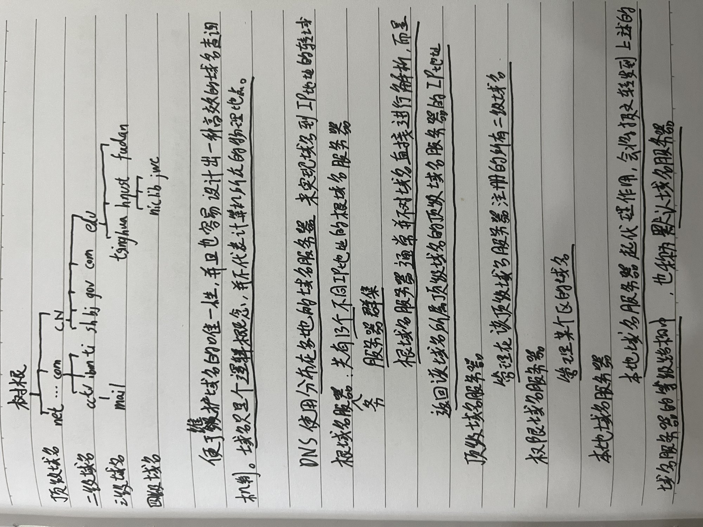

# 12-DNS 域名系统理论笔记

## 一、 总体解释 🎯

DNS（Domain Name System，域名系统）是互联网的核心基础设施之一。它的根本作用是将人类易于记忆的域名（如 `www.baidu.com`）转换为计算机网络通信所需的 IP 地址。由于全球互联网规模庞大，DNS 采用了层次化的命名结构和分布式的数据库系统，以此来保证查询的高效性和可扩展性。

## 二、 硬核解析 🔧

### 1. 域名结构

*   **层次树状结构**：域名由标号序列组成，级别最低的域名在最左边，级别最高的顶级域名在最右边。
*   **组成规则**：每一级由英文字母和数字组成，不超过 63 个字符，不区分大小写；完整的域名不超过 255 个字符。
*   **逻辑概念**：便于维护域名的唯一性，且容易设计出高效的查询机制。域名仅是逻辑上的标识，并不代表计算机实际所在的物理地点。
*   💬 **域名结构**：就像写地址，从右往左看，范围从大到小。最右边是“国家/类型”，中间是“省/市/单位”，最左边是“具体某人（主机）”。

### 2. 顶级域名（TLD）分类

*   **国家顶级域名（nTLD）**：如 `.cn`（中国）、`.us`（美国）。
*   **通用顶级域名（gTLD）**：如 `.com`（企业）、`.net`（网络机构）、`.org`（非营利组织）、`.int`（国际组织）。
*   **反向域（arpa）**：用于 IP 地址反向解析为域名。

### 3. 我国二级域名分类

在国家顶级域名（`.cn`）下注册的二级域名由该国自行确定，我国分为两类：
*   **类别域名**：`ac`（科研机构）、`com`（企业）、`edu`（教育机构）、`gov`（政府部门）、`net`（网络服务机构）、`mil`（军事机构）、`org`（非营利性组织）。
*   **行政区域名**：如 `bj`（北京）、`sh`（上海）等。

**图 12-1**：域名结构、分类我国、二级域名分类

### 4. 域名服务器层级与种类

DNS 采用分布式架构，主要分为以下四类服务器：
1.  **根域名服务器**：共 13 个不同 IP 地址（实为服务器集群）。通常不直接解析域名，而是返回该域名所属顶级域名服务器的 IP 地址。
2.  **顶级域名服务器**：负责管理在该顶级域名服务器注册的所有二级域名。
3.  **权限域名服务器**：负责管理某个“区”的域名。
4.  **本地域名服务器**：起代理作用，也是主机的“默认域名服务器”。负责将主机的请求转发至上述层级结构中。

💬 **根/顶级/权限服务器**：你去办事找不到路，根服务器是“总台”，它告诉你“这事归北京分台管”；顶级服务器是“北京分台”，它告诉你“具体归朝阳区人才市场管”；权限服务器就是“朝阳区人才市场”，它手里有确切档案（IP地址）。

**图 12-2**：层次树状结构手绘图、域名服务器层级与种类

### 5. 域名解析过程（核心考点）

*   **递归查询**：主机向本地域名服务器的查询一般采用递归查询。如果本地域名服务器不知道目标 IP，它会代替主机去向其他服务器查询，直到拿到最终结果返回给主机。
*   💬 **递归（老板与秘书）**：主机跟本地域名服务器说“帮我查一下这个网址”，然后就去喝茶了。本地服务器叫上级的域名服务器帮着一起跑腿，这叫递归。
*   **迭代查询**：本地域名服务器向根/顶级/权限域名服务器的查询一般采用迭代查询。被查询的服务器若不知道 IP，会告诉本地服务器“你应该去问下一个级别的服务器”。
*   💬 **迭代（自己跑腿）**：主机跟本地域名服务器说“帮我查一下这个网址”，然后就去喝茶了。本地域名服务器去问根服务器，根服务器说“我不知道，但你去问顶级服务器吧”。本地服务器就自己跑去找顶级服务器，顶级服务器又说“你去问权限服务器”。每次都是本地域名服务器一个人跑腿，这叫迭代。
*   *注：从请求主机到本地域名服务器的是递归查询，其余通常是迭代查询。*

### 6. 高速缓存

*   域名服务器和主机中广泛使用高速缓存，存放最近查询过的域名及映射信息。
*   必须设置计时器，删除超过合理时间（TTL）的项，以保持数据库一致性。

### 7. 传输层协议

*   DNS 报文使用 **UDP** 协议进行封装，服务器端口号为 **53**。
*   （补充：当报文过长或进行区域传送时，会使用 TCP 53 端口）。
*   💬 UDP 53 端口：查个网址要求快，UDP 不需要三次握手，丢包里重传就行，所以日常 DNS 查询用 UDP。做 Wireshark 抓包时，直接抓 UDP 53 端口就对了。

**图 12-3**：域名解析方式、域名服务器高速缓存、传输层协议端口53

---

## 自测：默写三种记录（2026-11-24，闭卷）

学完一周后合上资料，把 A / AAAA / CNAME 三种记录各写「指向什么 + 举个例子」。写完再对照本笔记，没有一道空题。

**默写内容（转录）**

| 记录 | 指向什么 | 例子 |
|---|---|---|
| **A** | IPv4 地址，点分十进制，4 字节 / 32 bit；可能返回多个 IP，因为服务器做负载均衡 | `192.168.1.1` |
| **AAAA** | IPv6 地址，十六进制，四个十六进制数一组、共八组，4×4×8 = 128 bit / 16 字节；可能有应答但无结果，因为服务器未配置 IPv6 地址 | `2409:8c20::34` |
| **CNAME** | 别名，值只能是域名 | `www.baidu.com` → `www.a.shifen.com` |

**这次默写里最值钱的两句**

1. **A 记录可能返回多个 IP**——不是“一个域名一个 IP”，负载均衡就是靠这个做的。
2. **AAAA 可能有应答但无结果**——服务器回了包，但没配 IPv6 地址，所以 Answer 区是空的。这是我在 DNS 双端抓包里亲眼看到的，书上没写这么细。

**复习**：三种记录的“值到底是什么”已经能说出来；下一步要把 **MX / NS / PTR** 也过一遍（第 3 周之后碰到再补）。