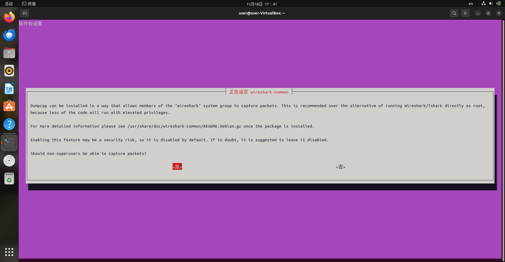
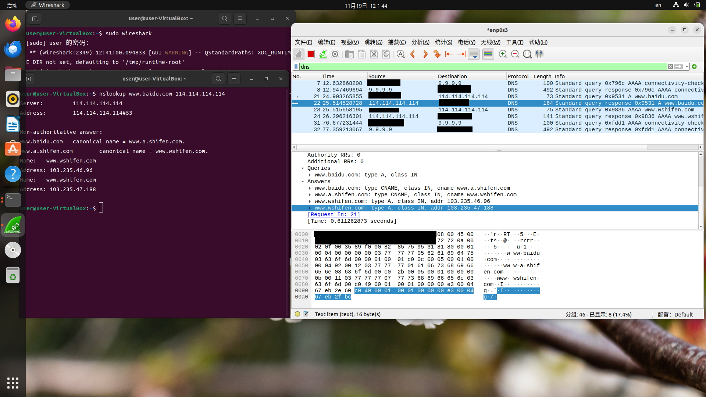

# 13-Wireshark 双端 DNS 抓包实操

## 一、 总体解释 🎯

本实验通过 Wireshark 在物理机（Win10）和虚拟机（Ubuntu）双端进行 DNS 抓包，对比两端在**查询类型、报文结构、以及 DNS 传输方式**上的差异。

第一轮完成了 A / AAAA 记录与 Transaction ID 匹配的验证；第二轮（2026-11-21）复抓时出现了一个新现象——**Win10 端无论如何都抓不到明文 DNS**，顺藤摸瓜查到根因是加密 DNS（DoT/DoH），这条反而成了本实验最有价值的部分，见第六节。

> 说明：本次截图已对本地虚拟网段的 IPv6 地址打码，并裁掉了十六进制区以聚焦关键字段。

## 二、 实验环境排错记录 🔧

🔧 硬核解析：在 Ubuntu 虚拟机中执行 `sudo apt install wireshark -y` 时，报错显示"暂时不能解析域名"。原因是初始的"桥接网卡"模式受限于宿主机防火墙或局域网分配机制，无法连通外网。
💬 大白话翻译：虚拟机原本想直接连你家路由器，但大门被防火墙锁了，发不出求救信号。

🔧 硬核解析：将 VirtualBox 网络模式从"桥接"改为"NAT 模式"后，网络恢复正常，成功执行 `apt update` 并安装 Wireshark。
💬 大白话翻译：换了 NAT 模式后，宿主机给虚拟机派了个专属管家，直接把主机的网络共享给它，虚拟机瞬间连上了网，顺利把软件买回来了。

🔧 硬核解析：安装过程中，终端弹出 `Should non-superusers be able to capture packets?` 界面，选择 `<Yes>`。
💬 大白话翻译：系统问"以后能不能给普通用户发抓包通行证？"咱们选了"能"，免得以后每次都要找管理员要钥匙。

**图 13-1**：安装 Wireshark 成功并进入权限选择界面

---

## 三、 物理机（Win10）实操解析 🔧

### 1. 请求包 (Query)

🔧 硬核解析：抓到了向 `114.114.114.114` 发起的 DNS 查询包。`Transaction ID` 为 `0x0002`，查询类型为 `A`（IPv4地址），查询域名为 `www.baidu.com`。
💬 大白话翻译：我的电脑给 DNS 服务器寄了个单号为 `0002` 的快递，问百度家的 IPv4 地址是多少。

**图 13-2**：Win10 DNS Query

### 2. 应答包 (Response)

🔧 硬核解析：收到 DNS 应答包。`Transaction ID` 同为 `0x0002`。`Answers` 字段直接返回了 2 个 `A` 记录，分别是 `36.152.44.93` 和 `36.152.44.132`，TTL 为 303 秒。
💬 大白话翻译：服务器签收了 `0002` 号快递，一步到位，直接回信说百度家有两个门牌号，你可以缓存 303 秒。

**图 13-3**：Win10 DNS Response

---

## 四、 虚拟机（Ubuntu）实操解析 🔧

> 本轮重新抓取。与首轮相比，这次抓到了更完整的证据链：CNAME 三段别名、EDNS0 的 OPT 记录，以及两条"我根本没访问过"的域名。

### 1. 请求包 (Query)

🔧 硬核解析：过滤器 `dns && udp.port==53` 生效，16 个包里命中 4 个。选中第 15 号包，关键字段为：`Transaction ID: 0x013f`、`Flags: 0x0100 Standard query`、`Questions: 1`、查询域名 `www.baidu.com`、`Type: A (Host Address)`、`Class: IN`，另带一条 `Additional records: OPT`。
💬 大白话翻译：我在电话局排到 `013f` 号，问了一句"百度家的 IPv4 门牌号是多少"。那个 `OPT` 是我顺手贴的一张便利贴，告诉对方"我能收下更大的回信"。

**图 13-4**：Ubuntu DNS Query（Source / Destination 已打码）

### 2. 应答包 (Response) —— 怎么看出它是"回答"

🔧 硬核解析：和 Query 一样，先看三个字段就能确认它是回答而不是提问——`Transaction ID` 必须与被问的包完全相同（这里都是 `0x013f`）；`Flags` 字段的最高位（QR 位）为 1 表示响应，为 0 表示查询；`Answer RRs`（回答记录数）从 `0` 变成 `4`。另外看 `RCODE`（返回码）：`0` 表示查询成功，`3` 表示域名不存在（NXDOMAIN），`2` 表示服务器处理失败（SERVFAIL）。
💬 大白话翻译：先验单号对不对得上，再看信头写的是"回信"还是"来信"，最后看"里面装了 4 条答案"以及"邮局没有报错"。

**图 13-5**：Ubuntu DNS Response（Answer 区完整可见）

### 3. Answer 区逐条解析 —— 4 条记录，两种类型

🔧 硬核解析：`Answers` 区一共 4 条记录，分两种类型、按顺序排列：

| # | 名称 | 类型 | 内容 | TTL |
|---|---|---|---|---|
| 1 | `www.baidu.com` | CNAME | `www.a.shifen.com` | 731 |
| 2 | `www.a.shifen.com` | CNAME | `www.wshifen.com` | — |
| 3 | `www.wshifen.com` | A | `103.235.46.96` | 104 |
| 4 | `www.wshifen.com` | A | `103.235.47.188` | 104 |

读法：前两条是**别名跳转**（CNAME），后两条才是真正的**地址**（A）。查询方需要沿着第 1 条跳到第 2 条、再跳到最终名称，才能用上第 3、4 条的 IP。
💬 大白话翻译：回信里先给两张"搬家通知单"——先告诉你"百度归 a.shifen.com 管"，再说"a.shifen.com 又交给 wshifen.com 调度"。绕完这两道门，最后才给两个真门牌号。这就是 CDN 用别名把访问分派到最近节点的做法。

🔧 硬核解析：为什么给 2 个 A 记录而不是 1 个？这是**负载均衡与容灾**的常见做法——客户端可以任选其一，第一个不通还能试第二个。响应里的记录条数不是固定的，取决于服务商的调度策略。
💬 大白话翻译：告诉你两个门牌号，是为了一个走不通时你能换另一个敲门。给几个门牌号，由人家调度系统自己定。

### 4. TTL —— 这两行数字决定你多久能再问一次

🔧 硬核解析：`Time to live` 是缓存有效期，单位秒。CNAME 给的是 `731`（12 分 11 秒），A 记录只有 `104`（1 分 44 秒）。二者差距这么大是有意设计的：CNAME 表达的是"这个域名归属哪套调度体系"，很少变；A 记录表达的是"此刻哪台机器可用"，随时可能调整。TTL 越短，切换越灵活，代价是客户端要更频繁地重新查询。
💬 大白话翻译：CNAME 像户口本上的地址，一年半载不动；A 记录像"今天哪家分店离你最近"，十几分钟就重新排一次。

### 5. Authority 与 Additional 区 —— 为什么是空的

🔧 硬核解析：`Authority RRs: 0` 说明这台服务器不是该域名的权威服务器，它只是替你去问、然后把结果转述给你（递归查询），所以不提供权威记录段。`Additional RRs: 1` 里那一条是 `OPT`（EDNS0 扩展），作用是协商 UDP 报文最大长度、支持更大响应等扩展能力，**不是地址记录**。
💬 大白话翻译：回信上没有盖"我是官方机构"的章，因为对方只是个代办；另外贴了张便利贴，说"以后回信可以写长一点"，那张便利贴不是地址。

### 6. 意外收获：两条我没访问过的查询

🔧 硬核解析：第 1、2 号包是 `connectivity-check.ubuntu.com` 的 A 查询与应答，我全程没有主动打开这个域名。这是 NetworkManager 的联网状态检测（connectivity check），系统会在后台周期性地发起，用来判断"网络是否真的连通"，而不是只看网卡有没有 IP。
💬 大白话翻译：系统自己偷偷发了一条短信问"咱家网到底通没通"，我什么都没干它也会发。所以抓包里冒出陌生域名，先别怀疑中毒，想想是不是系统在自己干活。

---

## 五、 双端对比与总结 🎯

> 本节为首轮结论。本轮 Win10 端出现新情况，见第六节。

🔧 硬核解析：Win10 查询 `A` 记录（IPv4）成功返回 IP；Ubuntu 查询 `A` 记录（IPv4）成功返回 IP。但在实测中发现 `AAAA` 记录（IPv6）返回为空，原因是百度未配备 IPv6 地址。两者都遵循一问一答的 `Transaction ID` 匹配机制。
💬 大白话翻译：不管是物理机还是虚拟机，寄信和回信的规矩是一样的。只不过问的内容不同，得到的答案就不同。

---

## 六、 追加排查：物理机端抓不到明文 DNS 🔧

### 1. 现象

🔧 硬核解析：同一台 Win10，同一条过滤器 `dns && udp.port==53`，Wireshark 已用**管理员身份**运行、接口选的是 WLAN（Intel Wireless-AC 9560，真实网卡而非 VirtualBox Host-Only）、`ipconfig /flushdns` 清过缓存、`nslookup www.baidu.com` 能正常返回 `www.wshifen.com` 与两个 A 记录——**但抓包列表始终为空**。
💬 大白话翻译：地址没写错、邮局也确实回信了，可我在门口盯着看，一封明文信都没截到。

### 2. 逐项排除

| 检查项 | 结果 | 是否可排除 |
|---|---|---|
| 抓包权限（Npcap `AdminOnly=1`） | 已用管理员身份运行 | ✅ 排除 |
| 网卡选择 | WLAN，非 VirtualBox 虚拟网卡 | ✅ 排除 |
| DNS 缓存 | `ipconfig /flushdns` 后仍为空 | ✅ 排除 |
| 解析是否真的发生 | `nslookup` 正常返回 CNAME 与 A 记录 | ✅ 解析确实发生了 |

🔧 硬核解析：四项逐一排除后只剩一个解释——**查询确实发生了，但它没有以明文 UDP 53 的形式出现在网卡上**。
💬 大白话翻译：信肯定寄出去了（因为回信都到了），只是它没穿着"明信片"的外衣出门。

### 3. 根因：加密 DNS

🔧 硬核解析：本机安装了 YogaDNS，安装目录下存在 `dnscrypt-proxy.toml`、`dnscrypt.dll`、`public-resolvers.md` 等文件。它的工作方式是接管系统 DNS 请求，**加密后再转发**（DoT / DoH / DNSCrypt）。因此在物理网卡层面，只能看到本机与上游服务器之间的 TLS 连接，DNS 报文已经看不见了。
💬 大白话翻译：家里请了个私人秘书，所有要送出去的信她先塞进密码箱再寄。我在门口当然只能看到一个个密码箱，看不到信纸上的字。

### 4. 怎么验证这个结论

🔧 硬核解析：把过滤器**清空**，抓 30 秒后打开 `Statistics → Protocol Hierarchy`。若 `DNS` 占比接近 0 而 `TLS` 占比显著，即可确认明文 DNS 已被加密替代。想更直接，退出 YogaDNS 后复测，明文 DNS 包会立刻重新出现。
💬 大白话翻译：把门口的帘子掀开看整体——如果满眼都是密码箱、一封明信片都没有，那就坐实了；把秘书请走再看，明信片立马回来。

### 5. 这对安全工作意味着什么 🎯

🔧 硬核解析：加密 DNS 会让基于 53 端口的域名检测、域名黑名单、内容过滤、DNS 日志审计**全部失效**——查不到收件人，也查不到寄给谁。
💬 大白话翻译：大家都把信装进密码箱了，邮局门口查"收件人是谁"的那一套，彻底不管用了。

🔧 硬核解析：蓝队只能转向三个方向——端点侧采集（EDR、系统 DNS 日志）、观察 TLS 的 SNI 与证书 CN、以及基于流量指纹（JA3/JA4）的识别。
💬 大白话翻译：要么改在"寄信人家里"记账，要么退一步，只看"信封上写的地址和信封长什么样"。

🔧 硬核解析：攻击方同样会利用 DoH 隐藏 C2 域名，这已是常见规避手段，所以"抓不到 DNS"本身就是一个告警信号。
💬 大白话翻译：攻击者也会用这招把指挥服务器的地址藏起来。所以对防守方来说，"居然一个 DNS 包都没有"这件事本身，就值得追一下。

### 6. 本节结论

🔧 硬核解析：过滤器语法没有问题——同一条过滤器在 Ubuntu 端一次命中。差异来自两端 **DNS 传输方式不同**：Ubuntu 走明文 UDP 53，Win10 的查询被加密代理接管。所以"双端对比"真正对比的不只是操作系统，还有**两端各自的 DNS 安全策略**。
💬 大白话翻译：不是我的命令写错了，是两边寄信方式不一样——一边寄明信片，一边寄密码箱。
