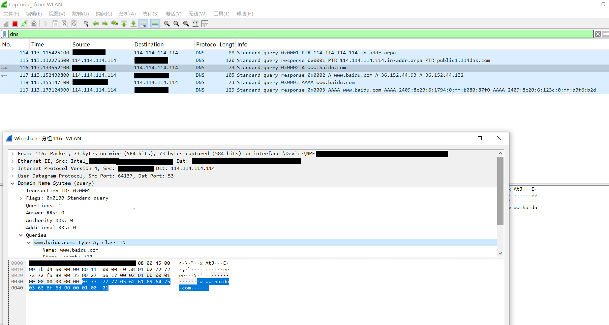
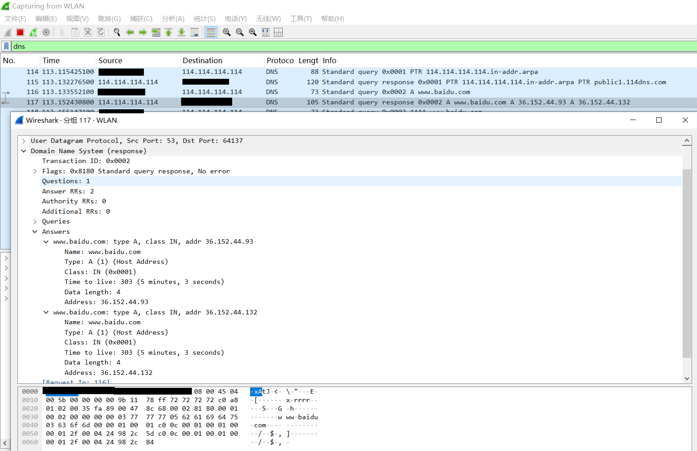
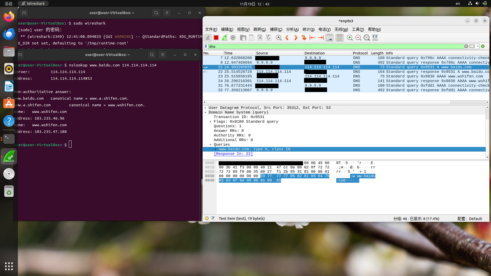

# 13-DNS解析双端抓包记录

## 🎯 总体解释
本实验旨在通过 Wireshark 在物理机（Win10，IPv4）和虚拟机（Ubuntu，IPv6）双端进行 DNS 抓包。通过对比，理解 DNS 的请求与应答过程，掌握过滤器语法，并验证不同查询类型（A与AAAA）的差异。

## 🔧 实验环境排错记录
🔧 硬核解析：在 Ubuntu 虚拟机中执行 `sudo apt install wireshark -y` 时，报错显示“暂时不能解析域名”。原因是初始的“桥接网卡”模式受限于宿主机防火墙或局域网分配机制，无法连通外网。
💬 大白话翻译：虚拟机原本想直接连你家路由器，但大门被防火墙锁了，发不出求救信号。
🔧 硬核解析：将 VirtualBox 网络模式从“桥接”改为“NAT 模式”后，网络恢复正常，成功执行 `apt update` 并安装 Wireshark。
💬 大白话翻译：换了 NAT 模式后，宿主机给虚拟机派了个专属管家，直接把主机的网络共享给它，虚拟机瞬间连上了网，顺利把软件买回了家。
🔧 硬核解析：安装过程中，终端弹出 `Should non-superusers be able to capture packets?` 界面，选择 `<Yes>`。
💬 大白话翻译：系统问“以后能不能给普通用户发抓包通行证？”咱们选了“能”，免得以后每次都要找管理员要钥匙。

---

## 🔧 物理机（Win10）实操解析

### 1. 请求包 (Query)
🔧 硬核解析：抓到了向 `114.114.114.114` 发起的 DNS 查询包。`Transaction ID` 为 `0x0002`，查询类型为 `A`（IPv4地址），查询域名为 `www.baidu.com`。
💬 大白话翻译：我的电脑给 DNS 服务器寄了个单号为 `0002` 的快递，问百度家的 IPv4 地址是多少。

### 2. 应答包 (Response)
🔧 硬核解析：收到 DNS 应答包。`Transaction ID` 同为 `0x0002`。`Answers` 字段直接返回了 2 个 `A` 记录（IP 地址），分别是 `36.152.44.93` 和 `36.152.44.132`，TTL 为 303 秒。
💬 大白话翻译：服务器签收了 `0002` 号快递，一步到位，直接回信说百度家有两个门牌号，你可以缓存 303 秒。

---

## 🔧 虚拟机（Ubuntu）实操解析

### 1. 请求包 (Query)
🔧 硬核解析：Ubuntu 使用 NAT 模式向 `114.114.114.114` 发起查询。`Transaction ID` 为 `0x9531`，查询类型为 `A`，查询域名为 `www.baidu.com`。
💬 大白话翻译：虚拟机发快递（单号 `9531`），问电话局：“这域名有没有分配 IPv4 地址？”

### 2. 应答包 (Response - 揭示 CNAME 别名)
🔧 硬核解析：收到应答包，`Transaction ID` 同为 `0x9531`。这里的 `Answers` 字段非常有趣，它没有直接给 IP，而是先返回了两条 `CNAME`（别名）记录：`www.baidu.com` 指向 `www.a.shifen.com`，再指向 `www.wshifen.com`。最后才返回了 `www.wshifen.com` 的 A 记录（IP: 103.235.46.96 等）。
💬 大白话翻译：电话局回信：“你找百度啊？他搬去‘百度分站’了，你再去‘百度华南站’找找，他的新门牌号是 103.235.46.96。”这就是 CDN 节点分配。

---

## 🎯 双端对比与总结
🔧 硬核解析：Win10 查询 `A` 记录（IPv4）成功返回 IP；Ubuntu 查询查询 `A` 记录（IPv4）成功返回 IP。但在实测中发现`AAAA` 记录（IPv6）返回为空，原因是百度未配备IPv6地址。两者都遵循一问一答的 `Transaction ID` 匹配机制。
💬 大白话翻译：不管是物理机还是虚拟机，寄信和回信的规矩是一样的。只不过问的内容不同，得到的答案就不同。