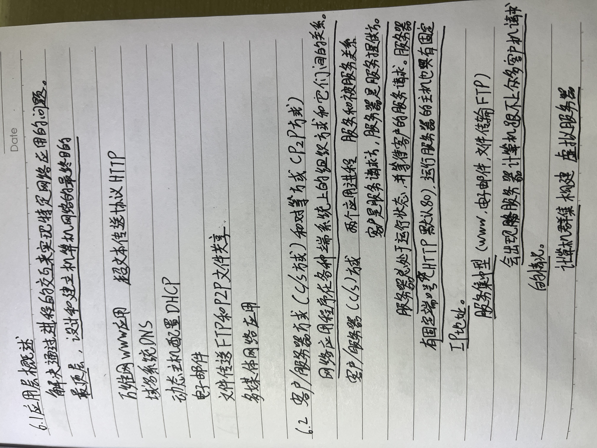
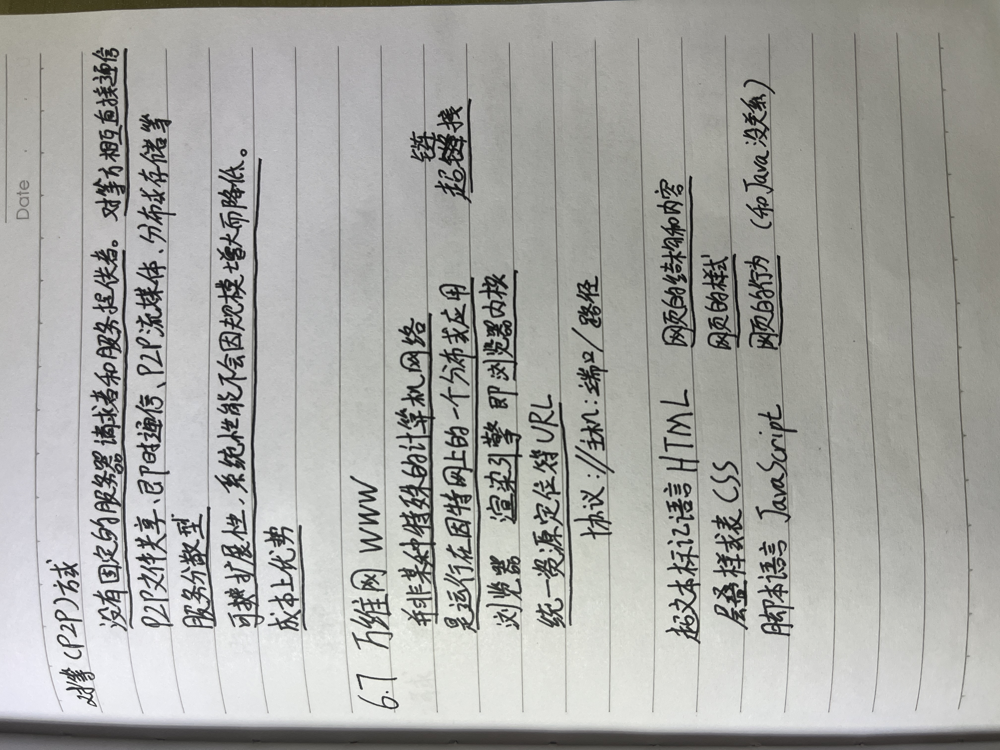
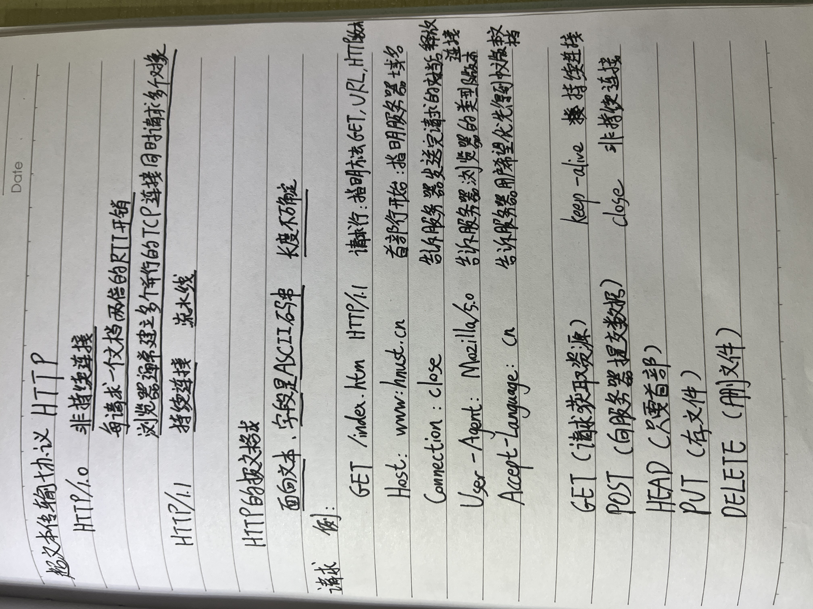
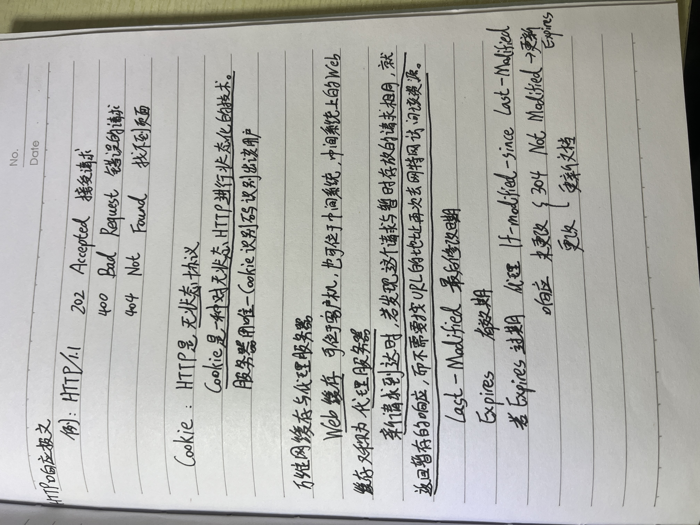

# 14-应用层 WWW 与 HTTP 理论笔记

## 一、 总体解释 🎯

应用层是计算机网络体系结构的最顶层，它的核心目的是解决通过应用进程的交互来实现特定网络应用的问题。本笔记主要涵盖应用层的体系结构（C/S与P2P）、万维网（WWW）的核心组件，以及支撑万维网运行的超文本传输协议（HTTP）的详细报文与缓存机制。

## 二、 硬核解析 🔧

### 1. 应用层概述

*   **硬核解析**：应用层负责解决通过进程的交互来实现特定网络应用的问题，是设计和建立计算机网络的最终目的。
*   **💬 大白话翻译**：前面学的物理层、网络层都是修路和建快递站的，应用层就是最终在快递站里收发包裹的“具体业务”（比如刷网页、发邮件）。

### 2. 网络应用的两种方式

*   **硬核解析**：
  *   **C/S 方式（客户/服务器）**：两个应用进程是服务和被服务的关系。客户是请求方，服务器是提供方。服务器始终运行，有固定端口（如 HTTP 默认 80）和固定 IP。属于服务集中型，请求多了会跟不上（可通过集群、虚拟服务器解决）。
  *   **P2P 方式（对等）**：没有固定的服务器请求者和提供者，对等方直接通信（如 P2P 文件共享、即时通信）。属于服务分散型，可扩展性极强，系统性能不因规模增大而降低，具有成本优势。
*   **💬 大白话翻译**：
  *   C/S 就像去**饭店吃饭**：饭店（服务器）固定开在那，厨师和服务员（固定端口）随时待命，你（客户）去点菜。
  *   P2P 就像**微信群聊**：没有谁是固定的群主来提供服务，大家都是对等的，互相直接发消息。加多少人，系统都不会卡死。

**图 14-1**：应用层概述与C/S 方式（客户/服务器）

### 3. 万维网 WWW

*   **硬核解析**：
  *   WWW 并非某种特殊的计算机网络，而是运行在因特网上的一个分布式应用，依靠超链接（超文本）将信息连接。
  *   **浏览器**：核心是渲染引擎（浏览器内核）。
  *   **URL（统一资源定位符）**：格式为 `协议://主机:端口/路径`。
  *   **前端三大件**：HTML（超文本标记语言，管网页结构和内容）；CSS（层叠样式表，管网页样式）；JavaScript（脚本语言，管网页行为，**与 Java 无任何关系**）。
*   **💬 大白话翻译**：
  *   WWW 就是你在浏览器里冲浪看到的网页。URL 就是网页的“快递地址”。
  *   做网页就像搭一个人：HTML 是**骨架（结构）**，CSS 是**衣服（样式）**，JavaScript 是**动作（行为）**。

**图 14-2**：P2P 方式（对等）与万维网 WWW概念

### 4. HTTP 协议版本与连接

*   **硬核解析**：
  *   **HTTP/1.0（非持续连接）**：每请求一个文档需两倍 RTT（往返时间）开销。浏览器通常建立多个并行的 TCP 连接同时请求多个对象。
  *   **HTTP/1.1（持续连接 / 流水线）**：服务器发送响应后保持连接，支持流水线作业。
  *   **连接状态字段**：请求头中 `Connection: keep-alive` 表示保持连接，`Connection: close` 表示非持续连接。
*   **💬 大白话翻译**：
  *   HTTP/1.0 就像你去小卖部买水，每次买完老板就关门（断开连接），下次买还得重新敲门（两次 RTT）。
  *   HTTP/1.1 就是老板一直开着门（keep-alive），你买完水接着买零食，不用重复敲门，效率极高。

### 5. HTTP 报文格式与请求方法

*   **硬核解析**：
  *   **报文格式**：HTTP 报文面向文本，每个字段都是 ASCII 码串，长度不确定。
  *   **请求报文结构**：请求行（方法 URL HTTP版本） + 首部行 + 实体主体（GET不用）。
  *   **首部行常见字段**：
    *   `Host`：指明服务器域名。
    *   `Connection`：连接状态。
    *   `User-Agent`：告诉服务器浏览器的类型版本。
    *   `Accept-Language`：告诉服务器希望优先得到中文版文档。
  *   **请求方法**：GET（请求获取资源）、POST（向服务器提交数据）、HEAD（只要首部）、PUT（存文件）、DELETE（删文件）。
*   **💬 大白话翻译**：
  *   请求报文就是一张“点菜单”。请求行是“我要点菜（GET）”，首部行是“我不吃辣（Accept）”、“我用的是苹果手机（User-Agent）”。
  *   GET 就是“给我看看”，POST 就是“我填好表交给你”。

**图 14-3**：HTTP 协议版本与请求报文

### 6. HTTP 响应报文与状态码

*   **硬核解析**：
  *   响应报文状态码用于标识服务器处理结果。
  *   `202 Accepted`：接受请求。
  *   `400 Bad Request`：错误的请求（客户端问题）。
  *   `404 Not Found`：找不到页面。
  *   （补充面试重点：`200 OK` 成功；`301/302` 重定向；`403 Forbidden` 拒绝访问；`500 Internal Server Error` 服务器内部错误）。
*   **💬 大白话翻译**：
  *   状态码就是服务器的“表情包”。202 是“收到了”，404 是“你要的东西不在我这”，500 是“我服务器自己崩了”。

### 7. Cookie 技术

*   **硬核解析**：HTTP 是**无状态协议**（不记忆之前的请求）。Cookie 是一种对无状态 HTTP 进行状态化的技术。服务器通过唯一的 Cookie 识别码识别出该用户。
*   **💬 大白话翻译**：HTTP 是金鱼，只有 7 秒记忆，你刚才聊了啥它转眼就忘（无状态）。Cookie 就是服务器给你发的一张**专属 VIP 卡**，你下次来一亮卡，服务器就知道“哦，是老客户”。

### 8. 万维网缓存与代理服务器

*   **硬核解析**：
  *   Web 缓存可位于客户机，也可位于中间系统。中间系统上的 Web 缓存称为**代理服务器**。
  *   新请求到达时，若发现暂存的请求相同，直接返回暂存响应（缓存命中），不需再次访问原服务器。
  *   **缓存更新机制**：依靠 `Last-Modified`（最后修改日期）和 `Expires`（有效期）判断。若 `Expires` 过期，代理服务器会向原服务器发送带 `If-modified-since` 的请求。若原服务器判断未更改，返回 `304 Not Modified` 并更新 `Expires`；若更改，则返回新文档。
*   **💬 大白话翻译**：
  *   代理服务器就像你家楼下的**丰巢快递柜**。你（客户机）拿快递不用每次都跑去快递公司（原服务器），直接在柜子（代理）拿。
  *   怎么看柜子里的东西过没过期？看保质期（Expires）。过期了怎么办？问一下客服（原服务器）“东西变了没？（If-modified-since）”。客服说“没变（304）”，你就继续用旧的；客服说“变了”，你就拿个新的。

**图 14-4**：HTTP 回应报文、Cookie、Web缓存、代理服务器

