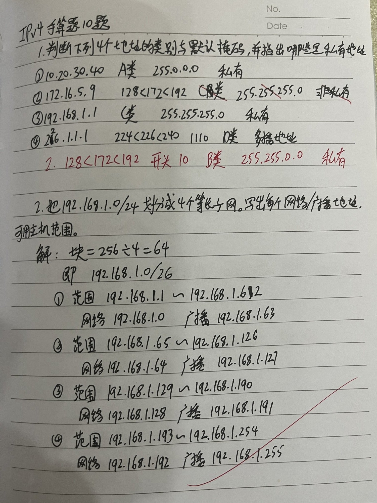
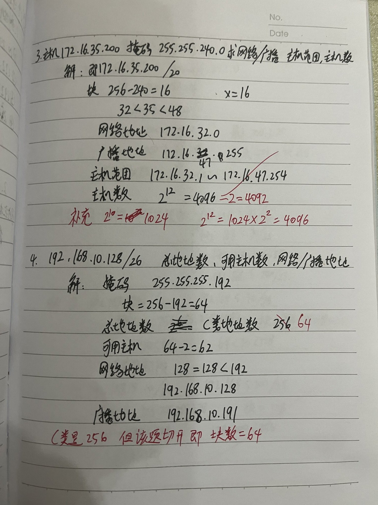
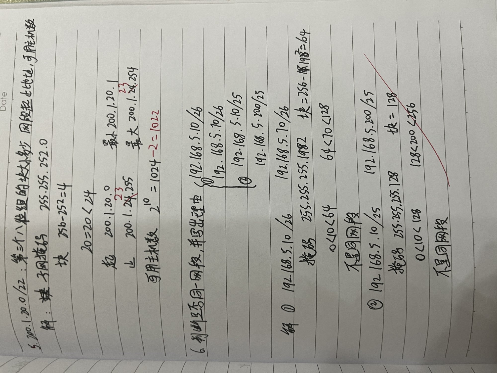
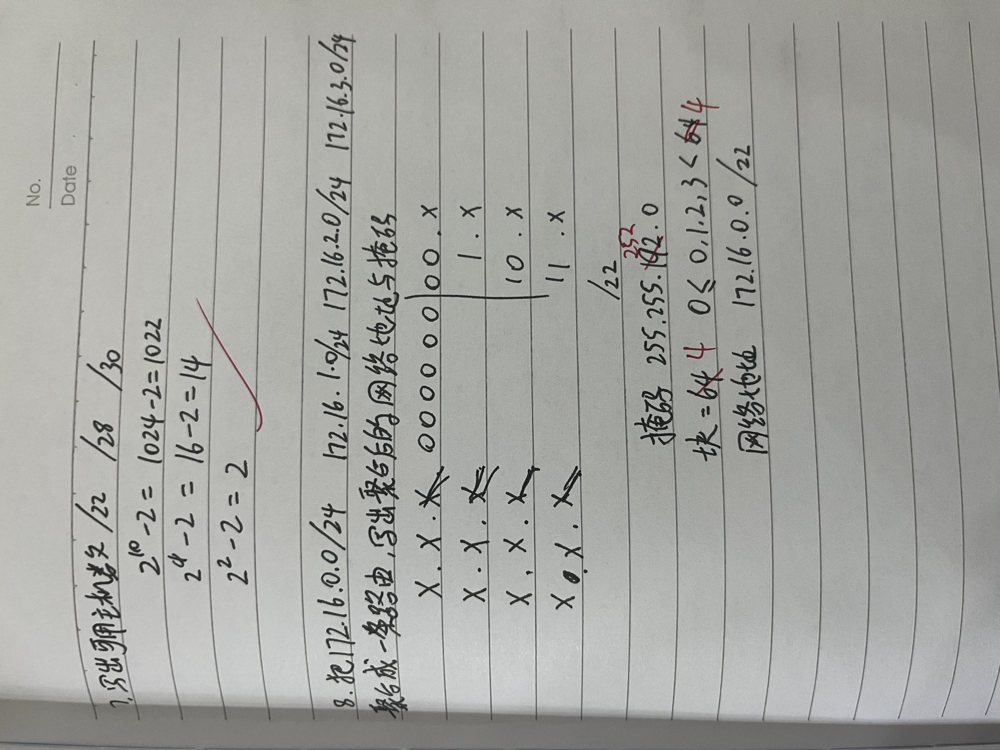
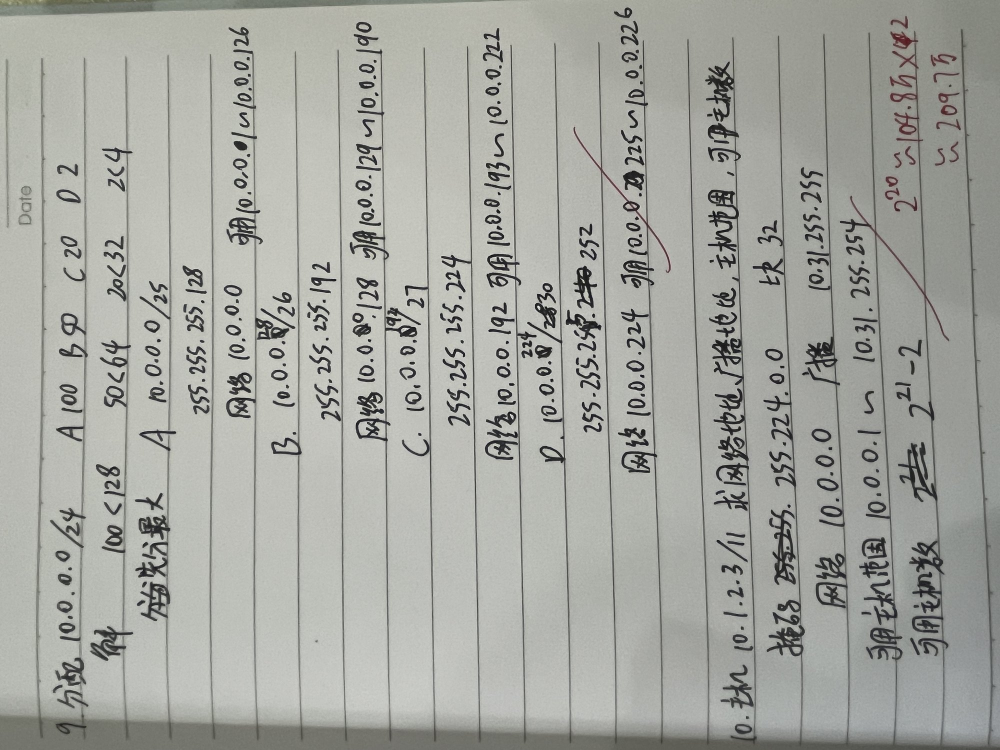

# 15-IPv4 手算子网练习

这周五是第一次完全不看答案、纯纸笔算子网。十道题从地址分类一路做到 VLSM 和 `/11` 的大网段，中间不许用计算器。

五张答题纸贴在下面，红笔是我对完答案之后自己改的。

整体下来思路是通的，但栽在三个地方：**忘了减 2**、**边界差一位**、**掩码表不熟**。下面按题记一遍，错哪了就写哪。

---

## 一、地址分类与默认掩码



四个地址，前三个判断完就顺手把 226 也做了。

十拿九稳，结果 `172.16.5.9` 翻车。我判成了 C 类，还写了「非私有」。

其实 **172 落在 128–191，是 B 类**，默认掩码 `255.255.0.0`。而且 `172.16.0.0/12` 本身就是私有段，所以它是私有地址。

错因就一个：B 类跟 C 类的分界记串了。当场把表补在纸上——

| 类 | 首字节范围 | 默认掩码 |
|---|---|---|
| A | 1 – 126 | 255.0.0.0 |
| B | 128 – 191 | 255.255.0.0 |
| C | 192 – 223 | 255.255.255.0 |
| D | 224 – 239 | 多播，无默认掩码 |
| E | 240 – 255 | 保留 |

私有地址就三段：`10.0.0.0/8`、`172.16.0.0/12`、`192.168.0.0/16`。这里有个容易忽略的边界：**172.16 到 172.31 才算私有，172.32 就不算了**。以前只看过「172.16」这四个字，没注意它还带着范围。

第四题 226 判成 D 类、多播，这个对。D 类没有默认掩码，因为它不分配给普通主机。

---

## 二、/24 等分四个子网

还是第 1 张纸的下半部分，`192.168.1.0/24` 切四块。

块大小 `256 ÷ 4 = 64`，所以是 `/26`。四个子网分别是 `.0`、`.64`、`.128`、`.192` 起头，广播是 `.63`、`.127`、`.191`、`.255`。

这题全对，没什么可说的。用块大小法一路推下来，比背公式省事。

顺带想过一个问题：如果切 8 块呢？**8 = 2³，借 3 位，`/24 + 3 = /27`，块 = 256 − 224 = 32**。掩码法跟块大小法能互相验证，以后做题可以两边对一下。

---

## 三、/20 的大网段



`172.16.35.200`，掩码 `255.255.240.0`。

第三段 240 意味着块大小是 `256 − 240 = 16`，所以整个网段按 16 的倍数切。35 落在 `[32, 48)` 里，网络地址 `172.16.32.0`，广播 `172.16.47.255`，可用范围 `.32.1` 到 `.47.254`。这四步都对。

**但主机数我只写了 `2¹²`。** 主机位是 32 − 20 = 12，总地址数是 4096，可这还没算完——

可用主机数要再减 2：`4096 − 2 = 4094`。

为什么减 2？因为**网络地址和广播地址不能配给主机**，得留出来。这一步我每次都会漏，后面第 5 题又漏了一次。

顺便记住一个心算路径：`2¹⁰ = 1024`，`2¹² = 1024 × 4 = 4096`。知道 1024 那个锚点，往上推很快。

---

## 四、/26 子网的四项数据

`192.168.10.128/26`，掩码 `255.255.255.192`，块 64。

错的只有一项：我把**总地址数写成了 256**。

256 是整个 C 类 `/24` 网段的地址数。题目问的是切出来**这一块**，一块只有 64 个地址。

> 该子网总地址数 = 2^主机位 = 2⁶ = 64
> 可用主机数 = 64 − 2 = 62

其实我自己后面写的 `64 − 2 = 62` 用的就是 64，前后打架了。**以后两个数对不上的时候，以推论链更长的那个为准，回头改前面。**

网络地址那一步我写的是 `128 = 128 < 192`，结果对但写法不规范。更清楚的两句是：

> 128 ÷ 64 = 2 → **能整除** → 128 正好落在块边界上 → 网络地址就是 `.128`

不能整除的时候才需要往下取整到最近的倍数。

广播地址就能用式子验：`网络地址 + 块大小 − 1 = 128 + 64 − 1 = 191`。

---

## 五、块在第三段的那种



`200.1.20.0/22`，掩码 `255.255.252.0`，块 4。这题的块落在**第三个八位组**，不是最后一段。

起止地址我写错了一处：终点写成了 `200.1.24.255`。

错在哪：我写完 `20 = 20 < 24` 之后，**把那个 24 当成终点了**。但 24 是下一块的起点，本块只覆盖 20、21、22、23 这四个数。

> 广播地址第三段 = 网段起始值 + 块 − 1 = 20 + 4 − 1 = **23**

所以正确终点是 `200.1.23.255`，最大可用 `200.1.23.254`。

**块大小是「数几个」，不是「加到几」。** 从 20 开始数 4 个是 20、21、22、23，不是 24。

另一个错：可用主机数又忘了减 2，写成 `2¹⁰ = 1024`。正确是 **1022**。

---

## 六、判断两个地址在不在同一网段

两个小问，都是判断题，不用算网络地址，只看落在第几个块里。

**①** `192.168.5.10/26` 和 `192.168.5.70/26`，块 64。
`.10` 在 `[0, 64)`，`.70` 在 `[64, 128)`——不同块，**不同网段**。

**②** `192.168.5.10/25` 和 `192.168.5.200/25`，块 128。
`.10` 在 `[0, 128)`，`.200` 在 `[128, 256)`——也是**不同网段**。

这题全对。不过写法可以更规范：考试更认「先把两个网络地址算出来再比」，

> `.10` → 10 ÷ 64 = 0 → `192.168.5.0`
> `.70` → 70 ÷ 64 = 1 → `192.168.5.64`
> 网络地址不同 → 不同网段

结论一样，但把网络地址写出来更保险，也不容易在区间边界上出错（第 5 题就是撞在这上面）。

② 这题有个细节：两个地址明明都在同一个 `/24` 里，切成 `/25` 之后就分家了。**「同不同网段」永远是相对掩码说的**，没有绝对答案。

---

## 七、可用主机数速算

`/22`、`/28`、`/30` 三个前缀，全是套公式：

```
/22 → 2¹⁰ − 2 = 1022
/28 → 2⁴ − 2 = 16 − 2 = 14
/30 → 2² − 2 = 4 − 2 = 2
```

这题全对，也是整场唯一一次一个「减 2」都没漏的。说明这一步能做对，只是不熟练。

---

## 八、路由聚合



四个连续的 `/24` 合成一条：`172.16.0.0`、`172.16.1.0`、`172.16.2.0`、`172.16.3.0`。

思路是对的：把第三段写成二进制看公共前缀。

```
0 → 000000 00
1 → 000000 01
2 → 000000 10
3 → 000000 11
```

前 6 位一样，加上前面两个完整的八位组，一共 22 位——所以聚合后是 `/22`。

**但掩码我写成了 `255.255.192.0`，错了。**

`/22` 是 8 + 8 + 6，第三个八位组前 6 位为 1：

```
11111100 = 128+64+32+16+8+4 = 252
```

正确掩码是 `255.255.252.0`。我写的 192 是 `11000000`，对应的是 `/18`。

块大小也跟着错成了 64（用 192 算的），正确是 `256 − 252 = 4`。

这里暴露的问题比答案本身大：**第 5 题我才刚写对过 `255.255.252.0`，这一题又写错。** 说明 `/22 → 252` 并没有变成条件反射，第 5 题那次对，是当场推算出来的，不是记住的。

背一下这张表：

| 前缀 | 最后一段 | 块 |
|---|---|---|
| /20 | 240 | 16 |
| /22 | 252 | 4 |
| /23 | 254 | 2 |
| /26 | 192 | 64 |
| /27 | 224 | 32 |
| /28 | 240 | 16 |
| /29 | 248 | 8 |
| /30 | 252 | 4 |

规律还是那句：**块 = 256 − 该段数值**。反过来知道块也能推掩码。

网络地址 `172.16.0.0/22` 是对的。用正确的块验一遍：起点第三段是 0，必须是块（4）的整数倍，0 满足；覆盖 0、1、2、3 四个，正好。

---

## 九、VLSM 变长子网分配



`10.0.0.0/24` 分给四个部门：A 要 100 台、B 要 50 台、C 要 20 台、D 要 2 台。

先按需求找最小够用的块：`100 < 128`、`50 < 64`、`20 < 32`、`2 < 4`。然后从大到小依次切，避免碎片。

| 部门 | 需求 | 子网 | 掩码 | 可用范围 |
|---|---|---|---|---|
| A | 100 | `10.0.0.0/25` | 255.255.255.128 | .1 – .126 |
| B | 50 | `10.0.0.128/26` | 255.255.255.192 | .129 – .190 |
| C | 20 | `10.0.0.192/27` | 255.255.255.224 | .193 – .222 |
| D | 2 | `10.0.0.224/30` | 255.255.255.252 | .225 – .226 |

分配结果本身是对的：四段互不重叠，都在一个 `/24` 里，也没浪费。

出问题的是 D 的写法。我掩码写成了 `255.255.255.240`，那是 `/28`：

```
/28 → 240 → 块 16 → 可用 14 台
/30 → 252 → 块 4  → 可用 2 台
```

我心里算的是 `/30`（可用范围 `225–226` 就是 `/30` 的），落笔抄成了 `/28`。

还有个小毛病：A、B、C 三行我在前缀那一栏都写成了 `10.0.0.0/xx`，把起始地址写死了。网络地址下面那一行是对的，但前缀这一行应该跟着子网走——B 是 `.128/26`，C 是 `.192/27`。

---

## 十、/11 的大网段

最后一题，`10.1.2.3/11`。

`/11` = 8 + 3，第二个八位组前 3 位为 1，掩码 `255.224.0.0`。

第二个八位组的块大小是 2⁵ = 32。`1 ÷ 32 = 0`，所以网络地址是 `10.0.0.0`；广播到第二个八位组的第 31——`10.31.255.255`。

可用范围 `10.0.0.1` 到 `10.31.255.254`。

主机位 32 − 11 = 21，`2²¹ − 2`。这个数当场没算出来，后来补的：

> `2²⁰ ≈ 104.8 万`，翻倍 `≈ 209.7 万`，减去 2 → **2,097,150**

---

## 小结

十道题做完，算的地方基本都对了——只要公式明确、步骤固定，我就能走对。失分全集中在三个地方，而且反复出现：

**一、忘了减 2。** 第 3、5 题各栽一次。以后每题收尾固定问一句：「这问的是总地址数，还是可用数？」

**二、边界差一位。** 第 5 题把下一块的起点当成终点。记死一句话：**终点 = 起点 + 块 − 1**，块大小是数几个，不是加到几。

**三、掩码表不熟。** 第 8 题写错 `/22` 的掩码，第 9 题写错 D 的掩码。这不是算错，是没背下来——`/20 /22 /23 /26 /27 /28 /29 /30` 这几个必须张口就来。

前两条是习惯问题，固定两个自检动作就能解决；第三条是记忆问题，背下来就行。

下一步：第 1 题②、第 3、4、5、8、9 题各重做一遍（第 2、6、7、10 题不用动）。重做时只验两件事：**这一问的是总地址数还是可用数**、**掩码是不是张口就来**。
