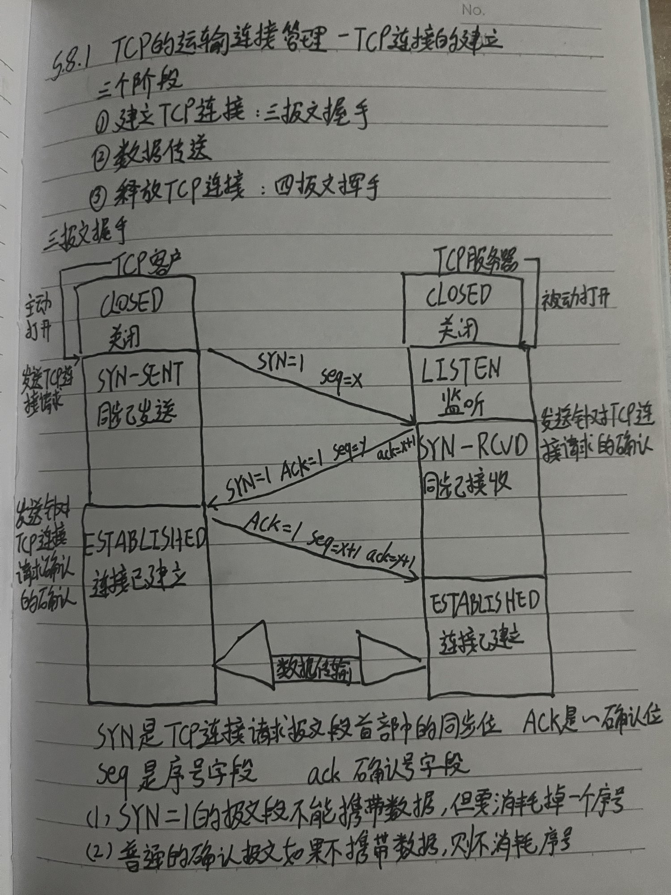
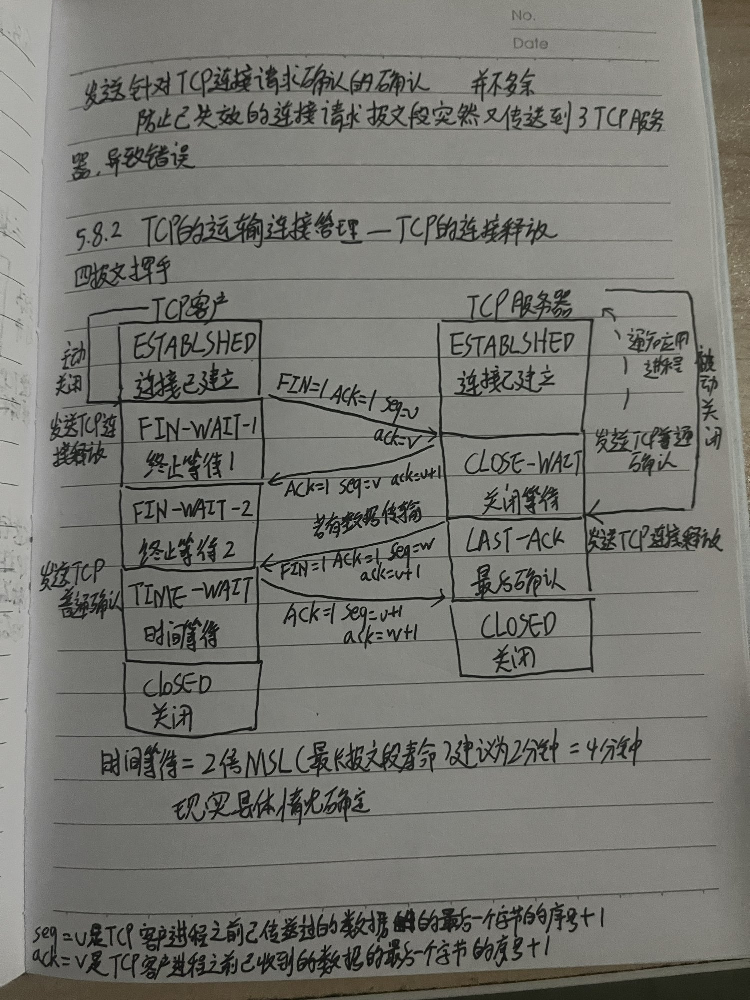
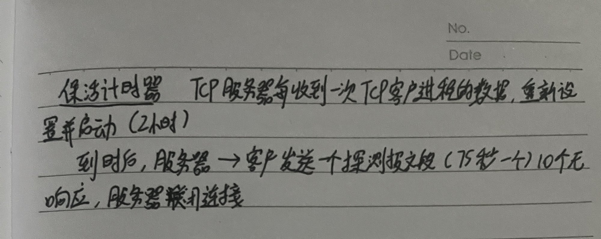
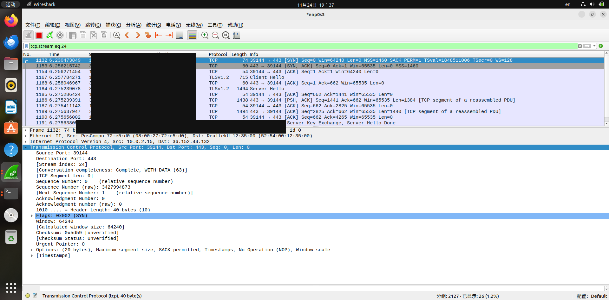
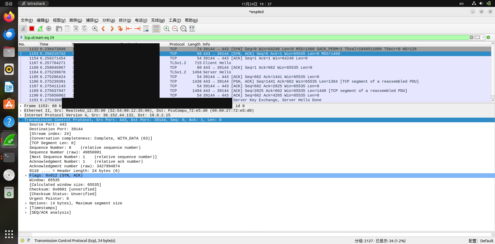
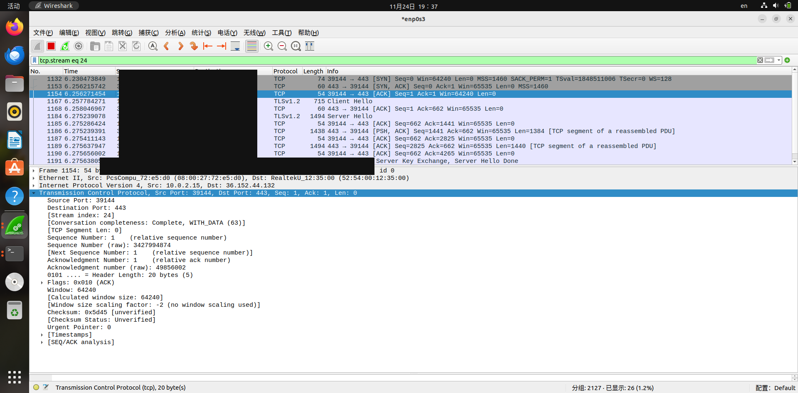

# 16-TCP 三次握手与四次挥手

## 一、先看整体：连接管理分三段

1. 建立连接：三次握手
2. 数据传送
3. 释放连接：四次挥手

画图的时候把两端的**状态**一起标了，光记三个包容易忘掉「谁在什么状态」。

---

## 二、三次握手



客户端：`CLOSED` → `SYN-SENT` → `ESTABLISHED`
服务器：`CLOSED` → `LISTEN` → `SYN-RCVD` → `ESTABLISHED`

| 第几个包 | 方向 | 标志位 | seq / ack | 状态变化 |
|---|---|---|---|---|
| 1 | 客户端 → 服务器 | `SYN=1` | `seq=x` | 客户端 → SYN-SENT |
| 2 | 服务器 → 客户端 | `SYN=1`、`ACK=1` | `seq=y`、`ack=x+1` | 服务器 → SYN-RCVD |
| 3 | 客户端 → 服务器 | `ACK=1` | `seq=x+1`、`ack=y+1` | 双方 → ESTABLISHED |

### 为什么非要第三次，不是两次

第三次那个 ACK **不多余**：它是为了防止「已失效的连接请求报文段」突然又传送到服务器。

假设只有两次：一个早就作废的旧 SYN 迟到，服务器照样回 SYN-ACK、照样进入等待数据的状态，白占一个连接；有了第三次，客户端不认这个旧连接，不会回 ACK，服务器就不会建立连接。

💬 大白话：门铃响了两次，第二次可能是隔壁小孩乱按的；得等屋里人真的应一声「进来」，才算这门开了。

### 两个关于序号的细节

1. `SYN=1` 的报文段**不能携带数据，但要消耗掉一个序号**。
2. 普通的确认报文如果**不携带数据，就不消耗序号**。

💬 大白话：SYN 虽然空着手来，但它在门口报了号，这个号就算用掉了；而普通的点头（ACK）不算号。

---

## 三、四次挥手



客户端：`ESTABLISHED` → `FIN-WAIT-1` → `FIN-WAIT-2` → `TIME-WAIT` → `CLOSED`
服务器：`ESTABLISHED` → `CLOSE-WAIT` → `LAST-ACK` → `CLOSED`

| 第几个包 | 方向 | 标志位 | seq / ack | 状态变化 |
|---|---|---|---|---|
| 1 | 客户端 → 服务器 | `FIN=1`、`ACK=1` | `seq=u`、`ack=v` | 客户端 → FIN-WAIT-1 |
| 2 | 服务器 → 客户端 | `ACK=1` | `seq=v`、`ack=u+1` | 服务器 → CLOSE-WAIT；客户端 → FIN-WAIT-2 |
| 3 | 服务器 → 客户端 | `FIN=1`、`ACK=1` | `seq=w`、`ack=u+1` | 服务器 → LAST-ACK |
| 4 | 客户端 → 服务器 | `ACK=1` | `seq=u+1`、`ack=w+1` | 客户端 → TIME-WAIT；服务器 → CLOSED |

`u` 是客户端之前发送过的最后一个字节的序号 + 1，`v` 是客户端之前收到的最后一个字节的序号 + 1。

### TIME-WAIT 为什么要等 2MSL

`MSL` 是最长报文段寿命，教材建议 2 分钟，所以 `TIME-WAIT` = 2MSL = **4 分钟**（现实里由具体实现定）。

等这两个 MSL 是为了：

1. **保证最后一个 ACK 能到**——如果它丢了，服务器会重发 FIN，客户端还在 TIME-WAIT 里就能再回一次 ACK；要是立刻关掉，服务器会一直收不到确认。
2. **让这条连接里滞留的旧报文在网络里消失**，不跑到下一个新连接里去捣乱。

💬 大白话：挂电话前多拿一会儿听筒，确认对方真的听见「挂了」，也等线路里的回音散干净。

---

## 四、顺带想通：为什么挥手是四次

握手三次、挥手四次，差别在「关闭是全双工的」：

A 说「我不发了」（FIN），B 先回「知道了」（ACK），但 B 手里可能还有数据没发完；等 B 也发完了，再发自己的 FIN，A 再 ACK 一次。两个方向各关一次，所以是四次。

握手能合并成三次，是因为服务器的 SYN 和 ACK 可以塞进同一个报文段里（第二个包）。

---

## 五、保活计时器



TCP 服务器每收到一次客户端数据，就把保活计时器**重置并启动**（2 小时）。两小时没有数据，服务器就给客户端发**探测报文段**，75 秒一个；连续 **10 个**没响应，就认为对端已经没了，关闭连接。

💬 大白话：座位上的人两小时没动静，服务员先敲十次门，一次比一次间隔久，没人应就收桌子。

一句话总结：**握手是把两个方向的「能发」都确认一遍，挥手是把两个方向的「不发」都确认一遍；三次和四次的差别，就在第二个包能不能合并。**

---

## 六、自己抓的一组握手（2026-11-24）

理论看完了，得亲手抓一遍才算。下面三张是我**在虚拟机里**访问 `https://baidu.com` 时抓到的真实报文，过滤器是 `tcp.flags.syn==1`，抓到之后用 `Follow → TCP Stream` 把同一对连接的完整三行调出来。

**抓包环境**：VirtualBox 里的 Ubuntu 22.04，网卡 `enp0s3`（NAT 模式，虚拟机 IP 是 `10.0.2.15`），Wireshark 4.6.9，用 `sudo wireshark` 以管理员权限抓。

> 一个当时的坑：一开始虚拟机走 IPv6 出网，抓到的 SYN 全是黑底重传（对方一次都没回），因为 VirtualBox 的 NAT 只通 IPv4。在 Firefox 里把 `network.dns.disableIPv6` 设成 `true` 之后才抓到正常的握手。







### 三个包的数字

| 序号 | 谁发 | 标志位 | Seq | Ack | 端口 |
|---|---|---|---|---|---|
| 1 | 我的机器 | `0x002 (SYN)` | 0 | 无 | 39144 → 443 |
| 2 | 服务器 | `0x012 (SYN, ACK)` | 0 | 1 | 443 → 39144 |
| 3 | 我的机器 | `0x010 (ACK)` | 1 | 1 | 39144 → 443 |

规律就一句话：**同一个方向的下一个 Seq = 上一个 Seq + 这个包占掉的长度**，而 SYN 和 FIN 各占 1 个序号。所以第三个包的 `Seq=1` 是「第一个包的 Seq 0 加 1」，不是「第二个包的 Ack 加 1」——这两把尺子容易混：

- `Seq` 是我自己这次发到第几个字节（看我这个方向上一包）
- `Ack` 是我收到了对方多少字节（看对方那个包的 Seq）

### 两个容易忽略的细节

**1. 序号是相对的。** 图上 `Sequence Number: 0` 下面还有一行 `Sequence Number (raw): 3427994873`。Wireshark 默认把每条连接的起始序号抹成 0 方便看规律；真实网络里初始序号是随机的，就是为了让人猜不到。

**2. 标志位是十六进制位掩码。** `0x002` 只有 SYN 位，`0x012` 是 SYN + ACK 两位同时置 1，`0x010` 只有 ACK 位。判断「这个包带不带 SYN」「带不带 ACK」，看这个值最快。

### 握手之后紧接着是什么

抓到的不止三个包。紧跟着的几行是：

```
TLSv1.2  Client Hello
TLSv1.2  Server Hello
TLSv1.2  Certificate, Server Key Exchange, Server Hello Done
```

因为访问的是 https，**TCP 建连接（三次握手）全部完成之后，才开始 TLS 握手**。这也是为什么在 Wireshark 里 Follow TCP Stream 出来是乱码——内容被 TLS 加密了，能看懂才是加密出了问题。

💬 大白话：先打电话确认对方接不接（三次握手），再接上传真机聊正事（TLS）。传真机里的字是加密的，中间人只能看到你们在传，看不到传了什么。

