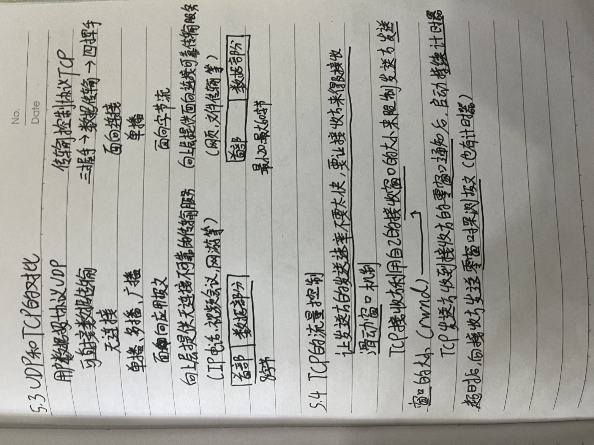
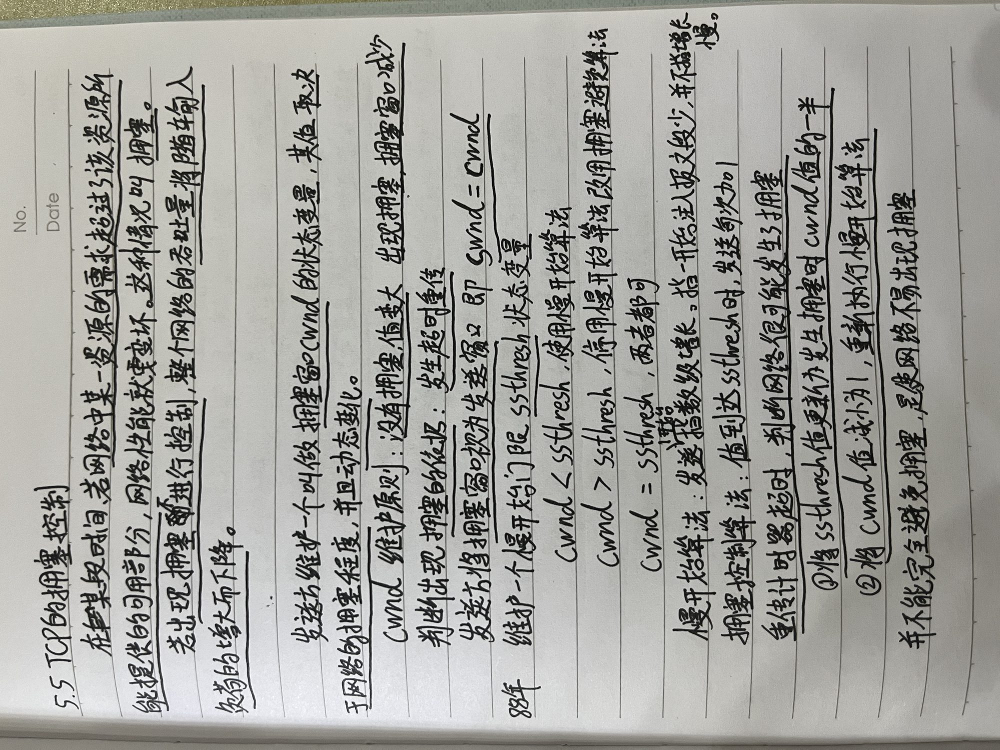
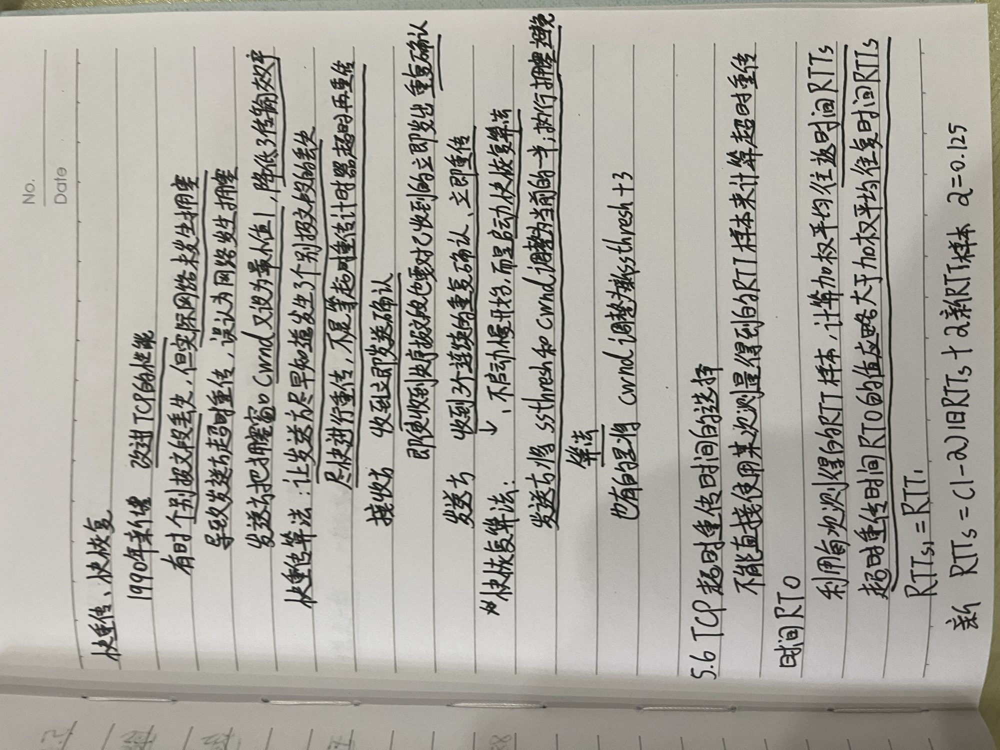
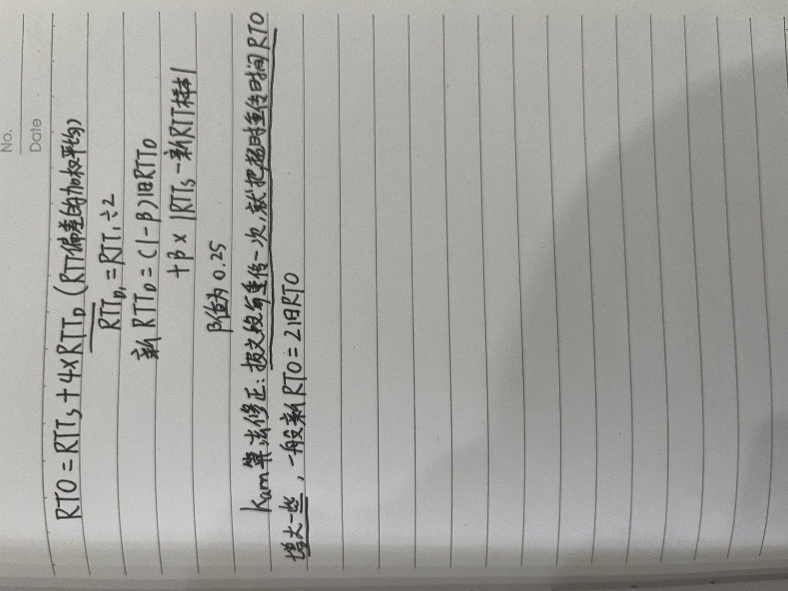

# 19-TCP 的可靠传输机制（流量控制 · 拥塞控制 · 超时重传）

> 第 3 周补记 · 2026-11-26
> 来源：湖科大第 5.4—5.6 讲的手写笔记（四页，见文末）+ 整理补充。
> 原笔记的结构和原话保留；**我改的地方会标「✏️ 修正」**，补的地方标「➕ 补充」。
> 一句话：**TCP 靠三套机制做到"不丢、不乱、不堵"——窗口管收得下，拥塞控制管路上不堵，重传管丢了补。**

---

## 一、先看全景：三套机制各管什么

| 机制 | 管什么 | 关键变量 |
|---|---|---|
| **流量控制** | 接收方收不收得下 | `rwnd`（接收窗口） |
| **拥塞控制** | 网络堵不堵 | `cwnd`、`ssthresh` |
| **超时重传** | 丢了怎么发现、等多久 | `RTO`（超时重传时间） |

**发送窗口 = min(rwnd, cwnd)** —— ➕ 这是三套机制的交汇点，也是原笔记里缺的一环。

💬 大白话：发货量取"对方能收多少"和"路上能过多少"里的**小值**。对方碗小就少发，路上堵也少发。

---

## 二、流量控制（5.4）

### 原笔记

- 让发送方的发送速率不要太快，要让接收方来得及接收
- **滑动窗口机制**
- TCP 接收方利用自己的**接收窗口**大小来限制发送方的发送窗口大小（`rwnd`）
- 发送方收到接收方的**零窗口通知**后，启动**持续计时器**；超时后向接收方发送**零窗口探测报文**（也有计时器）

### ➕ 补充

**① 零窗口探测报文每次带 1 字节**：接收方窗口为 0 时，发送方不能干等，要周期性探测；探测报文带 1 字节数据，逼对方回一个带最新窗口值的 ACK。

**② 窗口是动态的**：每个 ACK 都会带回新的 `rwnd`，所以叫"滑动"窗口。

**③ 糊涂窗口综合症（Silly Window Syndrome）**：接收方每次只腾出几个字节就通知，发送方就发很小的包，效率极低。解决：接收方等窗口够大再通知（或发送方用 Nagle 算法攒一攒）。

💬 大白话：流量控制就是"我碗小，你别一次倒满"；碗空了要主动喊一声（零窗口探测），不然对方以为你永远不吃了。

📎 关联：[18-TCP与UDP对照表](18-TCP与UDP对照表.md) 里的"速度"一行

---

## 三、拥塞控制（5.5）

### 原笔记

- **拥塞**：在某段时间，若对网络中某一资源的需求超过了该资源所能提供的可用部分，网络性能就要变坏
- 若出现拥塞而不进行控制，整个网络的吞吐量将随输入负荷的增大而下降
- 发送方维护一个**拥塞窗口 `cwnd`** 的状态变量，其值取决于网络的拥塞程度，并且动态变化
- `cwnd` 维护原则：**没有拥塞，值变大；出现拥塞，拥塞窗口减少**
- 判断出现拥塞的依据：**发生超时重传**
- 发送方将拥塞窗口视为发送窗口，即 `swnd = cwnd`（✏️ 见下方修正）
- 维护一个**慢开始门限 `ssthresh`** 状态变量
  - `cwnd < ssthresh`：使用**慢开始**算法
  - `cwnd > ssthresh`：停用慢开始，改用**拥塞避免**
  - `cwnd = ssthresh`：两者都可
- **慢开始**：发送指数级增长。一开始注入报文段少，**并不指增长慢**
- **拥塞避免**：值到达 `ssthresh` 时，发送每次加 1
- 重传计时器超时，判断网络很可能发生了拥塞：
  1. 将 `ssthresh` 值更新为发生拥塞时 `cwnd` 值的一半
  2. 将 `cwnd` 值减小为 1，重新执行慢开始
- 并不能完全避免拥塞，是使网络不易出现拥塞

### ✏️ 修正：`swnd = cwnd` 只对了一半

准确写法：

```
发送窗口 swnd = min(接收窗口 rwnd, 拥塞窗口 cwnd)
```

只看 `cwnd` 会忽略接收方的承受能力。**流量控制和拥塞控制同时起作用，取小值。**

### ➕ 补充：两个阶段的具体增长

| 阶段 | 条件 | 增长方式 |
|---|---|---|
| **慢开始** | `cwnd < ssthresh` | 每经过一个 RTT **翻倍**（指数） |
| **拥塞避免** | `cwnd ≥ ssthresh` | 每经过一个 RTT **加 1 个 MSS**（线性，加法增大） |

**超时后的动作**（乘法减小）：

```
ssthresh = cwnd / 2
cwnd = 1        → 重新慢开始
```

💬 大白话：慢开始是"试探着加速"，从 1 个包开始，每轮翻倍；到门槛后改成"每轮只多 1 个"，稳着来。一旦超时，就认为路堵了，把门槛砍一半、速度退回 1，重新试探。

**四个算法合起来叫：慢开始、拥塞避免、快重传、快恢复。** 前两个管"涨"，后两个管"丢包时别退太狠"。

---

## 四、快重传与快恢复（5.5 后半）

### 原笔记

- 1990 年新增，改进 TCP 性能
- 问题：有时个别报文段丢失，但实际网络未发生拥塞，导致发送方走超时重传、误认为网络发生拥塞；发送方把 `cwnd` 又设为最小值 1，降低了传输效率
- **快重传算法**：让发送方尽早知道发生了个别报文段的丢失，尽快重传，不是等超时重传计时器超时再重传
  - 接收方：收到失序报文段也要对已收到的立即发出**重复确认**
  - 发送方：收到 **3 个连续的重复确认**，立即重传
- **快恢复算法**：不启动慢开始，而是启动快恢复
  - 发送方将 `ssthresh` 和 `cwnd` 调整为当前的一半，执行拥塞避免
  - 也有的教材将 `cwnd` 调整为 `ssthresh + 3`

### ✏️ 修正：快恢复的 `cwnd` 写法容易混

标准过程（按发送方收到 3 个重复 ACK 处理）：

```
ssthresh = cwnd / 2          ← 先砍一半
cwnd = ssthresh + 3          ← 快恢复：等于新门槛 + 3
（之后每收到一个重复 ACK，cwnd 加 1；收到新数据的 ACK，cwnd = ssthresh，进入拥塞避免）
```

原笔记写"`ssthresh` 和 `cwnd` 都调整为一半"，**漏了 `+3` 这一步**；"也有的教材 `cwnd = ssthresh + 3`"这句其实才是标准做法。

**为什么 +3**：那 3 个重复 ACK 说明有 3 个报文段已经离开网络、到了接收方，所以可以多发 3 个。

💬 大白话：快重传是"邻居帮你喊了三声'我这儿缺一个'，你就赶紧补发，别等闹钟响"；快恢复是"补发之后别从头慢慢来，退一半再加回 3，接着跑"。

---

## 五、超时重传时间的选择（5.6）

### 原笔记

- 不能直接使用某次测量得到的 RTT 样本来计算超时重传时间 `RTO`
- 利用每次测得的 RTT 样本，计算**加权平均往返时间 `RTTs`**
- `RTO` 的值应**略大于**加权平均往返时间 `RTTs`
- `RTTs1 = RTT1`
- 新 `RTTs = (1 - α) × 旧 RTTs + α × 新 RTT 样本`，**α = 0.125**
- `RTO = RTTs + 4 × RTTd`（`RTTd` 是 RTT 偏差的加权平均）
- `RTTd1 = RTT1 ÷ 2`
- 新 `RTTd = (1 - β) × 旧 RTTd + β × |RTTs - 新 RTT 样本|`，**β = 0.25**
- **Karn 算法修正**：报文段每重传一次，就把超时重传时间 `RTO` 增大一些，一般新 `RTO = 2 × 旧 RTO`

### ✏️ 修正 + ➕ 补充：Karn 算法漏了最关键的一条

Karn 算法有**两条**，原笔记只写了第二条：

1. **凡是被重传过的报文段，都不用它来更新 RTT 样本**（因为收到的 ACK 分不清是对哪一次发送的确认，算出来的 RTT 没有意义）
2. **每重传一次，RTO 就翻倍**（指数退避：`RTO = 2 × 旧 RTO`）

只写"翻倍"会漏掉它为什么叫 Karn 算法——**核心是"重传的样本不能用"**。

### 为什么这些公式不用背

面试只会问三件事，都不需要代公式：

1. **为什么不能直接用一次 RTT 样本？** → 网络抖动，单次样本偏差大，要加权平均
2. **Karn 算法解决什么问题？** → 重传时分不清 ACK 对应哪次发送，所以不采样 + RTO 翻倍
3. **RTO 太小/太大会怎样？** → 太小会误重传，浪费带宽；太大会等太久，恢复慢

💬 大白话：RTO 是"等回信等多久"。等太短，人家还没回你就又发一遍；等太长，丢了半天才补。所以要按历史平均 + 波动来定，而且重传一次就把等待时间翻倍，别死磕。

---

## 六、四页手写笔记原稿









---

## 七、本节要背的（合上笔记自测）

- [ ] 发送窗口 = min(____, ____)
- [ ] 慢开始的增长方式？拥塞避免的增长方式？
- [ ] 超时后 `ssthresh` 和 `cwnd` 各变成多少？
- [ ] 快重传触发条件是什么？（几个重复确认）
- [ ] 快恢复时 `cwnd` 等于多少？
- [ ] Karn 算法的两条内容
- [ ] 为什么 RTO 不能直接用一次 RTT 样本

---

## 八、关联

- 三项对照（连接/可靠/有序/速度/场景）→ [18-TCP与UDP对照表](18-TCP与UDP对照表.md)
- 三次握手、四次挥手的序号规则 → [16-TCP三次握手与四次挥手-理论与实操](16-TCP三次握手与四次挥手-理论与实操.md)
- 抓包里怎么看重传 → [13-Wireshark双端DNS抓包实操](13-Wireshark双端DNS抓包实操.md)（Wireshark 里的 `[TCP Retransmission]` 就是本节讲的机制）
