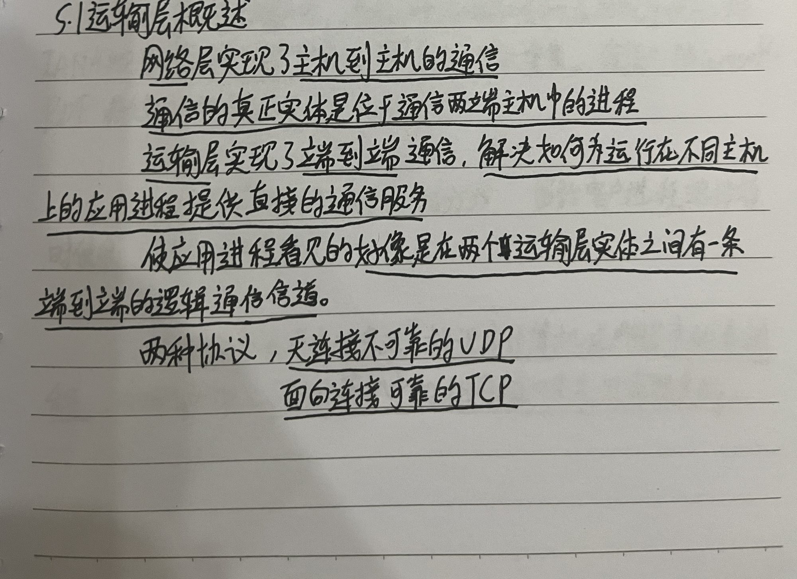
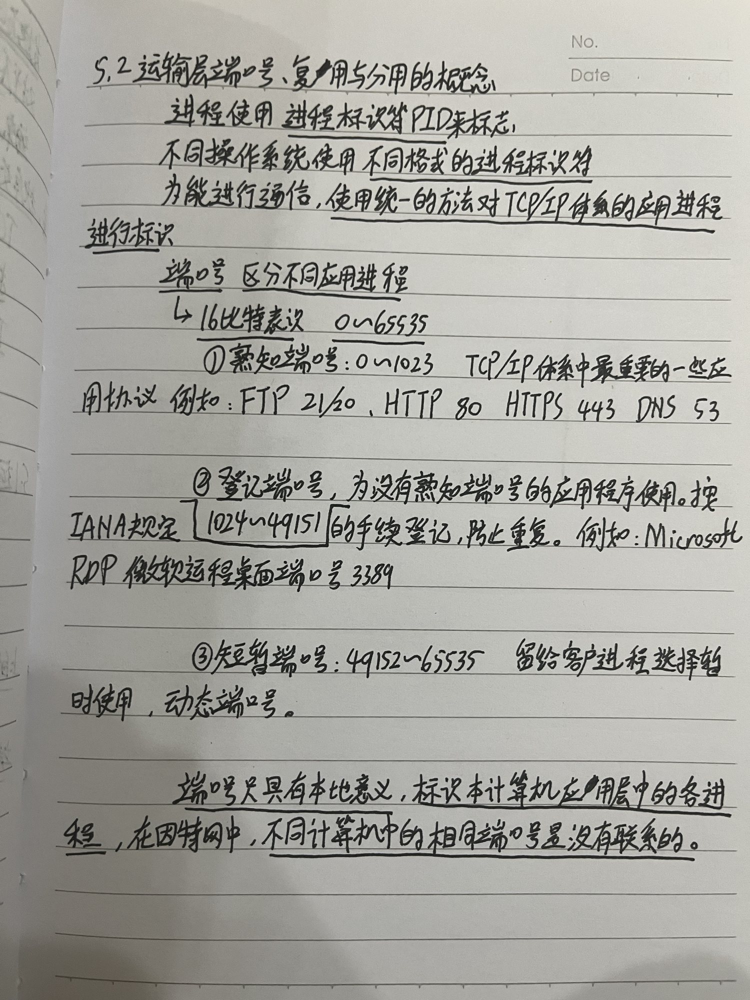
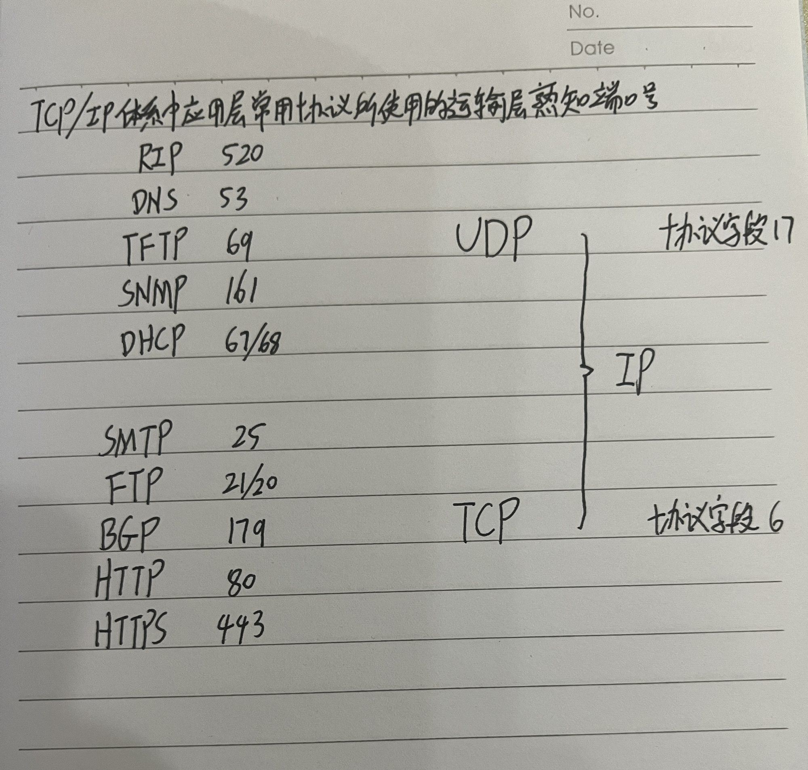
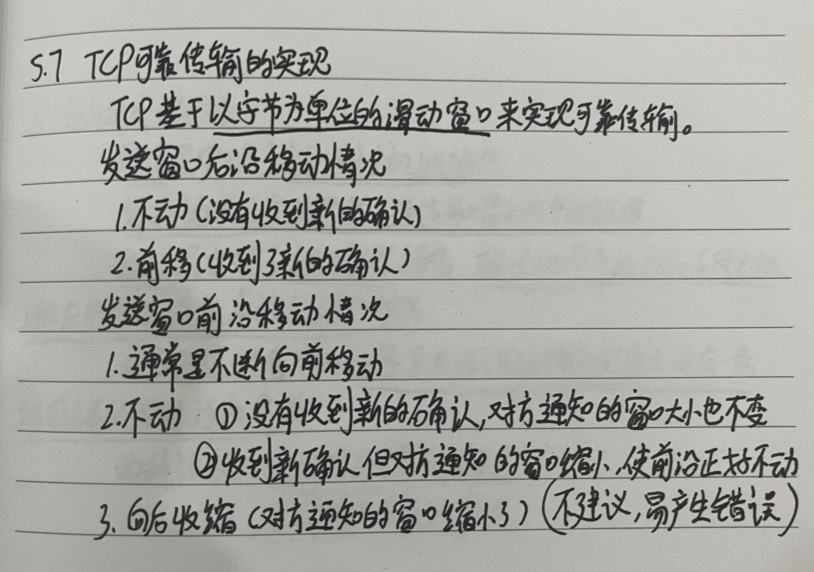
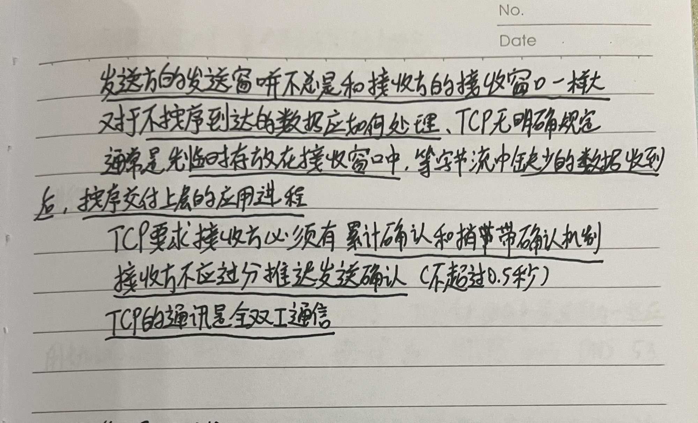

# 20-运输层：端口复用分用与 TCP 可靠传输实现

> 第 3 周补记 · 2026-11-26
> 来源：湖科大 5.1 / 5.2 / 5.7 讲的手写笔记。按 5.1 → 5.2 → 5.7 的顺序整理。
> 一句话：**运输层管两件事——"哪个进程"（端口）和"丢了怎么补"（滑动窗口）。**

---

## 一、运输层概述（5.1）

- 网络层实现了**主机到主机**的通信
- 通信的真正实体是位于通信两端主机中的**进程**
- 运输层实现了**端到端**通信，解决如何为运行在不同主机上的应用进程提供直接的通信服务
- 使应用进程看见的好像是在两个运输层实体之间有一条**端到端的逻辑通信信道**
- 两种协议：**无连接不可靠的 UDP**、**面向连接可靠的 TCP**

**＋补充：**

- **"端到端"和"点到点"的分工**：网络层把包送到"哪台主机"，运输层把它交给"哪个进程"。差一层，差的是**进程**这一级。
- **逻辑通信信道**是"看起来直连"：实际中间经过多少路由器，应用层完全不用管。
- 运输层的两大功能：**复用 / 分用**（靠端口）和**可靠传输 / 流量控制 / 拥塞控制**（TCP 专有）。

💬 大白话：网络层负责把快递送到**小区门口**，运输层负责送到**几零几室**。端口就是门牌号。



---

## 二、端口号、复用与分用（5.2）

- 进程使用**进程标识符 PID** 来标识
- 不同操作系统使用**不同格式**的进程标识符
- 为能进行通信，使用**统一的方法**对 TCP/IP 体系的应用进程进行标识
- **端口号**区分不同应用进程
  - **16 比特**表示，范围 **0～65535**
  - ① **熟知端口号：0～1023**，TCP/IP 体系中最重要的一些应用协议用，例如 FTP 21/20、HTTP 80、HTTPS 443、DNS 53
  - ② **登记端口号：1024～49151**，为没有熟知端口号的应用进程使用，按 IANA 规定的手续登记，防止重复，例如 Microsoft RDP 远程桌面端口号 3389
  - ③ **短暂端口号：49152～65535**，留给客户进程选择暂时使用，也叫动态端口号
- 端口号只具有**本地意义**：标识本计算机应用层中的各进程，在因特网中，不同计算机中的相同端口号是没有联系的

**＋补充：复用与分用（这一节真正的名字）**

- **复用**：发送方**多个应用进程**共用同一个运输层协议、同一个 IP 往外发——靠端口区分是谁发的
- **分用**：接收方收到数据后，**按目的端口**把数据交给对应的应用进程
- **四元组**：`(源 IP, 源端口, 目的 IP, 目的端口)` 唯一确定一条连接。所以**同一台机器能同时开多条连接**，哪怕目的都是 443

**✏️ 一处需要补全**："端口号区分不同应用进程"这句本身没错，但还要再加一句：**同一个进程的多条连接，靠"源端口不同"区分**（比如浏览器同时开十几个标签页）。

💬 大白话：一栋楼只有一个地址（IP），但有很多门牌（端口）。寄件写"某栋 + 门牌"，才是"复用"；收件按门牌分到各家，才是"分用"。



### 常用协议的熟知端口

| 协议 | 端口 | 传输层 | IP 首部协议字段 |
|---|---|---|---|
| RIP | 520 | UDP | 17 |
| DNS | 53 | UDP（区域传送用 TCP） | 17 / 6 |
| TFTP | 69 | UDP | 17 |
| SNMP | 161 | UDP | 17 |
| DHCP | 67（服务器）/ 68（客户端） | UDP | 17 |
| SMTP | 25 | TCP | 6 |
| FTP | 21（控制）/ 20（数据） | TCP | 6 |
| BGP | 179 | TCP | 6 |
| HTTP | 80 | TCP | 6 |
| HTTPS | 443 | TCP | 6 |

**记法（协议字段）**：

```
6  = TCP
17 = UDP
```

**没有逻辑，就是规定。** 记住这两个数字即可，不用推导。

**＋补充：必须背的 7 个端口**

| 协议 | 端口 | 干什么 |
|---|---|---|
| **SSH** | 22 | 远程登录服务器 |
| **SMTP** | 25 | 发邮件 |
| **DNS** | 53 | 域名解析 |
| **HTTP** | 80 | 网页 |
| **HTTPS** | 443 | 加密网页 |
| **RDP** | 3389 | Windows 远程桌面 |
| **SMB** | 445 | Windows 共享文件 |

**这 7 个是日常排查看得见的**（登录、邮件、网页、远程桌面、共享），要条件反射。

其余协议（FTP 21/20、DHCP 67/68、TFTP 69、SNMP 161、BGP 179、RIP 520）**用到再查**，不背。


---

## 三、TCP 可靠传输的实现（5.7）

- TCP 基于**以字节为单位**的滑动窗口来实现可靠传输
- **发送窗口后沿**移动情况
  1. **不动**：没有收到新的确认
  2. **前移**：收到了新的确认
- **发送窗口前沿**移动情况
  1. **通常不断向前移动**
  2. **不动**：
     - ① 没有收到新的确认，对方通知的窗口大小也不变
     - ② 收到新确认，但对方通知的窗口缩小，使前沿正好不动
  3. **向后收缩**：对方通知的窗口缩小了（**不建议，易产生错误**）
- 发送方的发送窗口**并不总是**和接收方的接收窗口一样大
- 对于**不按序到达**的数据应如何处理，TCP 无明确规定；通常是先**临时存放在接收窗口**中，等字节流中缺少的数据收到后，**按序交付**上层的应用进程
- TCP 要求接收方必须有**累计确认**和**捎带确认**机制
- 接收方不应过分推迟发送确认（**不超过 0.5 秒**）
- TCP 的通讯是**全双工**通信

**✏️ 修正一处**：

> "TCP 要求接收方必须有**累计确认**和**捎带确认**机制"

- **累计确认**是 TCP 的基本机制（收到 101 号，就说明 100 及以前全收到了）；
- **捎带确认（piggyback）** 是"**可以**这样做"，不是"必须有"——它指接收方自己有数据要发时，把确认搭在数据帧上一起发；没有数据要发时，就单独发确认（或按 0.5 秒推迟）。

**＋补充：**

- **窗口为什么以字节为单位**：TCP 是字节流，序号也是按字节编的（不是按报文段），所以窗口滑动的粒度是"字节"。
- **后沿为什么不能后退**：已经确认过的字节不能再"收回来"，否则接收方会重复交付。
- **前沿收缩为什么危险**：发送方可能已经按旧窗口发出去了，收回来会造成乱序与丢包，所以教材明确"不建议"。
- **0.5 秒**是"推迟确认"的上限——既想攒一攒再确认（省带宽），又不能让发送方等太久（误判定超时）。

💬 大白话：把发送窗口想成一条**传送带**。后沿是"已经交货、不再管"的那一端，只能往前；前沿是"还能往上放货"的那一端，可以往前，也可以暂时不动，但**绝不能往回缩**——货都已经放上去了，往回缩就是耍赖。





---

## 四、关联

- 三项对照（连接/可靠/有序/速度/场景）→ [18-TCP与UDP对照表](18-TCP与UDP对照表.md)
- 流量控制、拥塞控制、快重传、RTO → [19-TCP的可靠传输机制](19-TCP的可靠传输机制.md)
- 三次握手、四次挥手的序号规则 → [16-TCP三次握手与四次挥手-理论与实操](16-TCP三次握手与四次挥手-理论与实操.md)
- 抓包里怎么看端口和窗口 → [13-Wireshark双端DNS抓包实操](13-Wireshark双端DNS抓包实操.md)
