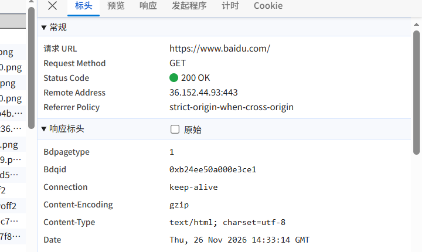
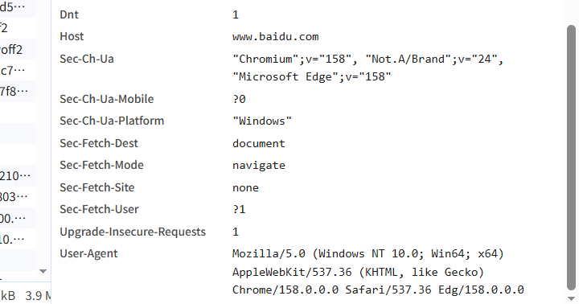
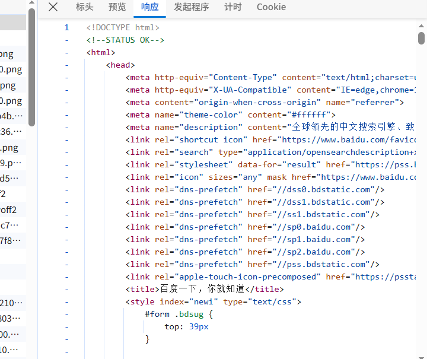

# 21-HTTP 请求结构抄录（实抓）

## 一、请求行（General）

| 项 | 值 |
|---|---|
| 请求 URL | `https://www.baidu.com/` |
| 请求方法 | `GET` |
| 状态代码 | `200 OK` |
| 远程地址 | `36.152.44.93:443` |
| Referrer Policy | `strict-origin-when-cross-origin` |

💬 一行请求 = 方法 + 路径 + 版本；这里是 `GET / HTTP/1.1`（HTTPS 下 F12 不直接显示版本，但默认 HTTP/1.1 或 HTTP/2）。



---

## 二、请求标头（浏览器 → 服务器）

| 头 | 值（截断） | 在说什么 |
|---|---|---|
| `Host` | `www.baidu.com` | **找哪个站点**（一个 IP 可能挂很多站，靠它区分） |
| `User-Agent` | `Mozilla/5.0 (Windows NT 10.0; Win64; x64) … Chrome/158.0.0.0 Safari/537.36 Edg/158.0.0.0` | 我是谁：Win10 + Edge 158 + Chromium 内核 |
| `Accept` | `text/html, application/xhtml+xml, …` | 我能收 HTML，也收 XHTML |
| `Accept-Encoding` | `gzip, deflate, br, zstd` | 这四种压缩我都能解 |
| `Accept-Language` | `zh-CN,zh;q=0.9,en;q=0.8,en-GB;q=0.7,en-US;q=0.6` | 我要中文，英文备选（q 是权重） |
| `Cache-Control` | `max-age=0` | 别用缓存，给我最新的 |
| `Connection` | `keep-alive` | 这条连接留着别关，后面还要用 |
| `Upgrade-Insecure-Requests` | `1` | 如果站里有 http 资源，帮我升级成 https |
| `Sec-Ch-Ua` | `"Chromium";v="158", "Not.A/Brand";v="24", "Microsoft Edge";v="158"` | 新式浏览器标识（替代部分 UA 功能） |
| `Sec-Ch-Ua-Mobile` | `?0` | 不是手机 |
| `Sec-Ch-Ua-Platform` | `"Windows"` | 系统是 Windows |
| `Sec-Fetch-Dest` | `document` | 我要的是页面本身 |
| `Sec-Fetch-Mode` | `navigate` | 这是一次页面跳转 |
| `Sec-Fetch-Site` | `none` | 我是直接打开，不是从别的站跳来的 |
| `Sec-Fetch-User` | `?1` | 是用户主动触发的 |
| `Cookie` | `BIDUPSID=…; PSTM=…; BAIDUID=…; BD_HOME=1; H_PS_PSSID=…` | **上次服务器给我的身份，这次带回来** |

💬 记法：请求头分三类——**我是谁**（Host / User-Agent）、**我要什么**（Accept / Accept-Language / Cache-Control）、**带什么凭证**（Cookie）。



---

## 三、响应标头（服务器 → 浏览器）

| 头 | 值 | 在说什么 |
|---|---|---|
| `Content-Type` | `text/html; charset=utf-8` | 这是 HTML，用 UTF-8 编码 |
| `Content-Encoding` | `gzip` | **内容是压缩过的，先解压再显示** |
| `Connection` | `keep-alive` | 连接保持 |
| `Date` | `Thu, 26 Nov 2026 14:33:14 GMT` | 服务器时间（GMT，**注意不是本地时间**） |
| `Server` | `BWS/1.1` | 服务器软件是百度自己的 BWS |
| `Bdpagetype` | `1` | 百度自定义头：页面类型 |
| `Bdqid` | `0xb24ee50a000e3ce1` | 百度自定义头：请求追踪 ID |
| `Set-Cookie` | `H_PS_PSSID=…; expires=…; domain=.baidu.com; path=/` | **下发 Cookie，浏览器下次带回来** |
| `Set-Cookie` | `BDSVRTM=4; path=/` | 同上，第二条 Cookie |

💬 记法：响应头看三件事——**是什么格式**（Content-Type）、**怎么编码的**（Content-Encoding）、**给我什么凭证**（Set-Cookie）。

---

## 四、响应体（前 10 行）

```html
<!DOCTYPE html>
<!--STATUS OK-->
<html>
<head>
<meta http-equiv="Content-Type" content="text/html;charset=utf-8">
<meta http-equiv="X-UA-Compatible" content="IE=edge,chrome=1">
<meta content="origin-when-cross-origin" name="referrer">
<meta name="theme-color" content="#ffffff">
<meta name="description" content="全球领先的中文搜索引擎…">
<link rel="shortcut icon" href="https://www.baidu.com/favicon.ico">
<link rel="search" type="application/opensearchdescription+xml" …>
```

**这里面能看到的**：

- `<!DOCTYPE html>` 声明是 HTML5
- `<meta charset>` 决定中文不乱码（对不上就变乱码）
- `<title>百度一下，你就知道</title>` 是标签页上那行字
- `<!--STATUS OK-->` 是百度自己的注释（传统，不是标准）



---

## 五、五个发现

**① 一个 IP 挂一个站，靠 Host 区分**

`Remote Address` 是 `36.152.44.93:443`，但请求头里 `Host: www.baidu.com`——**同一个 IP 上可能有好几个站点，靠 Host 头告诉服务器“我要哪个”。**

**② 服务器先压缩，浏览器再解压**

`Accept-Encoding: gzip, deflate, br, zstd`（我能解四种）↔ `Content-Encoding: gzip`（我用了 gzip）。**这一对是商量出来的，不是硬编的。**

**③ Cookie 是“来回”的**

响应头 `Set-Cookie` 下发 → 下次请求的 `Cookie` 带回来。**这就是“无状态的 HTTP 怎么记住你”。**

**④ `Connection: keep-alive` 就是持久连接**

不用每个请求都重新握手，连接复用——**这就是 5.7 里“全双工 + 持久”的现实版。**

**⑤ `Sec-Fetch-*` 这组头是浏览器加的，不是网站**

`Sec-Fetch-Site: none` 表示“直接输入网址打开的”。**服务器靠它判断请求来源，防 CSRF 的一种手段。**

---

## 六、关联

- HTTP 理论（请求四部分、方法、状态码）→ [14-应用层WWW与HTTP理论笔记](14-应用层WWW与HTTP理论笔记.md)
- 端口与四元组 → [20-运输层：端口复用分用与TCP可靠传输实现](20-运输层：端口复用分用与TCP可靠传输实现.md)
- 抓包看握手（F12 看不到的那部分）→ [13-Wireshark双端DNS抓包实操](13-Wireshark双端DNS抓包实操.md)
- 状态码速查 → [22-状态码对照表](22-状态码对照表.md)（下一步就写它）

---

## 总结

- 一次 HTTP 请求由请求行、请求头、空行、请求体组成；响应由状态行、响应头、空行、响应体组成。
- 一个 IP 挂多个站，靠 `Host` 区分；压缩靠 `Accept-Encoding` 与 `Content-Encoding` 协商；Cookie 由 `Set-Cookie` 下发、下次请求带回。
- 抓取时间：2026-11-26；设备：Windows 10 + Edge 158。
