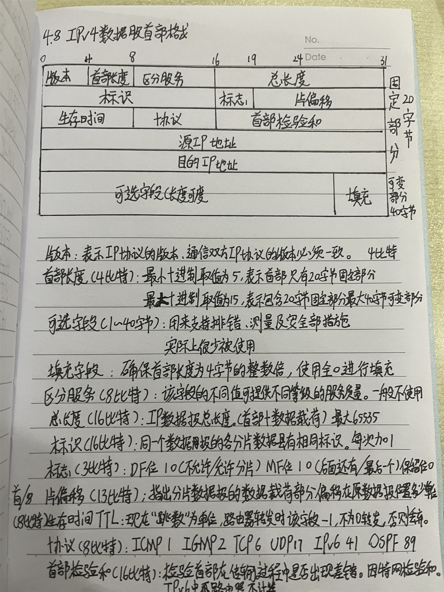

# 22-IPv4 数据报首部格式

## 一、首部长什么样（一行 32 位，共 5 行 = 20 字节）

| 行 | 0 — 3 | 4 — 7 | 8 — 15 | 16 — 31 |
|---|---|---|---|---|
| 第 1 行 | 版本（4 位） | 首部长度（4 位） | 区分服务（8 位） | 总长度（16 位） |
| 第 2 行 | 标识（16 位） | | 标志（3 位） | 片偏移（13 位） |
| 第 3 行 | 生存时间 TTL（8 位） | 协议（8 位） | | 首部检验和（16 位） |
| 第 4 行 | 源 IP 地址（32 位） | | | |
| 第 5 行 | 目的 IP 地址（32 位） | | | |
| 可选 | 可选字段（0—40 字节） | | | 填充 |

**固定部分 20 字节，可变部分最多 40 字节。**



---

## 二、每个字段在管什么

| 字段 | 位数 | 说明 |
|---|---|---|
| **版本** | 4 | IP 协议版本，通信双方必须一致（IPv4 = 4） |
| **首部长度** | 4 | **单位 4 字节**。最小 5 → 20 字节；最大 15 → 60 字节（20 固定 + 最多 40 可变） |
| **区分服务** | 8 | 提供不同等级的服务质量（QoS），一般不用 |
| **总长度** | 16 | 首部 + 数据的总字节数，**最大 65535** |
| **标识** | 16 | 同一个数据报的各分片用**相同标识**；每发一个数据报加 1 |
| **标志** | 3 | DF：1 = 不允许分片，0 = 允许；MF：1 = 后面还有分片，0 = 最后一个；还有 1 位保留 |
| **片偏移** | 13 | 分片的数据部分在原数据报中的位置，**单位 8 字节** |
| **生存时间 TTL** | 8 | 每经过一个路由器减 1；减到 0 就丢弃并发 ICMP 超时 |
| **协议** | 8 | 数据部分交给谁：ICMP 1 / IGMP 2 / TCP 6 / UDP 17 / IPv6 41 / OSPF 89 |
| **首部检验和** | 16 | 只检验首部，不检验数据 |
| **源 / 目的 IP** | 各 32 | 从哪里来、到哪里去 |
| **可选字段** | 0—40 字节 | 排错、测量、安全等；很少使用 |
| **填充** | 可变 | 用全 0 补齐，保证首部是 4 字节的整数倍 |

---

## 三、三个单位（最容易错）

```
首部长度 × 4 字节      5 → 20 字节；15 → 60 字节
片偏移   × 8 字节      185 → 1480 字节处
总长度 = 首部 + 数据    不是只有数据
```

---

## 四、分片怎么算（一个例子）

**条件**：数据报总长 4000 字节（20 字节首部 + 3980 字节数据），链路 MTU = 1500。

```
每片最多装数据 = 1500 - 20 = 1480 字节（正好是 8 的倍数）
第 1 片：数据 1480 字节，片偏移 0，   MF = 1
第 2 片：数据 1480 字节，片偏移 185， MF = 1
第 3 片：数据 1020 字节，片偏移 370， MF = 0
```

**验算**：1480 + 1480 + 1020 = 3980，正好是原数据部分；185 × 8 = 1480，370 × 8 = 2960。

💬 **一句话**：每片都是「20 字节首部 + 最多 1480 字节数据」，片偏移按 8 字节为单位往后排。

---

## 五、💬 大白话

- 首部就像快递单：**版本**是快递公司，**总长度**是包裹多大，**协议**是里面装的什么东西。
- **标识**是同一单货拆成几个箱子时的运单号，**片偏移**是这个箱子在原单里的位置。
- **TTL** 是保鲜期：过一个中转站减 1，减没了就退回。
- 分片时**片偏移永远按 8 字节对齐**，所以每片的数据长度必须是 8 的倍数。

---

## 六、总结

1. 首部固定 20 字节，可变部分最多 40 字节；**首部长度字段 × 4 = 首部总字节数**。
2. 分片三个关键：**总长度**（这片多大）、**标志**（还有没有下一片）、**片偏移**（在原文哪儿）。
3. **片偏移单位 8 字节，首部长度单位 4 字节**——两个单位不同，最容易混。
4. TTL 的实际效果是「跳数」：每经一个路由器减 1，防止数据报在网络里无限打转。
5. 首部检验和**只查首部**，数据部分交给上层（TCP/UDP）自己校验。
6. 来源：湖科大第 4 章「IPv4 数据报首部格式」+ 手写笔记（2026-11-27）。

---

## 七、学习作用

- 抓包时看到 `Total Length`、`Flags`、`Fragment offset` 三个字段，能马上说出它们在讲什么。
- 遇到「大包为什么被拆开」「为什么 ping 大包会分片」这类问题，能自己算一遍。
- 为下一步抓 ICMP（ping）打底：ICMP 装在 IP 里，协议号 = 1。

- 来源：湖科大第 4 章「IPv4 数据报首部格式」+ 手写笔记（2026-11-27）。

---

## 八、关联

- 上一站：[21-HTTP 请求结构抄录](21-HTTP请求结构抄录.md)
- 下一站：ICMP 与 ping 抓包（待写）
- 手写原图：`images/22-IP首部手写.JPG`
