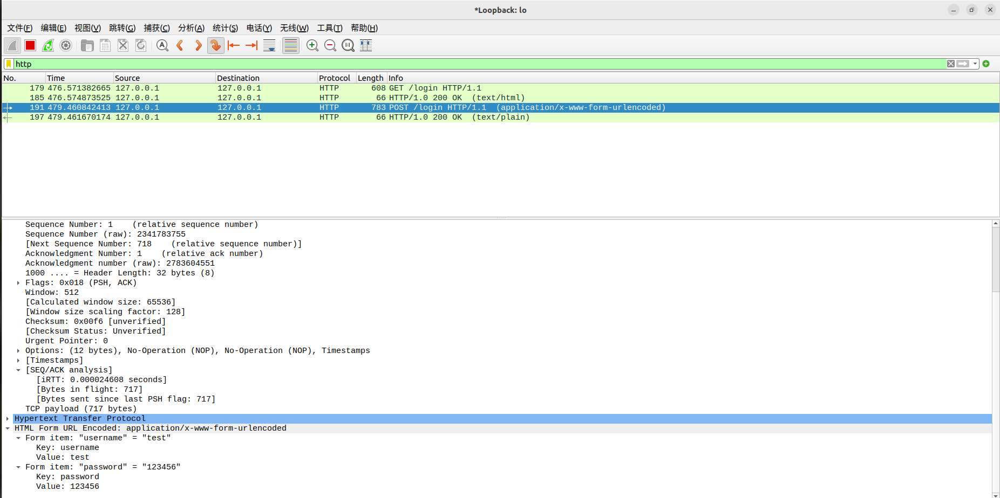

# 23-登录抓包标注（http 明文表单）

## 一、抓包环境

| 项 | 值 |
|---|---|
| 系统 | Ubuntu 22.04（VirtualBox 虚拟机） |
| 工具 | Wireshark |
| 接口 | `Loopback: lo`（回环） |
| 过滤器 | `http` |
| 目标 | 本机 `http://127.0.0.1:8000` 上的测试表单 |

**说明**：这次抓的是回环接口，数据不出网卡，目的是在可控环境里看「http 表单长什么样」。真实场景要把接口换成 `enp0s3`（或 Wi-Fi 网卡）。

---

## 二、列表里看到什么

```
179  GET  /                 → 200  取表单页面
185  GET  /                 → 200  再取一次
191  POST /login            → 200  你点「提交」
197  GET  /                 → 200  提交后刷新
```

**关键在 191 这一行**：方法是 `POST`，地址是 `/login`，`Content-Type` 是 `application/x-www-form-urlencoded`。



---

## 三、请求行与正文

**请求行：**

```
POST /login HTTP/1.1
```

**展开 `HTML Form URL Encoded` 之后：**

```
Form item: "username" = "test"
Form item: "password" = "123456"
```

**对应的正文就是一行文本：**

```
username=test&password=123456
```

---

## 四、表单编码规则

| 规则 | 例子 |
|---|---|
| 键值对用 `&` 连接 | `a=1&b=2` |
| 键和值用 `=` 分开 | `username=test` |
| 特殊字符做百分号编码 | 空格变 `+` 或 `%20`，中文变 UTF-8 的 `%XX` |
| 告诉服务器格式 | `Content-Type: application/x-www-form-urlencoded` |

**所以服务器收到的不是“表单”，是这一串文本，再自己拆开。**

---

## 五、为什么这是安全问题

1. **HTTP 不加密**：请求行、请求头、正文全是明文，抓包工具直接可读。
2. **表单里的密码也是明文**：`password=123456` 就躺在包里，不需要破解。
3. **真实局域网里谁能看到**：同网段抓包、交换机端口镜像、ARP 欺骗后的中间人、公共 Wi-Fi 的网关。
4. **HTTPS 就不一样**：TLS 会把整段 HTTP 报文加密，抓到的只有 `Application Data`，看不到字段值。

💬 **一句话**：http 登录 = 把密码写在明信片上寄出去；https 才是装进信封。

---

## 六、总结

1. 表单提交在 HTTP 里就是一行 `键=值&键=值` 的文本，`Content-Type` 说明编码方式。
2. 用 `http` 过滤器能直接抓到 `POST` 行，展开 `HTML Form URL Encoded` 就能看到字段值。
3. HTTP 明文传输，账号密码对链路上任何能抓包的人可见；HTTPS 用 TLS 加密同样的内容。
4. 抓包接口要选对：回环 `lo` 用来看本机，`enp0s3` 用来看真实网络流量。
5. 判断一个登录页是否安全，先看地址栏是不是 `https://`，再看表单提交的 action 是不是 https。

---

## 七、学习作用

- 能在 Wireshark 里认出 `POST` 请求，并展开表单字段。
- 能解释 `application/x-www-form-urlencoded` 的含义与编码规则。
- 能说清“为什么登录必须用 https”，并用抓包结果作证据。

---

## 八、关联

- 上一站：[22-IPv4数据报首部格式](22-IPv4数据报首部格式.md)
- 相关：[21-HTTP请求结构抄录](21-HTTP请求结构抄录.md)
