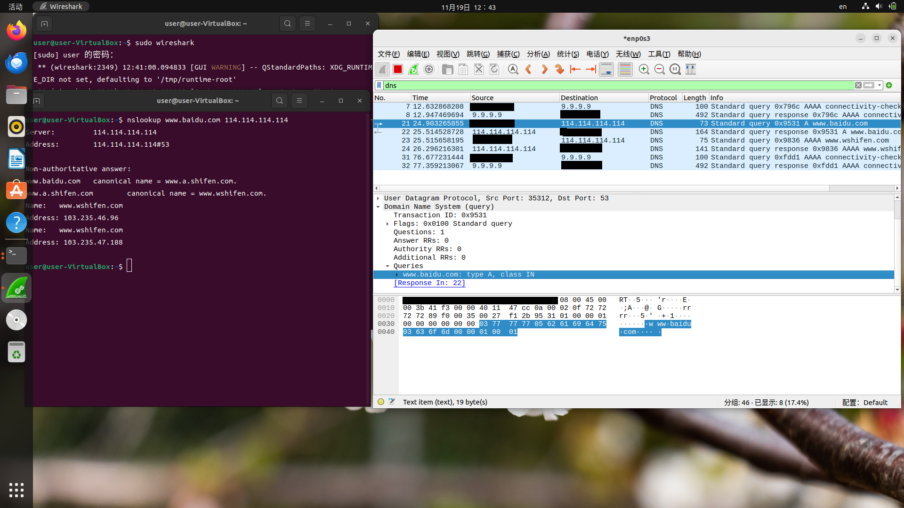
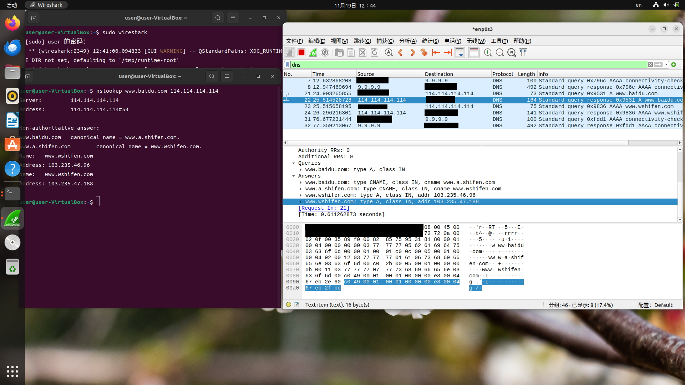
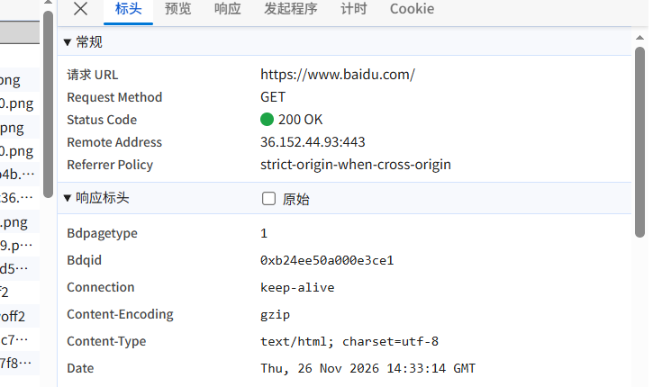
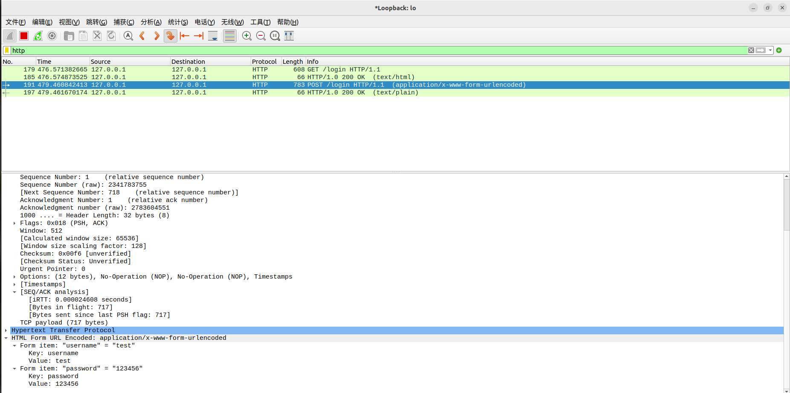

# 24-一次网页访问的抓包分析报告

> 目标：把第 2、3 周的抓包串成一条链——DNS → TCP → HTTP，每一段都能指到具体的包和字段。

---

## 一、DNS：先把域名换成 IP

**结论（先写一句）：** 浏览器不知道 `www.example.com` 的 IP，先发 DNS 查询；拿到 A 记录之后，才有后面的连接。

| 项 | 内容 |
|---|---|
| 抓到的包 | 查询 / 响应各一条 |
| 协议与端口 | DNS，UDP 53 |
| 关键字段 | Transaction ID（一问一答配对）、Flags 里的 QR、Question 里的域名、Answer 里的 A 记录与 TTL |





**这一节要说明：** 为什么先查 DNS；Transaction ID 怎么把请求和响应配对；TTL 是干什么的。

---

## 二、TCP：建立连接

**结论：** 拿到 IP 之后，传输层用三次握手建立连接；SYN、SYN+ACK、ACK 三个包各自确认了什么。

| 包 | 方向 | 标志位 | 关键字段 |
|---|---|---|---|
| 第 1 个 | 客户端 → 服务器 | SYN | 随机初始序号 seq |
| 第 2 个 | 服务器 → 客户端 | SYN, ACK | 自己的 seq + 对客户端的 ack |
| 第 3 个 | 客户端 → 服务器 | ACK | 对服务器 seq 的确认 |


**这一节要说明：** 三次握手各自的作用；为什么是三次不是两次；状态怎么变。

---

## 三、HTTP：请求与响应

**结论：** 连接建好后，浏览器发 HTTP 请求；服务器回状态行、响应头和响应体。

**请求四部分：**

```
请求行   GET / HTTP/1.1
请求头   Host / User-Agent / Accept / Cookie ...
空行
请求体   （GET 一般没有）
```

**响应四部分：**

```
状态行   HTTP/1.1 200 OK
响应头   Content-Type / Content-Encoding / Set-Cookie ...
空行
响应体   页面内容
```




**表单提交的不同：** 用 POST 时，数据放在请求体里，`Content-Type: application/x-www-form-urlencoded`，正文就是 `键=值&键=值`。



**这一节要说明：** GET 与 POST 的区别；`Host` 怎么区分站点；`Content-Encoding` 与 `Accept-Encoding` 怎么协商。

---

## 四、串起来：一条链

| 步 | 做什么 | 协议 | 看哪个字段 | 证据 |
|---|---|---|---|---|
| 1 | 域名换 IP | DNS | Transaction ID、Answer | 13 号截图 |
| 2 | 建立连接 | TCP | SYN / ACK、seq | 16 号截图 |
| 3 | 发请求 | HTTP | 请求行、Host | 21 号截图 |
| 4 | 收响应 | HTTP | 状态码、Content-Type | 21 号截图 |
| 5 | 提交表单 | HTTP | Content-Type、正文 | 23 号截图 |

---

## 五、总结

1. 一次网页访问不是“一个包”，是一条链：DNS 找地址 → TCP 建连接 → HTTP 要内容。
2. DNS 靠 UDP 53；TCP 靠三次握手；HTTP 只描述“要什么”，可靠传输交给 TCP。
3. 抓包要会选接口和过滤器：`dns`、`tcp.flags.syn==1`、`http` 各看一段。
4. HTTP 是明文，表单里的账号密码在包里直接可见；HTTPS 用 TLS 把整段加密。
5. 讲一条链的关键是“上一段拿到了什么，才轮到下一段”。

---

## 六、学习作用

- 能把三周的抓包讲成一条完整链路，而不是三张互不相干的截图。
- 面试被问“输入网址到页面出来发生了什么”，能按 DNS → TCP → HTTP 讲清每一步。
- 看到任何一条抓包，能判断它属于链路的哪一段。

---

## 七、关联

- [12-DNS域名系统理论笔记](12-DNS域名系统理论笔记.md)
- [13-Wireshark双端DNS抓包实操](13-Wireshark双端DNS抓包实操.md)
- [16-TCP三次握手与四次挥手-理论与实操](16-TCP三次握手与四次挥手-理论与实操.md)
- [21-HTTP请求结构抄录](21-HTTP请求结构抄录.md)
- [23-http登录表单明文抓包标注](23-http登录表单明文抓包标注.md)
