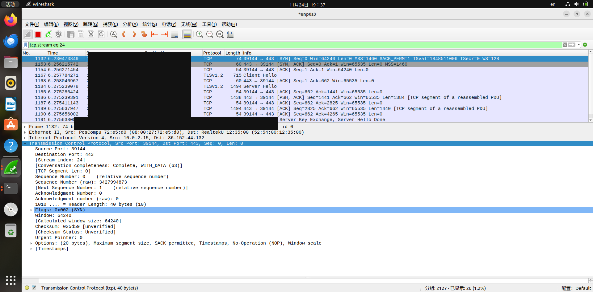
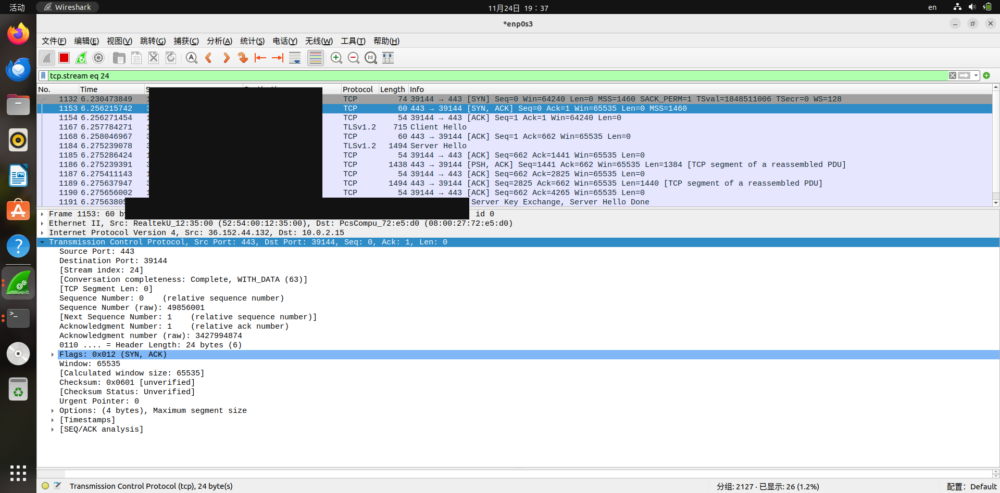
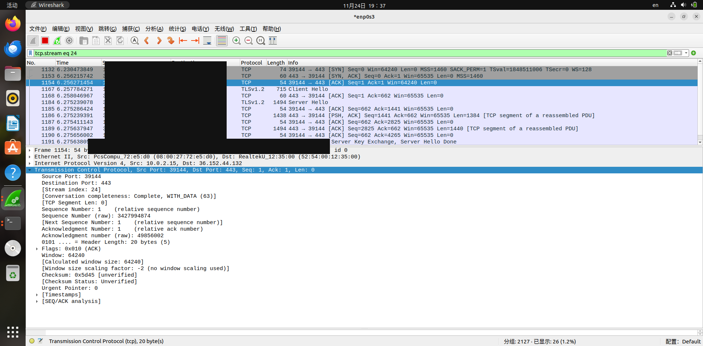
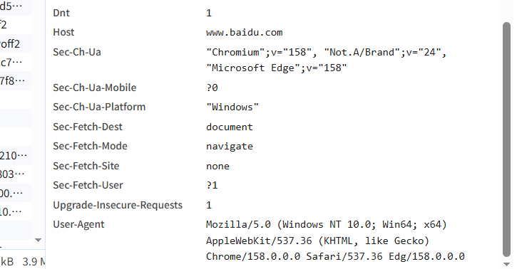
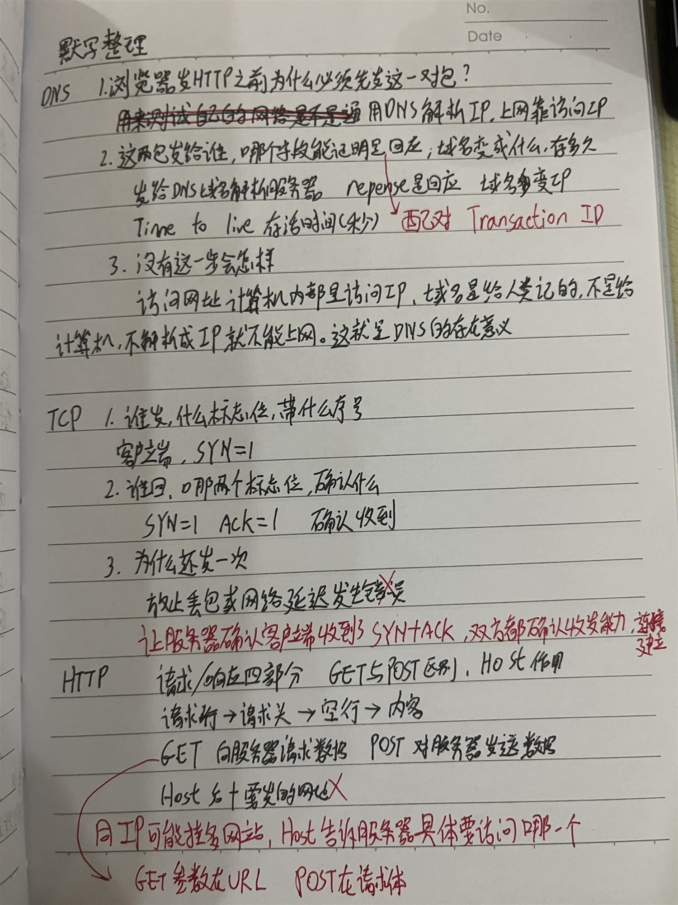
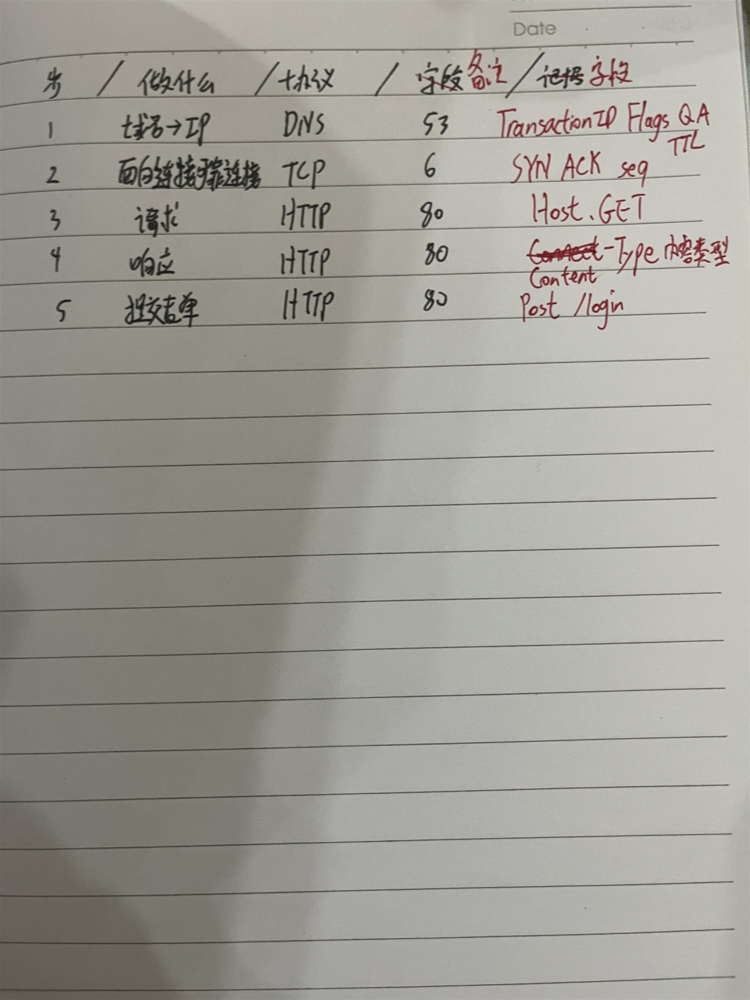

# 24-一次网页访问的抓包分析报告

## 一、DNS：先把域名换成 IP

| 项 | 内容 |
|---|---|
| 抓到的包 | 查询 / 响应各一条 |
| 协议与端口 | DNS，UDP 53 |
| 关键字段 | Transaction ID（一问一答配对）、Flags 里的 QR、Question 里的域名、Answer 里的 A 记录与 TTL |


**过程：** 浏览器在向服务器发送 HTTP 请求之前，必须先知道域名对应的 IP 地址；这一步由 DNS 完成——应用层发起 DNS 查询，通过 UDP 53 端口发给本地域名服务器。

**证据：** 查询与响应是一问一答的两个包；响应中的 Transaction ID 与查询完全相同，说明它们属于同一事务；Answer 区返回 A 记录（IPv4 地址），TTL 指出该记录可以被缓存多久（单位：秒）。

**意义：** 主机之间真正通信使用的是 IP 地址；没有域名解析，用户输入的域名无法到达目标服务器。

---

## 二、TCP：建立连接

| 包 | 方向 | 标志位 | 关键字段 |
|---|---|---|---|
| 第 1 个 | 客户端 → 服务器 | SYN | 随机初始序号 seq |
| 第 2 个 | 服务器 → 客户端 | SYN, ACK | 自己的 seq + 对客户端的 ack |
| 第 3 个 | 客户端 → 服务器 | ACK | 对服务器 seq 的确认 |







**过程：** 拿到 IP 之后，传输层通过三次握手建立 TCP 连接。

1. 客户端发送 SYN=1，携带初始序号 seq，此时不携带数据；
2. 服务器返回 SYN=1、ACK=1，既同步自己的初始序号，也用 ack 确认收到了客户端的 SYN；
3. 客户端再回 ACK=1，确认收到了服务器的 SYN。

**为什么是三次：** 第三次不是为了防止丢包（丢包由重传机制处理），而是让服务器确认「客户端已经收到 SYN+ACK」。三次之后，双方都确认了对方的发送与接收能力，连接建立，才可以传输 HTTP 数据。

---

## 三、HTTP：请求与响应

**请求四部分：**

```
请求行   GET / HTTP/1.1
请求头   Host / User-Agent / Accept / Cookie ...
空行
请求体   （GET 一般没有）
```

**响应四部分：**

```
状态行   HTTP/1.1 200 OK
响应头   Content-Type / Content-Encoding / Set-Cookie ...
空行
响应体   页面内容
```

状态码表示请求结果（200 成功、404 找不到资源）；`Content-Type` 告诉浏览器响应体是什么格式。




**Host 的作用：** 一个 IP 地址上可能承载多个网站；`Host` 指明本次请求要访问哪一个站点，服务器据此选择对应的虚拟主机。

**GET 与 POST 的区别：** GET 把参数拼在 URL 上，会留在浏览器历史与服务器访问日志中；POST 把参数放在请求体里，不出现在 URL 中。两者本身都不提供加密，传输安全依靠 HTTPS，而不是更换请求方法。

**表单提交：** 账号、密码等数据放在请求体中，由 `Content-Type: application/x-www-form-urlencoded` 说明编码方式，正文形如 `username=test&password=123456`。正因为走的是 http 明文，抓包才能直接看到这些值；换成 https，这部分内容会被 TLS 加密。


---

## 四、串起来：一条链

| 步 | 做什么 | 协议 | 备注（端口 / 协议号） | 关键字段 | 证据 |
|---|---|---|---|---|---|
| 1 | 域名 → IP | DNS | 端口 53（UDP） | Transaction ID、Flags、Question/Answer、TTL | 13 号截图；手写稿 1 |
| 2 | 建立连接（三次握手） | TCP | IP 首部协议号 6 | SYN、ACK、seq | 16 号三张截图；手写稿 1 |
| 3 | 发请求 | HTTP | 端口 80 | 请求行（方法 + 路径）、Host | 21 号请求头截图；手写稿 2 |
| 4 | 收响应 | HTTP | 端口 80 | 状态码、Content-Type | 21 号响应头截图；手写稿 2 |
| 5 | 提交表单（POST） | HTTP | 端口 80 | POST /login、Content-Type、正文 `username=…&password=…` | 23 号截图；手写稿 2 |

**记法：端口管“找哪个进程”，协议号管“里面装的是什么”；字段管“这一层里哪一格能作证”。**

### 手写原稿

默写整理（DNS / TCP / HTTP 三问）：



串链表：



## 五、总结

1. 一次网页访问不是“一个包”，是一条链：DNS 找地址 → TCP 建连接 → HTTP 要内容。
2. DNS 靠 UDP 53；TCP 靠三次握手；HTTP 只描述“要什么”，可靠传输交给 TCP。
3. 抓包要会选接口和过滤器：`dns`、`tcp.flags.syn==1`、`http` 各看一段。
4. HTTP 是明文，表单里的账号密码在包里直接可见；HTTPS 用 TLS 把整段加密。
5. 讲一条链的关键是“上一段拿到了什么，才轮到下一段”。

---

## 六、学习作用

- 能把三周的抓包讲成一条完整链路，而不是三张互不相干的截图。
- 面试被问“输入网址到页面出来发生了什么”，能按 DNS → TCP → HTTP 讲清每一步。
- 看到任何一条抓包，能判断它属于链路的哪一段。

---

## 附录 · 一个包里的字段（速查）

以一次 `POST /login` 为例，从外到内五层：

```
Frame 47: 412 bytes on wire, captured 412 bytes
Ethernet II   Destination 52:54:00:12:35:00 / Source 08:00:27:72:e5:d0 / Type 0x0800
IPv4          Version 4 / Header 20 / Total Length 398 / TTL 64 / Protocol 6
              Source 10.0.2.15 / Destination 93.184.216.34
TCP           Source Port 50123 / Destination Port 80 / Flags 0x018 (PSH, ACK) / Window 64240
HTTP          POST /login HTTP/1.1 / Host: example.com
              Content-Type: application/x-www-form-urlencoded / Content-Length: 27
              username=test&password=123456
```

| 字段 | 值 | 含义 | 工作里能说明什么 |
|---|---|---|---|
| Frame Length | 412 字节 | 这一帧在链路上的长度，抓到的也是 412（没截断） | 判断是否被截断、估算流量 |
| Ethernet Type | 0x0800 | 帧头类型字段，表示里面装 IPv4（IPv6 是 0x86dd） | 一眼判断三层协议 |
| IP Total Length | 398 字节 | IP 首部 + 数据的总长度；比 Frame 小 14 字节（帧头） | 分片、异常大包判断 |
| TTL | 64 | 还能经过多少个路由器，每过一个减 1 | 异常小 = 伪造、同网段或探测 |
| Protocol | 6 | IP 首部协议号：6=TCP、17=UDP、1=ICMP | 一秒判断上层协议 |
| Source Port / Dest Port | 50123 / 80 | 客户端临时端口 / HTTP 服务端口 | 识别服务、扫描与横向端口 |
| Flags | 0x018（PSH, ACK） | 标志位字段的值：PSH 尽快交付，ACK 确认收到 | SYN Flood、扫描、连接重置 |
| Window | 64240 | **发这个包的一方**通告的接收窗口，告诉对方还能收多少字节 | 窗口为 0 = 接收方来不及处理 |
| Host | example.com | 要访问哪个站点（同一 IP 可承载多个站点） | 虚拟主机、域名前置 |
| Content-Type | application/x-www-form-urlencoded | 正文按表单编码，形如 `键=值&键=值` | 判断是表单、JSON 还是上传 |
| Form item | username=test / password=123456 | 按 Content-Type 解码出的字段与值 | 明文表单里能直接看到账号密码 |

**几个补充：**

- 以太网帧头的 Type 字段：`0x0800` = 里面装 IPv4；`0x86dd` = IPv6；`0x0806` = ARP。
- TCP 标志位是 9 个位，Wireshark 用十六进制显示：`0x018` = 二进制 `0001 1000`，即 PSH（0x08）+ ACK（0x10）。
- `Form item` 不是协议里的字段，是 Wireshark 按 `Content-Type` 把正文解析出来的显示。

**三个容易混的点：**

1. `Type`、`Protocol`、`Flags` 都是**字段的值**，不是“成功 / 失败”这种结论。
2. `Frame Length` 比 `IP Total Length` 大 14 字节——差的正是以太网帧头。
3. 窗口是**发包方**通告的接收能力，方向别弄反。

---

## 七、关联

- [12-DNS域名系统理论笔记](12-DNS域名系统理论笔记.md)
- [13-Wireshark双端DNS抓包实操](13-Wireshark双端DNS抓包实操.md)
- [16-TCP三次握手与四次挥手-理论与实操](16-TCP三次握手与四次挥手-理论与实操.md)
- [21-HTTP请求结构抄录](21-HTTP请求结构抄录.md)
- [23-http登录表单明文抓包标注](23-http登录表单明文抓包标注.md)
